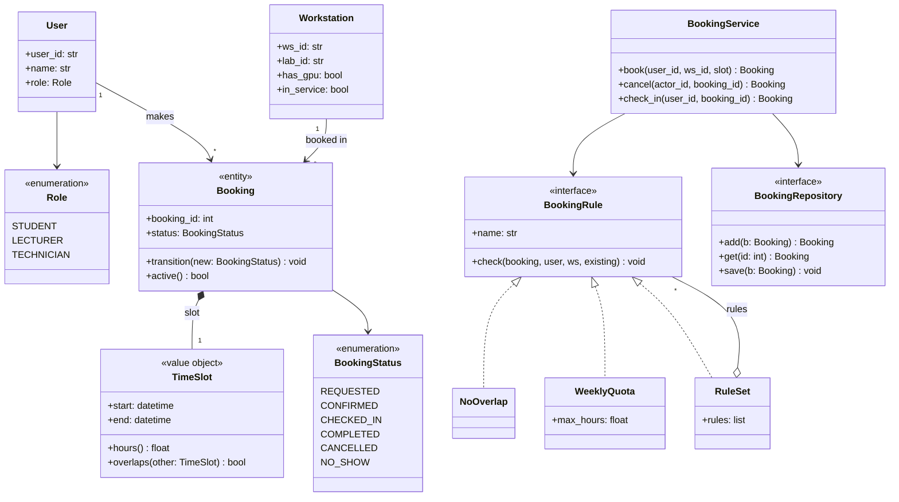

# SD-07 UML Class Diagrams

> [!info] Topic card
> **Unit:** U4 · **Time:** 4 h · **Case:** the LabBook domain classes in `code/labbook/domain.py`, `rules.py` and `repository.py`. The diagrams below were drawn from that code. · Notation reference: OMG UML 2.5.1.

## 1. Learning objectives
1. **Read and draw** class notation: attributes, operations, visibility, types, static and abstract members.
2. **Model** relationships correctly: association (with multiplicity and navigability), aggregation, composition, generalisation, realisation and dependency.
3. **Distinguish** a domain (conceptual) model from a design model.
4. **Map** between class diagrams and Python code in both directions.
5. **Critique** class diagrams for common errors.

## 2. Why it matters
Class diagrams are the most widely used UML diagram, and the most examined. They let a team agree on the concepts and their relationships before writing code, and they document the structure of existing code for newcomers. Misusing composition or getting multiplicities wrong are classic exam mistakes, and they're also real design errors.

## 3. Prerequisites
[[PY-16 Classes and Objects]], [[PY-17 Inheritance, Composition and Polymorphism]] · [[SD-06 Modular Design, Cohesion and Coupling]] · Relations and multiplicity from [[DM-07 Functions]] and [[DM-10 Relations, Equivalence Relations and Partial Orders]].

## 4. Intuition
A class diagram is a **map of the nouns** in a system, and of how they're allowed to connect. Multiplicities are the rules of the map: "every booking belongs to exactly one workstation; a workstation can have many bookings." If the map allows something the business forbids, the code probably will too.

## 5. Rigorous explanation

### 5.1 Class notation
A box with three compartments: **name**; **attributes** (`visibility name: Type [multiplicity] = default`); **operations** (`visibility name(param: Type): ReturnType`).
- **Visibility:** `+` public, `-` private, `#` protected, `~` package.
- **Underlined** members are static (class-level). *Italic* names are abstract.
- **Stereotypes:** `«interface»`, `«enumeration»`, `«entity»`, `«value object»` (the last two are domain-modelling conventions).

### 5.2 Relationships
| Relationship | Notation | Meaning | LabBook example |
|---|---|---|---|
| Association | A solid line, optionally with an arrow (navigability) | Objects are linked | A Booking is made by one User |
| Multiplicity | `1`, `0..1`, `*`, `1..*`, `2..5` at each end | How many objects participate | User `1` — `0..*` Booking |
| Aggregation | A hollow diamond at the whole | Whole–part; the part can exist independently and be shared | Lab ◇— Workstation (a workstation can be moved to another lab) |
| Composition | A filled diamond at the whole | Whole–part with shared lifetime; the part belongs to exactly one whole | Booking ◆— status history entries |
| Generalisation | A hollow triangle arrow to the parent | "Is-a" (inheritance) | (none in LabBook's domain; see the clinic's misuse, F2) |
| Realisation | A dashed line with a hollow triangle to the interface | Implements an interface | NoOverlap ⋯▷ «interface» BookingRule |
| Dependency | A dashed arrow | "Uses temporarily" (a parameter, a local variable) | BookingService ⋯> TimeSlot |

**Composition rules:** a part has at most one composite owner at a time, and if the whole is deleted, its parts are deleted too. When in doubt, use plain association. Aggregation's semantics are weak, and many modellers avoid it.

### 5.3 Domain model vs design model
- A **domain (conceptual) model** has business concepts, attributes and associations, but no operations, no visibility and no technology. It's for talking with users.
- A **design model** adds operations, interfaces, visibility, navigability, and design classes such as services, repositories and strategies.

### 5.4 From code to diagram (Python)
- A `@dataclass` with fields becomes a class with attributes.
- A field holding another object becomes an association (its multiplicity comes from the type: `X` = 1, `X | None` = 0..1, `list[X]` = *).
- A `Protocol` or ABC becomes an «interface» (or an abstract class).
- A class that provides the protocol's methods has a realisation (Python's structural typing means this isn't declared; show it anyway).
- `Enum` becomes «enumeration».

## 6. Terminology
| Term | Meaning |
|---|---|
| Multiplicity | The allowed number of linked objects at an association end |
| Navigability | Which direction an association can be traversed in code |
| Role name | A label on an association end (e.g. `booker`) |
| Association class | A class attached to an association to hold its attributes |
| Abstract class | Can't be instantiated; it may have abstract operations |
| Interface | A set of operations, with no implementation |
| Qualified association | An association looked up by a key (e.g. a Directory, by `user_id`) |

## 7. Step-by-step: drawing the LabBook domain model
1. **Nouns** from the requirements: user, role, workstation, lab, booking, time slot, status.
2. **Classes vs attributes:** TimeSlot has behaviour (`overlaps`) and validation, so it's a class (a value object). Role and status are enumerations.
3. **Associations and multiplicities:**
   - User 1 — 0..* Booking;
   - Workstation 1 — 0..* Booking;
   - Lab 1 — 1..* Workstation;
   - Booking 1 — 1 TimeSlot (composition: the slot belongs to its booking).
4. **Constraints in notes:** `{active bookings on one workstation do not overlap}`, `{student weekly hours ≤ 10}`.
5. **Check against the code:**
   - `Booking.slot: TimeSlot` ✓;
   - `Booking.user_id: str` (in the code, the association is implemented by an ID reference) ✓;
   - `Workstation.lab_id` ✓.

## 8. Diagram: LabBook design class diagram

*Text version: a User makes many Bookings, and a Workstation is booked in many Bookings. Each Booking owns exactly one TimeSlot (composition) and has a BookingStatus. NoOverlap, WeeklyQuota and RuleSet realise the BookingRule interface, and RuleSet aggregates many rules (the Composite pattern). BookingService depends on the BookingRepository and BookingRule interfaces.*

## 9. Worked examples

### Example 1 (basic): read the multiplicities
"User `1` → `*` Booking" means every booking is made by exactly one user, and a user can have zero or more bookings. "Booking `*--` `1` TimeSlot" means each booking has exactly one slot, which doesn't outlive it. If a booking is deleted, its slot value goes with it.

### Example 2 (intermediate): composition or aggregation?
| Pair | Choice | Reason |
|---|---|---|
| Booking — TimeSlot | Composition | The slot exists only as part of its booking |
| Lab — Workstation | Aggregation (or plain association) | A workstation can be moved to another lab; it exists independently |
| RuleSet — BookingRule | Aggregation | The same rule object can belong to several rule sets |
| University — Faculty | Composition, in most models | A faculty doesn't exist outside its university (a domain decision) |

### Example 3 (challenging): critique a student's diagram
A submitted diagram shows:
1. `Booking` *inherits from* `User`.
2. `Database` drawn as a class associated with every class.
3. Multiplicity `1` on both ends of User—Booking.
4. A `Student` class with no attributes or behaviour beyond those of `User`.

**Critique:**
1. Inheritance means "is-a", and a booking is not a user. It should be an association (`User 1 — * Booking`).
2. The database is infrastructure. It doesn't belong in a domain model; in a design model, show a `BookingRepository` interface instead.
3. `1..1` means each user has exactly one booking, which is wrong; it should be `1 — 0..*`.
4. If Student differs only in role-based permissions, model the role as an attribute or enumeration (as LabBook does). Use subclasses only for genuinely different behaviour or data, and prefer composition (see the LSP violation in [[SD Flawed Design Clinic]] F2).

## 10. Application: diagrams for your projects
For [[PRJ-PY-03 Library Management System]] and your FYP:
- a domain model for user validation (no operations);
- a design model for the implementation, with interfaces and services.

Keep both in the repository, as Mermaid or exported images, and update them when the code changes.

## 11. Common mistakes
| Mistake | Fix |
|---|---|
| Inheritance for "has-a" | Association or composition |
| Every whole–part relationship drawn as composition | Composition only for exclusive ownership with shared lifetime |
| Missing multiplicities | Put them on both ends |
| Database, screens or "System" as classes in a domain model | Domain concepts only |
| Showing every getter and setter | Show meaningful operations |
| Diagram and code drifting apart | Generate the diagram from the code, or review it in each sprint |

## 12. Comparison: association vs aggregation vs composition
| | Association | Aggregation | Composition |
|---|---|---|---|
| Symbol | A line | A hollow diamond at the whole | A filled diamond at the whole |
| Ownership | None | Weak (shared) | Strong (exclusive) |
| Lifetime | Independent | Independent | The part dies with the whole |
| Part shared? | Yes | Yes | No |

## 13. Practice
**L1** 1. What do `+`, `-` and `#` mean? 2. Draw the symbols for realisation and dependency.

**L2** 3. Write the multiplicities: a lab has 10–40 workstations; a workstation is in exactly one lab. 4. Convert the Python `@dataclass class Workstation` to UML.

**L3** 5. Draw a domain model for the hostel maintenance system (Student, Room, Block, Request, Technician, Comment) with multiplicities. 6. Add the waiting-list feature to the LabBook design diagram.

**L4** 7. Model "a lecturer reserves a lab for a recurring session with an approval". Should Reservation be a class, an association class or an attribute? Justify. 8. Reverse-engineer `events.py` into a class diagram, and say which relationship links `EventBus` and its handlers.

**L5** 9. Produce a complete design class diagram for [[PRJ-PY-05 Hostel Maintenance System]] from its code, and list three places where the code and your ideal design differ, with refactoring suggestions.

## 14. Hints
> [!tip]- Hints
> 3: `Lab "1" -- "10..40" Workstation`. 5: Block 1 — * Room, Room 1 — * Request, Request * — 0..1 Technician, Request 1 *-- * Comment. 7: it has its own attributes (dates, approval status), so make it a class. 8: handlers are callables; the bus holds references to them.

## 15. Worked solutions
> [!success]- Solutions 1–2
> 1. Public, private, protected. 2. Realisation: a dashed line with a hollow triangle pointing to the interface. Dependency: a dashed line with an open arrowhead pointing to the used element.

> [!success]- Solution 3
> `Lab "1" o-- "10..40" Workstation` (or a plain association). The workstation end reads 10..40, and the lab end reads 1.

> [!success]- Solution 4
> ```text
> Workstation        (an entity: identified by ws_id)
> + ws_id: str
> + lab_id: str
> + has_gpu: bool = False
> + in_service: bool = True
> ```
> (`frozen=True` means it's immutable. You can note `{readOnly}` on the attributes.)

> [!success]- Solution 5
> ```mermaid
> classDiagram
>     Block "1" o-- "1..*" Room
>     Room "1" --> "*" Request : location of
>     Student "1" --> "*" Request : reports
>     Request "*" --> "0..1" Technician : assigned to
>     Request "1" *-- "*" Comment
>     Student "*" --> "1" Room : lives in
> ```

> [!success]- Solution 7
> Make **Reservation** a class (or an association class between Lecturer and Lab). It has its own attributes (day of week, start and end times, semester weeks, approval status, approver) and its own lifecycle (pending → approved/rejected → cancelled). It associates with Lecturer (1 requester), Lab (1), and the head of department (0..1 approver), and possibly composes Occurrence objects (1..*), which can be cancelled individually.

> [!success]- Solution 8
> Classes: `Event` (a value object: name, booking_id, user_id, detail), `EventBus` (`-_handlers`, `+errors`, `+subscribe(name, handler)`, `+publish(event)`), `Outbox` and `AuditLog` (callables with `__call__(event)`). `EventBus` has an **association** (aggregation) to many handlers: it holds references, but doesn't own their lifetime. `EventBus` has a **dependency** on `Event` (a parameter). Outbox and AuditLog realise an implicit «interface» Handler (`(Event) → None`).

> [!success]- Solution 9 (guidance)
> Typical differences: a service that depends directly on SQLite instead of a repository interface; a request status kept as a string rather than an enumeration with allowed transitions; notification code inside the service. Suggest introducing the repository protocol, a state machine as in `Booking.transition`, and an event bus.

## 16. Self-test (pass ≥ 4/5)
1. Which diamond means composition? 2. What does `0..1` mean? 3. What does a dashed arrow with a hollow triangle mean? 4. Domain model vs design model? 5. When is inheritance appropriate?
> [!success]- Answers
> 1. Filled. 2. Optional: zero or one. 3. Realisation (implements an interface). 4. A domain model has concepts and relations only; a design model adds operations, interfaces and design classes. 5. When there's a true "is-a" relationship and the subclass can substitute for the parent (LSP).

## 17. Flashcards
#flashcards/software-design
Composition?::A filled diamond: exclusive whole–part with a shared lifetime.
Aggregation?::A hollow diamond: whole–part, where the part can be shared and exists independently.
Realisation notation?::A dashed line with a hollow triangle pointing to the interface.
Multiplicity 1 to 0..*?::One on one side, zero or more on the other.
Visibility symbols?::+ public, - private, # protected, ~ package.
Python Protocol in UML?::An «interface»; implementing classes are shown with realisation.

## 18. Blank-page recall
Redraw the LabBook design class diagram with all multiplicities from memory.

## 19. Revision summary
- Classes: name, attributes, operations, visibility; interfaces and enumerations by stereotype.
- Relationships: association (with multiplicity, navigability), aggregation (shared), composition (exclusive lifetime), generalisation (is-a), realisation (implements), dependency (uses).
- Domain models talk to users; design models guide code.
- Avoid inheritance for has-a, a database in the domain model, and missing multiplicities.

## 20. Links
Prev: [[SD-06 Modular Design, Cohesion and Coupling]] · Next: [[SD-08 UML Sequence, Activity and State Diagrams]] · Related: [[SD-09 Data Modeling and Interface Design]], [[PY-17 Inheritance, Composition and Polymorphism]], [[PRJ-PY-03 Library Management System]]

## 21. Sources
- OMG, *Unified Modeling Language (UML) Specification*, Version 2.5.1, 2017, clauses 9–11 (classification, structured classifiers).
- Fowler, M., *UML Distilled*, 3rd ed., Addison-Wesley, 2003.
- Larman, C., *Applying UML and Patterns*, 3rd ed., Prentice Hall, 2004 (domain models).
- Mermaid class diagram syntax: https://mermaid.js.org/syntax/classDiagram.html
- *(Not checked online during the build, because there was no network access.)*

## 22. Mastery checklist
- [ ] I can draw and read all relationship types with correct multiplicities
- [ ] I can convert between Python classes and UML
- [ ] I can critique a class diagram and fix its errors
- [ ] Reviews scheduled
