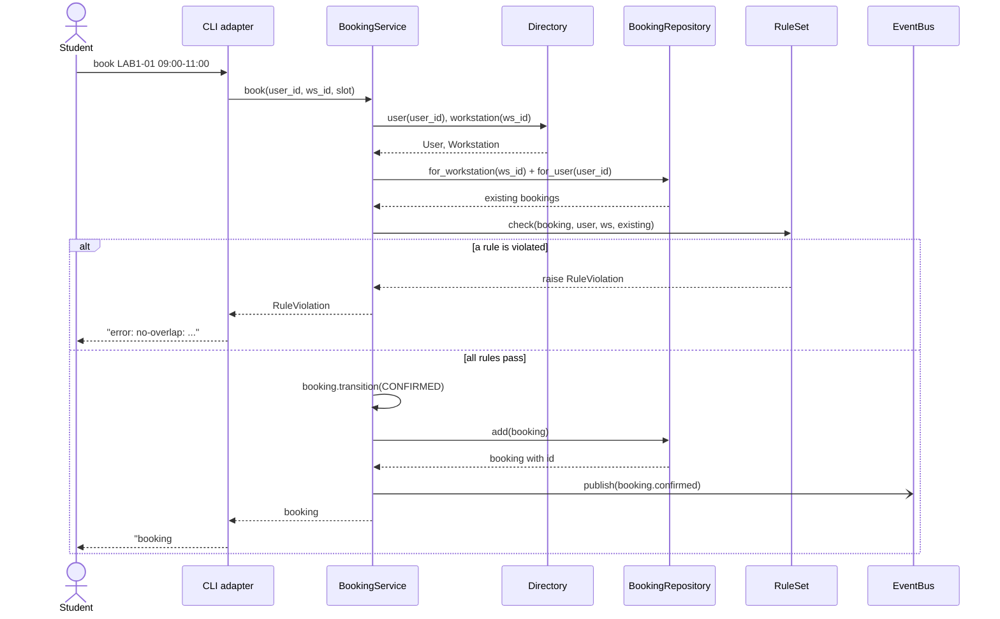
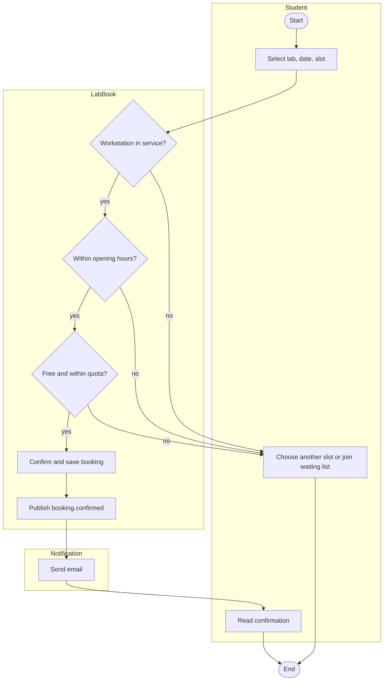
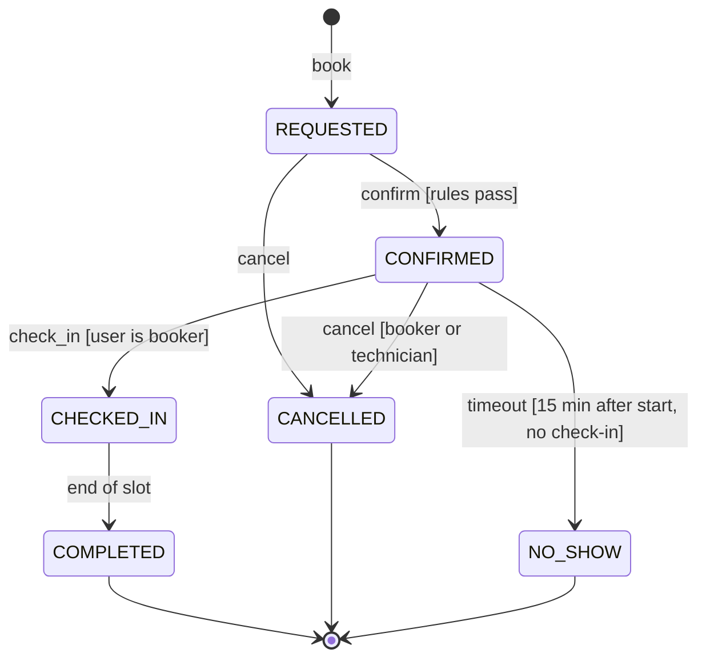

# SD-08 UML Sequence, Activity and State Diagrams

> [!info] Topic card
> **Unit:** U4 · **Time:** 4 h · **Case:** `BookingService.book` (sequence), the UC-01 flow (activity), and `domain.ALLOWED` (state machine). The state diagram below matches the code's transition table exactly, and `test_state_machine` exercises it.

## 1. Learning objectives
1. **Draw** sequence diagrams with lifelines, synchronous and asynchronous messages, returns, activations and combined fragments (`alt`, `opt`, `loop`).
2. **Draw** activity diagrams with actions, decisions/merges, forks/joins and swimlanes.
3. **Draw** state machine diagrams with states, transitions (event [guard] / action), initial and final states.
4. **Choose** the right behavioural diagram for a question.
5. **Check** diagrams against code, and **derive** test cases from them.

## 2. Why it matters
Class diagrams show structure. Many design errors are in **behaviour**: the wrong order of calls, missed failure paths, illegal state changes (a cancelled booking that gets checked in). Behavioural diagrams make these visible, and state machines translate directly into code and tests.

## 3. Prerequisites
[[SD-07 UML Class Diagrams]] · [[SD-04 Use Cases, User Stories and Traceability]] (scenarios) · Relations from [[DM-10 Relations, Equivalence Relations and Partial Orders]] (a transition table is a relation on states).

## 4. Intuition
- **Sequence diagram:** a **comic strip** of who talks to whom, in time order.
- **Activity diagram:** a **flowchart** of a process, possibly with parallel paths and responsibilities (swimlanes).
- **State machine:** the **life story** of one object: which states it can be in and which events move it between them.

## 5. Rigorous explanation

### 5.1 Sequence diagrams
- **Lifelines:** participants (objects or roles) across the top, with dashed lines downwards. Time runs down the page.
- **Messages:** a solid arrow with a filled head is a synchronous call; an open arrowhead is asynchronous; a dashed arrow is a return.
- **Activation bars:** show when a participant is executing.
- **Combined fragments:**
  - `alt` (if/else, with guards in brackets);
  - `opt` (optional);
  - `loop` (repetition);
  - `par` (parallel);
  - `ref` (a reference to another diagram).
- Keep one scenario, or one use case with its main extensions, per diagram.

### 5.2 Activity diagrams
- **Actions:** rounded rectangles.
- The **initial node** is a filled circle; the **final node** is a bullseye.
- **Decision/merge:** a diamond, with **guards** `[condition]` on the outgoing edges.
- **Fork/join:** thick bars for parallel flows.
- **Swimlanes (partitions):** show who performs each action.
- Good for business processes, use-case flows and algorithms with concurrency.

### 5.3 State machine diagrams
- **States:** rounded rectangles. Optional `entry/`, `exit/` and `do/` activities.
- **Transitions:** arrows labelled `event [guard] / action`.
- The **initial pseudostate** is a filled circle; a **final state** is a bullseye.
- **Composite states** contain sub-states.
- **Rule:** an event that has no transition from the current state is either ignored or an error. LabBook treats it as an error (`InvalidTransition`), which is safer for business objects.
- **Implementation:** a transition table (`ALLOWED`) plus a single `transition()` method. This is simpler than the State pattern for small machines ([[SD-12 Behavioral Design Patterns]]).

### 5.4 Choosing
| Question | Diagram |
|---|---|
| Which objects collaborate, and in which order, for one scenario? | Sequence |
| What are the steps, decisions and parallel activities in a process, and who does each? | Activity (with swimlanes) |
| What states can one object be in, and what's legal when? | State machine |
| What does the system offer to whom? | Use case (SD-04) |

## 6. Terminology
| Term | Meaning |
|---|---|
| Lifeline | A participant in a sequence diagram |
| Activation | The period during which a participant is executing |
| Combined fragment | A framed region with an operator (alt, opt, loop…) |
| Guard | A boolean condition in brackets that must be true to proceed |
| Fork / join | Splitting into parallel flows / synchronising them |
| Swimlane | A partition showing responsibility |
| Transition | A state change triggered by an event, possibly guarded, possibly with an action |
| Pseudostate | The initial node, or a choice/junction (not a real state) |

## 7. Step-by-step: deriving tests from a state machine
1. List the states: REQUESTED, CONFIRMED, CHECKED_IN, COMPLETED, CANCELLED, NO_SHOW.
2. For each *allowed* transition, write one test. There are 6 allowed transitions:
   - REQUESTED → CONFIRMED, REQUESTED → CANCELLED;
   - CONFIRMED → CHECKED_IN, CONFIRMED → CANCELLED, CONFIRMED → NO_SHOW;
   - CHECKED_IN → COMPLETED.
3. For important *disallowed* transitions, write negative tests (REQUESTED → CHECKED_IN; COMPLETED → CANCELLED).
4. Test the final states: no outgoing transitions.

`test_state_machine` covers a full happy path plus two illegal transitions. Covering all 6 allowed transitions is Practice 6.

## 8. Diagrams

### 8.1 Sequence: UC-01 Book workstation (from `BookingService.book`)


### 8.2 Activity: booking with swimlane-style grouping

*Mermaid has no native activity diagrams. In exams, draw the UML symbols (filled initial node, diamonds with guards, fork/join bars, and partitions as vertical lanes).*

### 8.3 State machine: Booking (identical to `domain.ALLOWED`)

*Text version: a booking starts REQUESTED. It can be confirmed (if the rules pass) or cancelled. A confirmed booking can be checked in by the booker, cancelled by the booker or a technician, or marked no-show after a timeout. Checked-in bookings complete. COMPLETED, CANCELLED and NO_SHOW are final.* (The NO_SHOW timeout isn't automated in the code yet; that's case-study exercise 6.)

## 9. Worked examples

### Example 1 (basic): read the sequence diagram
The `alt` fragment shows two outcomes. The `-)` arrow to EventBus is drawn asynchronous to show intent ("fire and forget"). In the current code, `publish` is synchronous but isolates subscriber failures (NFR-04). That kind of difference is worth noting in a design review: if the email subscriber is slow, booking is slow.

### Example 2 (intermediate): diagram ↔ code consistency check
| Diagram element | Code | Consistent? |
|---|---|---|
| CONFIRMED → CANCELLED | `ALLOWED[CONFIRMED]` contains CANCELLED | ✓ |
| CHECKED_IN → CANCELLED (not drawn) | Not in `ALLOWED[CHECKED_IN]`, so it raises | ✓ |
| The guard [user is booker] on check_in | Enforced in `BookingService.check_in`, not in the domain | ✓, but located in the service; document it |
| [booker or technician] on cancel | Enforced in `BookingService.cancel` | ✓ |
| The timeout to NO_SHOW | No scheduler yet | ✗: a gap, recorded as exercise 6 |

### Example 3 (challenging): concurrency in a sequence diagram
Two students click "book" for LAB1-01 09:00 at the same moment. A sequence diagram with `par` makes the race visible:
1. Both requests call `for_workstation`, and both see no booking.
2. Both pass `NoOverlap`.
3. Both call `add`.

The result is a double booking, violating FR-02. The diagram exposes a design flaw that unit tests (single-threaded) don't catch. Fixes:
- a database uniqueness or exclusion constraint;
- a transaction with row locking around check-and-insert;
- a single-writer queue.

This is case-study exercise 5 and is examined in [[SD-17 Secure and Reliable Software Design]].

## 10. Application: hostel request lifecycle
Draw a state machine for a maintenance request:
- NEW → ASSIGNED → IN_PROGRESS → RESOLVED → CLOSED;
- REJECTED from NEW;
- REOPENED from RESOLVED, within 7 days.

Then implement it as a transition table like `ALLOWED`, with tests generated from the diagram. Compare with [[PRJ-PY-05 Hostel Maintenance System]].

## 11. Common mistakes
| Mistake | Fix |
|---|---|
| Sequence diagrams covering every scenario at once | One scenario, plus `alt` for the key variations |
| Return arrows that don't match the calls | Dashed returns for synchronous calls when the value matters |
| States that are really activities ("Validating") | States are conditions an object waits in; activities happen in them |
| Transitions without events | Label them with event [guard] / action |
| No final states, or unreachable states | Check every state is reachable, and terminates where it should |
| Activity diagrams without guards on decisions | Every outgoing edge of a decision needs a guard |

## 12. Comparison: the three behavioural diagrams
| | Sequence | Activity | State machine |
|---|---|---|---|
| Focus | Interactions between objects over time | The flow of actions in a process | The states of one object |
| Shows concurrency | `par` fragment | Fork/join | Orthogonal regions |
| Best for | Designing calls in a use case | Business processes, workflows | Lifecycles, protocols, UI modes |
| Maps to code as | Method calls | Functions/workflows | A transition table, or the State pattern |

## 13. Practice
**L1** 1. What does a dashed arrow mean in a sequence diagram? 2. What's a guard?

**L2** 3. Draw the sequence diagram for UC-02 Cancel booking, including the permission check. 4. List all 6 allowed transitions of the booking state machine.

**L3** 5. Draw an activity diagram, with swimlanes, for a technician marking a workstation out of service and handling its future bookings. 6. Write pytest tests covering all 6 allowed transitions and 3 disallowed ones.

**L4** 7. Add a "waiting list" offer flow to the sequence diagram (cancellation triggers an offer to the next user). 8. Draw a `par` sequence diagram of the double-booking race, then a corrected version using a database constraint.

**L5** 9. Design the full lifecycle (a state machine with guards and actions) for an exam result: draft → submitted → moderated → approved → published → amended. Include who triggers each transition, then implement it as a transition table with tests.

## 14. Hints
> [!tip]- Hints
> 3: compare with `BookingService.cancel`: the directory lookup, the repository get, the permission `alt`, `transition`, save, publish. 4: read `ALLOWED`. 6: parametrise over (from, to) pairs. 8: the second insert fails with an IntegrityError, which is turned into a RuleViolation.

## 15. Worked solutions
> [!success]- Solutions 1–2
> 1. A return message (the reply from a synchronous call). 2. A boolean condition in brackets; the transition or flow is taken only when it's true.

> [!success]- Solution 4
> REQUESTED→CONFIRMED, REQUESTED→CANCELLED, CONFIRMED→CHECKED_IN, CONFIRMED→CANCELLED, CONFIRMED→NO_SHOW, CHECKED_IN→COMPLETED.

> [!success]- Solution 6
> ```python
> import pytest
> from labbook.domain import ALLOWED, Booking, BookingStatus as S, TimeSlot
> from datetime import datetime
>
> SLOT = TimeSlot(datetime(2026, 3, 2, 9), datetime(2026, 3, 2, 10))
> PATH_TO = {S.REQUESTED: [], S.CONFIRMED: [S.CONFIRMED], S.CHECKED_IN: [S.CONFIRMED, S.CHECKED_IN]}
>
> def booking_in(state):
>     b = Booking(1, "u", "w", SLOT)
>     for step in PATH_TO[state]:
>         b.transition(step)
>     return b
>
> @pytest.mark.parametrize("src, dst", [(a, b) for a, targets in ALLOWED.items() for b in targets])
> def test_allowed(src, dst):
>     b = booking_in(src)
>     b.transition(dst)
>     assert b.status is dst
>
> @pytest.mark.parametrize("src, dst", [(S.REQUESTED, S.CHECKED_IN), (S.CHECKED_IN, S.CANCELLED), (S.REQUESTED, S.NO_SHOW)])
> def test_disallowed(src, dst):
>     from labbook.errors import InvalidTransition
>     with pytest.raises(InvalidTransition):
>         booking_in(src).transition(dst)
> ```
> (The allowed-transition sources are only REQUESTED, CONFIRMED and CHECKED_IN, so `PATH_TO` covers them all. Run it in `code/` and check that 9 tests pass.)

> [!success]- Solution 8 (description)
> **Race:** `par` with two lanes. Each lane does: S→RP for_workstation → [] ; S→RU check OK ; S→RP add → success. Result: two rows for the same slot. **Corrected:** the database enforces "no two active bookings on the same workstation with overlapping times". In SQLite, a simple form is a UNIQUE index on (ws_id, start_at) for fixed slots, or a check inside a transaction (`BEGIN IMMEDIATE`). In PostgreSQL, an exclusion constraint on a time range. In the corrected diagram, the second `add` returns an IntegrityError, which the service translates into `RuleViolation("no-overlap", …)`.

> [!success]- Solution 9 (outline)
> States: DRAFT, SUBMITTED, MODERATED, APPROVED, PUBLISHED, AMENDED. Transitions:
> - submit (lecturer): DRAFT → SUBMITTED;
> - moderate (moderator): SUBMITTED → MODERATED, or reject → DRAFT;
> - approve (board/exams officer): MODERATED → APPROVED;
> - publish (exams office, [release date reached]): APPROVED → PUBLISHED;
> - amend (exams officer, [approved appeal], / log the reason): PUBLISHED → AMENDED → PUBLISHED.
>
> Implement it as `ALLOWED = {...}` plus a role check per transition, with tests for each allowed and each forbidden transition, and an audit-log assertion for amendments.

## 16. Self-test (pass ≥ 4/5)
1. Which fragment models if/else? 2. Which diagram shows parallel steps with fork/join? 3. What's a final state? 4. What does `event [guard] / action` mean? 5. Why can't unit tests reveal the double-booking race?
> [!success]- Answers
> 1. `alt`. 2. Activity. 3. A state with no outgoing transitions, where the object's lifecycle ends. 4. When the event occurs and the guard is true, take the transition and perform the action. 5. Typical unit tests run one request at a time, so the interleaving of concurrent requests never happens.

## 17. Flashcards
#flashcards/software-design
Sequence diagram reads in which direction?::Top to bottom, in time order; participants across the top.
alt vs opt?::alt = alternatives (if/else); opt = optional (if, without an else).
Activity diagram decision?::A diamond with guarded outgoing edges.
State transition label?::event [guard] / action.
Booking final states?::COMPLETED, CANCELLED, NO_SHOW.
Simplest implementation of a small state machine?::A transition table plus one transition method that rejects illegal moves.

## 18. Blank-page recall
Redraw the Booking state machine and the UC-01 sequence diagram from memory, then check them against `domain.py` and `service.py`.

## 19. Revision summary
- Sequence = interactions over time (`alt`/`opt`/`loop`/`par`). Activity = process flow with decisions, fork/join and swimlanes. State machine = one object's lifecycle.
- State machines map to transition tables and generate test cases.
- Check diagrams against the code; behavioural diagrams expose missing paths and concurrency races.

## 20. Links
Prev: [[SD-07 UML Class Diagrams]] · Next: [[SD-09 Data Modeling and Interface Design]] · Related: [[SD-12 Behavioral Design Patterns]], [[SD-14 Software Testing, Verification and Validation]], [[SD-17 Secure and Reliable Software Design]]

## 21. Sources
- OMG, *UML Specification*, Version 2.5.1, 2017, clauses 14 (state machines), 15 (activities) and 17 (interactions).
- Fowler, M., *UML Distilled*, 3rd ed., Addison-Wesley, 2003, chapters 4, 10 and 11.
- Mermaid sequence and state diagram syntax: https://mermaid.js.org/
- *(Not checked online during the build, because there was no network access.)*

## 22. Mastery checklist
- [ ] I can draw sequence diagrams with fragments that match the code
- [ ] I can draw activity diagrams with guards, fork/join and swimlanes
- [ ] I can draw a state machine and derive tests from it
- [ ] Reviews scheduled
