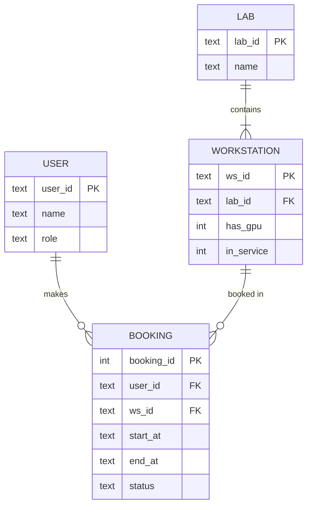

# SD-09 Data Modeling and Interface Design

> [!info] Topic card
> **Unit:** U4 · **Time:** 5 h · **Case:** LabBook's SQLite schema (`SqliteBookingRepository.SCHEMA` in `code/labbook/repository.py`), which is tested through the repository contract test. The REST API in §8 is a **design** for case-study exercise 4; it hasn't been implemented.

## 1. Learning objectives
1. **Draw** entity–relationship diagrams (entities, attributes, keys, cardinality), and **map** them to relational tables.
2. **Normalise** tables to 3NF, and **explain** each normal form through the anomalies it prevents.
3. **Use** constraints (primary keys, foreign keys, NOT NULL, CHECK, UNIQUE) to enforce business rules in the database.
4. **Design** programmatic interfaces (function signatures, REST APIs) that are consistent, minimal, versioned and hard to misuse.
5. **Apply** user-interface design heuristics to evaluate and improve screens.

## 2. Why it matters
Data usually outlives the code that created it. A badly designed schema causes inconsistent data, slow queries and painful migrations for years. Interfaces (APIs and screens) are the contracts others depend on: once published, they're expensive to change. Getting both right early saves enormous effort.

## 3. Prerequisites
[[PY-22 SQL and Database Integration]] · [[SD-07 UML Class Diagrams]] · Functions and relations from [[DM-07 Functions]] and [[DM-10 Relations, Equivalence Relations and Partial Orders]] (functional dependencies are relations between attribute sets).

## 4. Intuition
- **A data model** is the filing system: each fact should be filed **once**, in the right drawer, with labels (keys) linking the drawers. Storing the same fact twice means one day the two copies will disagree.
- **An interface** is a doorway: make the right thing easy and the wrong thing hard, and don't move the door once people use it.

## 5. Rigorous explanation

### 5.1 ER modelling
- **Entity:** a thing of interest (User, Workstation, Booking).
- **Attributes;** the **primary key** (PK) uniquely identifies each instance.
- **Relationships** with **cardinality**: 1:1, 1:N, M:N. An M:N relationship becomes a **junction table** in a relational schema.
- **Notation** (crow's foot): `||` exactly one, `o|` zero or one, `|{` one or more, `o{` zero or more.

**Mapping to tables:** each entity becomes a table; a 1:N relationship becomes a foreign key on the "many" side; M:N becomes a junction table with two foreign keys.

### 5.2 Normalisation
A **functional dependency** X → Y means the values of X determine Y.
- **1NF:** atomic values, with no repeating groups. Not `workstations = "LAB1-01, LAB1-02"`.
- **2NF:** 1NF, plus no non-key attribute depends on only *part* of a composite key.
- **3NF:** 2NF, plus no non-key attribute depends on another non-key attribute (no transitive dependencies).
- **BCNF:** every determinant is a candidate key.

**Anomalies** that normalisation prevents:
- **update:** changing a fact in one row but not another;
- **insertion:** you can't record a lab until it has a booking;
- **deletion:** deleting the last booking deletes the lab's information.

**Denormalisation:** deliberate duplication for read performance (e.g. reporting tables). Do it knowingly, and keep the copies consistent.

### 5.3 Constraints as executable rules
| Constraint | Enforces | LabBook schema |
|---|---|---|
| PRIMARY KEY | Identity | `booking_id INTEGER PRIMARY KEY AUTOINCREMENT` |
| NOT NULL | Required data | `user_id`, `ws_id`, `start_at`, `end_at`, `status` |
| CHECK | Domain rules | `status IN (...)`, `end_at > start_at` |
| FOREIGN KEY | Referential integrity | (missing: users and workstations live in the Directory; see Example 3) |
| UNIQUE / exclusion | No duplicates / no overlaps | (not available in SQLite for time ranges; since SD-17 the repository enforces it with a `BEGIN IMMEDIATE` check-and-insert transaction) |
| INDEX | Fast lookups | `ix_bookings_ws (ws_id, start_at)` |

Rules enforced in the database also hold for other programs, scripts and concurrent requests, not just for well-behaved callers of the service.

### 5.4 API design principles
- **Consistency:** the same naming, error format and pagination everywhere.
- **Minimal and complete:** expose what clients need, and no internals.
- **Hard to misuse:** typed parameters (`TimeSlot`, not two strings), validation at the boundary, clear errors.
- **REST conventions:**
  - resources as nouns (`/bookings/{id}`);
  - HTTP methods for actions (GET, POST, PATCH, DELETE);
  - status codes: 200, 201, 400, 401, 403, 404, 409 (conflict), 422.
- **Idempotency:** PUT and DELETE are idempotent. For POST, use an idempotency key to make retries safe.
- **Versioning** (`/v1/`) and **backwards compatibility:** add fields, don't remove or repurpose them.
- **Contracts:** document them with OpenAPI, and test them with contract tests.

### 5.5 User-interface design
Nielsen's 10 usability heuristics, summarised:
1. Visibility of system status.
2. Match with the real world.
3. User control and freedom (undo, cancel).
4. Consistency and standards.
5. Error prevention.
6. Recognition rather than recall.
7. Flexibility and efficiency.
8. Aesthetic, minimalist design.
9. Help users recognise, diagnose and recover from errors.
10. Help and documentation.

Accessibility (WCAG 2.2): sufficient contrast, keyboard navigation, text alternatives, clear labels.

## 6. Terminology
| Term | Meaning |
|---|---|
| Primary / foreign key | A unique identifier / a reference to another table's key |
| Cardinality | How many instances relate (1:1, 1:N, M:N) |
| Junction (associative) table | A table that resolves an M:N relationship |
| Functional dependency | X → Y: X determines Y |
| Transitive dependency | A → B → C, where B isn't a key |
| Idempotent | Repeating the operation has the same effect as doing it once |
| Contract test | A test that an implementation honours an interface's promised behaviour |

## 7. Step-by-step: from class diagram to schema
1. Entities from SD-07: User, Workstation, Lab, Booking. TimeSlot is a value object, so it's embedded as `start_at` and `end_at` columns.
2. Keys: `user_id`, `ws_id`, `lab_id`, `booking_id`.
3. Relationships:
   - Lab 1:N Workstation, so `workstations.lab_id` is a foreign key;
   - User 1:N Booking, so `bookings.user_id` is a foreign key;
   - Workstation 1:N Booking, so `bookings.ws_id` is a foreign key.
4. Constraints from the requirements:
   - CHECK on the status set (FR-07);
   - `end_at > start_at` (FR-09);
   - a no-overlap guarantee (FR-02): needs an exclusion constraint, or transactional enforcement.
5. Indexes for the queries the system actually runs (`for_workstation` → `(ws_id, start_at)`).

## 8. Diagrams

### 8.1 ERD: target LabBook schema

*Text version: a lab contains one or more workstations. A user makes zero or more bookings. A workstation is booked in zero or more bookings. The current code persists only BOOKING; users and workstations live in an in-memory Directory.*

### 8.2 REST API design (exercise 4)
| Method + path | Body / params | Success | Errors |
|---|---|---|---|
| `POST /v1/bookings` | `{"ws_id": "LAB1-01", "start": "2026-03-02T09:00", "end": "2026-03-02T11:00"}` + `Idempotency-Key` header | `201` + booking JSON + `Location` | `400` invalid input · `401` not logged in · `404` unknown workstation · `409` rule violation (`{"error": "no-overlap", "message": "..."}`) |
| `GET /v1/bookings?mine=true` | — | `200` list | `401` |
| `POST /v1/bookings/{id}/cancel` | — | `200` booking | `403` not permitted · `404` · `409` invalid transition |
| `POST /v1/bookings/{id}/check-in` | — | `200` | `403` · `409` |

`user_id` comes from the authenticated session, **never from the request body** (otherwise anyone could book as anyone, CS-04). State changes are modelled as action sub-resources (`/cancel`), because they're domain transitions rather than field edits.

## 9. Worked examples

### Example 1 (basic): normalise a spreadsheet
Technicians kept this sheet:

| booking | student | student_email | ws | lab | lab_building | start |
|---|---|---|---|---|---|---|
| 1 | Amina | amina@… | LAB1-01 | LAB1 | Science Block | 09:00 |
| 2 | Amina | amina@… | LAB1-02 | LAB1 | Science Block | 11:00 |

Dependencies:
- booking → student, ws, start;
- student → student_email;
- ws → lab;
- lab → lab_building.

The transitive dependencies (booking → student → email; booking → ws → lab → building) break 3NF. If Amina changes her email, two rows must be updated (an update anomaly).

**3NF result:**
- STUDENT(student_id, name, email);
- LAB(lab_id, building);
- WORKSTATION(ws_id, lab_id);
- BOOKING(booking_id, student_id, ws_id, start, end).

### Example 2 (intermediate): constraints catch bugs the code misses
The repository's schema contains `CHECK (end_at > start_at)` and a CHECK on the status values. Even if a future script bypasses `TimeSlot` validation and inserts `end_at` earlier than `start_at`, SQLite rejects the row with `CHECK constraint failed`. This is defence in depth for FR-09. (Try it in `sqlite3`, or with `repo.conn.execute(...)` in Python.)

### Example 3 (challenging): review the actual LabBook schema
**Strengths:** a PK, NOT NULLs, two CHECKs, an index that fits the main query.

**Gaps:**
1. **No foreign keys.** `user_id` and `ws_id` could reference non-existent users or workstations; the service checks via the Directory, but other writers wouldn't. Fix: add USER and WORKSTATION tables with `FOREIGN KEY` (and `PRAGMA foreign_keys = ON`; SQLite enforces foreign keys only when this is enabled).
2. **No overlap constraint** (at the time of this lesson). Concurrent requests could double-book (SD-08 Example 3; measured in SD-14). Fix, as implemented in SD-17: serialise the check-and-insert in a transaction (`BEGIN IMMEDIATE`) in the repository, or, in PostgreSQL, use an exclusion constraint on `(ws_id WITH =, tsrange(start_at, end_at) WITH &&)` for active statuses.
3. **Times stored as ISO text without a time zone.** That's acceptable for a single-campus system; document it as an assumption.

Each gap is a design decision to record: either an ADR, or an issue to fix.

## 10. Application: interface design for the booking screen
A heuristic review of a proposed mobile booking screen:
- Show **free slots** visually, rather than asking for typed times (error prevention; recognition over recall).
- Show the **weekly hours used** before the user books (visibility of status).
- Rule-violation messages explain *what to do*: "You've used 9 of 10 hours this week. Choose a slot of 1 hour or less" (heuristic 9).
- A **Cancel** button on confirmed bookings (user control).
- Sufficient contrast, plus labels for screen readers (WCAG).

## 11. Common mistakes
| Mistake | Fix |
|---|---|
| Comma-separated lists in one column | A separate table (1NF) |
| Copying descriptive data into many rows | Normalise to 3NF; denormalise only deliberately |
| Business rules only in application code | Add DB constraints for the critical invariants |
| `user_id` taken from the request body | Take identity from the authenticated session |
| Ad-hoc error formats and status codes | One error schema; correct HTTP codes (409 for rule conflicts) |
| Breaking API changes without a version | Version the API; make additive changes |
| Error messages that blame or confuse users | Plain-language problem + solution |

## 12. Comparison: where to enforce a rule
| Rule | Domain code | Database constraint | UI |
|---|---|---|---|
| End after start | ✓ (`TimeSlot`) | ✓ CHECK | ✓ prevent bad input |
| Valid status | ✓ (enum + `ALLOWED`) | ✓ CHECK | — |
| No overlap | ✓ (`NoOverlap`) | Should be added (transaction/exclusion) | Show only free slots |
| Weekly quota | ✓ (`WeeklyQuota`) | Hard in SQL; keep it in code | Show hours used |
| Referential integrity | Partly (Directory lookup) | Should be FKs | — |

## 13. Practice
**L1** 1. Define a foreign key. 2. What does 1NF forbid?

**L2** 3. Map "Student M:N Course with a grade" to tables. 4. Identify the anomalies in Example 1's sheet: one update, one insertion and one deletion anomaly.

**L3** 5. Write `CREATE TABLE` statements for USER, LAB and WORKSTATION, plus an altered BOOKING with foreign keys (SQLite). 6. Design the JSON error format for the LabBook API, and give two examples.

**L4** 7. Implement transactional overlap protection in `SqliteBookingRepository.add` (`BEGIN IMMEDIATE`, check, insert, commit), and write a test that simulates the race with two connections to one database file. 8. Perform a 10-heuristic review of a real university portal page you use (as a user only; no testing of the site), and propose 5 improvements.

**L5** 9. Design the full data model (ERD + 3NF schema + constraints + indexes) and REST API (OpenAPI-style table) for the hostel maintenance system, with a justification for each constraint.

## 14. Hints
> [!tip]- Hints
> 3: ENROLMENT(student_id, course_id, grade), with a composite PK. 4: changing a building name; adding a lab with no bookings; deleting booking 2. 5: `PRAGMA foreign_keys = ON;`. 7: two `sqlite3.connect(path)` objects; the second `BEGIN IMMEDIATE` waits or raises "database is locked" (use a timeout).

## 15. Worked solutions
> [!success]- Solutions 1–2
> 1. A column whose values must match a key in another (or the same) table, which enforces referential integrity. 2. Non-atomic values and repeating groups (lists in a cell, columns like phone1, phone2, phone3).

> [!success]- Solution 3
> STUDENT(student_id PK, name), COURSE(course_code PK, title), ENROLMENT(student_id FK, course_code FK, grade, PK(student_id, course_code)). The grade depends on the *pair*, so it belongs in the junction table.

> [!success]- Solution 4
> **Update:** if the Science Block is renamed, every booking row for LAB1 must change; miss one, and the data is inconsistent. **Insertion:** a new lab can't be recorded until someone books one of its workstations. **Deletion:** deleting the only booking of a workstation loses which lab and building it's in.

> [!success]- Solution 5
> ```sql
> PRAGMA foreign_keys = ON;
> CREATE TABLE users (user_id TEXT PRIMARY KEY, name TEXT NOT NULL,
>                     role TEXT NOT NULL CHECK (role IN ('student','lecturer','technician')));
> CREATE TABLE labs (lab_id TEXT PRIMARY KEY, building TEXT NOT NULL);
> CREATE TABLE workstations (ws_id TEXT PRIMARY KEY, lab_id TEXT NOT NULL REFERENCES labs(lab_id),
>                            has_gpu INTEGER NOT NULL DEFAULT 0 CHECK (has_gpu IN (0,1)),
>                            in_service INTEGER NOT NULL DEFAULT 1 CHECK (in_service IN (0,1)));
> CREATE TABLE bookings (
>   booking_id INTEGER PRIMARY KEY AUTOINCREMENT,
>   user_id TEXT NOT NULL REFERENCES users(user_id),
>   ws_id   TEXT NOT NULL REFERENCES workstations(ws_id),
>   start_at TEXT NOT NULL, end_at TEXT NOT NULL,
>   status TEXT NOT NULL CHECK (status IN ('requested','confirmed','checked_in','completed','cancelled','no_show')),
>   CHECK (end_at > start_at));
> CREATE INDEX ix_bookings_ws ON bookings (ws_id, start_at);
> CREATE INDEX ix_bookings_user ON bookings (user_id, start_at);
> ```
> (Run it in `sqlite3 :memory:` to check. Inserting a booking for an unknown `ws_id` must fail with `FOREIGN KEY constraint failed`.)

> [!success]- Solution 6
> Format: `{"error": "<machine-code>", "message": "<human text>", "details": {...}}`. Examples:
> - `409 {"error": "weekly-quota", "message": "11 h exceeds 10 h per week", "details": {"used_hours": 8, "requested_hours": 3}}`
> - `400 {"error": "validation", "message": "slot must end after it starts", "details": {"field": "end"}}`
>
> The codes match the `RuleViolation.rule` names, so clients can react programmatically.

> [!success]- Solution 7 (approach)
> In `add`: `self.conn.isolation_level = None` (manual transactions), then `BEGIN IMMEDIATE` (takes the write lock), then `SELECT` any active booking on `ws_id` with `start_at < new_end AND end_at > new_start`. If one is found: `ROLLBACK` and raise `RuleViolation("no-overlap", ...)`. Otherwise `INSERT` and `COMMIT`. **Test:** create two repositories on the same temporary file; begin the first's transaction and pause it (or run both in threads); verify that only one insert succeeds and the other raises `RuleViolation` or times out with "database is locked", which you then translate.

> [!success]- Solution 9 (outline)
> **Entities:** BLOCK, ROOM, STUDENT, TECHNICIAN, REQUEST, COMMENT, PHOTO, STATUS_CHANGE (an audit table).
> **Constraints:**
> - FKs everywhere;
> - a status CHECK;
> - `description` length 10–500 (CHECK);
> - UNIQUE(room_number, block_id);
> - `photos.size_bytes ≤ 5 MB` (CHECK);
> - status changes are append-only (no UPDATE permission for the app user, CS-12).
>
> **Indexes:** `requests(status, created_at)` for the warden queue; `requests(student_id)`.
> **API:** `/v1/requests` POST/GET, `/v1/requests/{id}/assign` (warden), `/{id}/status` (technician), `/{id}/comments`, with an error schema as in Solution 6.

## 16. Self-test (pass ≥ 4/5)
1. Which normal form removes transitive dependencies? 2. How is an M:N relationship implemented? 3. Which HTTP status suits "slot already booked"? 4. Why enforce rules in the database too? 5. Why must `user_id` not come from the request body?
> [!success]- Answers
> 1. 3NF. 2. A junction table with foreign keys to both sides. 3. 409 Conflict. 4. Other programs, scripts and concurrent requests bypass the application logic; constraints always hold. 5. Clients could impersonate other users; identity must come from authentication.

## 17. Flashcards
#flashcards/software-design
1NF / 2NF / 3NF?::Atomic values / no partial dependency on a composite key / no transitive dependencies.
M:N in a relational schema?::A junction table with two foreign keys.
Crow's foot o{?::Zero or more.
REST status for a business-rule conflict?::409 Conflict.
Idempotent HTTP methods?::GET, PUT, DELETE (and HEAD, OPTIONS); POST isn't, unless you add an idempotency key.
SQLite foreign keys gotcha?::Enforced only after PRAGMA foreign_keys = ON.
One of Nielsen's heuristics?::Error prevention (or visibility of status, recognition over recall, and so on).

## 18. Blank-page recall
Normalise Example 1's sheet from memory, then draw the ERD.

## 19. Revision summary
- ER modelling: entities, keys, cardinality. Map 1:N with FKs and M:N with junction tables.
- Normalise to 3NF to prevent update, insertion and deletion anomalies; denormalise only deliberately.
- Put critical invariants in the database (PK, FK, CHECK, UNIQUE/exclusion), as well as in code.
- APIs: consistent, minimal, versioned, idempotent where needed, identity from authentication, clear error schema.
- UIs: Nielsen's heuristics and WCAG accessibility.

## 20. Links
Prev: [[SD-08 UML Sequence, Activity and State Diagrams]] · Next: [[SD-10 SOLID Principles]] · Related: [[PY-22 SQL and Database Integration]], [[PY-23 HTTP APIs and External Services]], [[CS-12 Secure Software Development and Database Security]]

## 21. Sources
- Codd, E. F., "A relational model of data for large shared data banks", *Communications of the ACM*, 13(6), 1970, pp. 377–387.
- Elmasri, R. & Navathe, S., *Fundamentals of Database Systems*, 7th ed., Pearson, 2016.
- Nielsen, J., "10 Usability Heuristics for User Interface Design", Nielsen Norman Group, 1994 (updated 2020): https://www.nngroup.com/articles/ten-usability-heuristics/
- W3C, *Web Content Accessibility Guidelines (WCAG) 2.2*, 2023.
- OpenAPI Specification: https://spec.openapis.org/oas/latest.html · SQLite foreign keys: https://www.sqlite.org/foreignkeys.html
- *(Not checked online during the build, because there was no network access.)*

## 22. Mastery checklist
- [ ] I can draw an ERD and map it to tables
- [ ] I can normalise to 3NF and name the anomalies
- [ ] I can choose where to enforce each rule
- [ ] I can design a REST API contract with errors, versioning and idempotency · reviews scheduled
