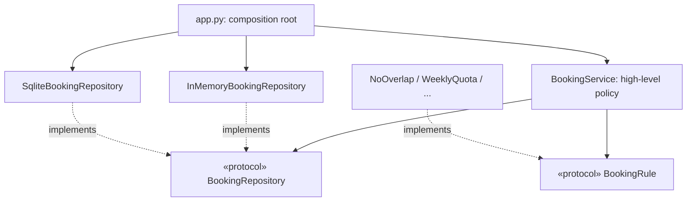

# SD-10 SOLID Principles

> [!info] Topic card
> **Unit:** U5 · **Time:** 4 h · **Code:** good examples in `code/labbook/` and violations in `code/clinic/`. The tests in `test_labbook.py` and `test_clinic.py` demonstrate both: `test_new_rule_plugs_in_without_changing_service` for open/closed, and `test_lsp_violation`.

## 1. Learning objectives
1. **State** each SOLID principle precisely, and **explain** the design problem it addresses.
2. **Identify** violations in code, and **refactor** them.
3. **Apply** SOLID in Python, using protocols, composition and dependency injection.
4. **Judge** when applying a principle adds needless complexity.
5. **Relate** SOLID to cohesion and coupling (SD-06) and to design patterns (SD-11, SD-12).

## 2. Why it matters
SOLID is a compact checklist for object-oriented design reviews and a favourite exam topic. Applied with judgement, it produces code where changes stay local and tests are easy. Applied dogmatically, it produces dozens of one-method interfaces nobody needs. Learning both sides is the point.

## 3. Prerequisites
[[SD-06 Modular Design, Cohesion and Coupling]] · [[PY-17 Inheritance, Composition and Polymorphism]] · [[PY-19 Type Hints, Documentation, Clean Code and Refactoring]] (Protocols).

## 4. Intuition
- **S:** one reason to change per module.
- **O:** add new behaviour by adding code, not by editing working code.
- **L:** a subclass must keep its parent's promises.
- **I:** don't force clients to depend on methods they don't use.
- **D:** high-level policy shouldn't depend on low-level details; both should depend on abstractions.

## 5. Rigorous explanation

### 5.1 Single Responsibility Principle (SRP)
"A module should have one, and only one, reason to change." Martin later restated this as "responsible to one actor". `LabManager.do_booking` changes when the rules change (the department), the storage changes (ICT), the email wording changes (communications) or the HTML changes (the web team): four reasons, so it violates SRP. In LabBook, each of these lives in its own module.

### 5.2 Open/Closed Principle (OCP)
"Software entities should be open for extension but closed for modification" (Meyer, 1988; the polymorphic form comes from Martin). The extension point is the `BookingRule` protocol. `GpuForLecturersAndApprovedOnly` was added without editing `BookingService` (proved by `test_new_rule_plugs_in_without_changing_service`). OCP applies to **anticipated** variation: you can't be closed against every change, so choose the axis that actually varies (here, the rules).

### 5.3 Liskov Substitution Principle (LSP)
"If S is a subtype of T, objects of type T may be replaced with objects of type S without altering the desirable properties of the program" (Liskov & Wing, 1994). A subtype must not:
- **strengthen preconditions** (demand more of callers);
- **weaken postconditions** (promise less);
- break **invariants**;
- throw new unexpected exceptions.

In clinic case F2, `GpuWorkstation.book` raises for more than 2 hours, and `OutOfServiceWorkstation.book` raises `NotImplementedError`. `book_whole_lab` works for `Workstation` but fails for these subclasses, so LSP is violated (`test_lsp_violation`). LabBook models these variations as **data** (`has_gpu`, `in_service`) checked by **rules**, rather than as subclasses.

### 5.4 Interface Segregation Principle (ISP)
"Clients should not be forced to depend on methods they do not use." For example, a reporting module needs only `for_user` / `for_workstation` reads. Making it depend on the full `BookingRepository` (with `add` and `save`) gives it write capability it doesn't need. That's a coupling cost, and a security risk (least privilege, CS-04). A segregated `BookingReader` protocol fixes it. Python's structural Protocols make small interfaces cheap: any object with the right methods conforms.

### 5.5 Dependency Inversion Principle (DIP)
1. "High-level modules should not depend on low-level modules. Both should depend on abstractions."
2. "Abstractions should not depend on details. Details should depend on abstractions."

In LabBook, `BookingService` (high level) depends on the `BookingRepository` and `BookingRule` protocols. `SqliteBookingRepository` (a low-level detail) implements the protocol. `app.py` (the composition root) chooses and injects the concrete classes. This is **dependency injection** through the constructor, the mechanism that implements DIP. In clinic F3, `ReminderService` creates `SmtpMailer()` internally and reads the real clock, so it can't be tested without a mail server (`test_hidden_dependencies_make_testing_hard`).

### 5.6 When not to apply them
- **SRP taken too far:** a class for every line, so that understanding needs 15 files.
- **OCP everywhere:** a plug-in architecture for a rule that will never vary. YAGNI ("you aren't gonna need it") says add the abstraction when the second variant appears.
- **ISP extremes:** one interface per method.
- **DIP for stable things:** you don't need an interface for `datetime` arithmetic or the standard library. Invert dependencies on **volatile** or **external** things (databases, networks, clocks, email).

## 6. Terminology
| Term | Meaning |
|---|---|
| Responsibility | A reason to change (an actor or concern) |
| Extension point | A place designed for new behaviour to plug in |
| Precondition / postcondition / invariant | What callers must ensure / what the method guarantees / what always holds |
| Dependency injection | Supplying dependencies from outside (constructor, parameters) |
| Composition root | The single place where the object graph is assembled (`app.py`) |
| Protocol (Python) | A structural interface: conformance by shape, not by inheritance |
| YAGNI | Don't build abstractions before they're needed |

## 7. Step-by-step: a SOLID review checklist
For each class or module:
1. **S:** list who would ask for changes to it. More than one actor? Split it.
2. **O:** what varies here? Is there an extension point for that variation, and only that?
3. **L:** for each subclass, does it accept everything the parent accepts and promise everything the parent promises? Would the parent's tests pass against it?
4. **I:** does each client use most of the interface it depends on?
5. **D:** does business logic import infrastructure (sqlite3, smtplib, requests, `datetime.now`)? Inject it instead.

## 8. Diagram: dependency inversion in LabBook

*Text version: the service depends only on two protocols. Concrete repositories and rules implement them. Only `app.py` knows about the concrete classes.*

## 9. Worked examples

### Example 1 (basic): which principle is violated?
| Code smell | Principle |
|---|---|
| `class Report: def compute(); def to_pdf(); def email()` | SRP |
| `if rule_type == "quota": ... elif rule_type == "overlap": ...`, edited for every new rule | OCP |
| `class ReadOnlyList(list): def append(self, x): raise TypeError` | LSP |
| A `Printer` interface with `print`, `scan`, `fax`, implemented by a simple printer that raises on `fax` | ISP (and LSP) |
| `class Service: def __init__(self): self.db = sqlite3.connect("prod.db")` | DIP |

### Example 2 (intermediate): fixing the ISP issue for reports
```python
from typing import Protocol
from labbook.domain import Booking


class BookingReader(Protocol):
    def for_user(self, user_id: str) -> list[Booking]: ...
    def for_workstation(self, ws_id: str) -> list[Booking]: ...


def weekly_hours(reader: BookingReader, user_id: str) -> float:
    return sum(b.slot.hours for b in reader.for_user(user_id) if b.active)
```
Both existing repositories already conform, with no changes, because Protocols are structural. The report can't call `add` or `save`, so a bug in it can't corrupt bookings.

### Example 3 (challenging): refactor F3 with DIP
```python
from datetime import datetime, timedelta
from typing import Callable, Protocol


class Mailer(Protocol):
    def send(self, to: str, body: str) -> None: ...


class ReminderService:
    def __init__(self, mailer: Mailer, clock: Callable[[], datetime] = datetime.now, window=timedelta(hours=1)):
        self.mailer, self.clock, self.window = mailer, clock, window

    def remind_if_soon(self, start: datetime, email: str) -> bool:
        delta = start - self.clock()
        if timedelta(0) < delta < self.window:
            self.mailer.send(email, "Your lab session starts soon")
            return True
        return False


class FakeMailer:
    def __init__(self):
        self.sent = []

    def send(self, to, body):
        self.sent.append((to, body))


fixed_now = datetime(2026, 3, 2, 8, 30)
svc = ReminderService(FakeMailer(), clock=lambda: fixed_now)
print(svc.remind_if_soon(datetime(2026, 3, 2, 9, 0), "amina@example.ac.tz"), svc.mailer.sent)
print(svc.remind_if_soon(datetime(2026, 3, 2, 11, 0), "amina@example.ac.tz"))
```
Output (run during the build):
```text
True [('amina@example.ac.tz', 'Your lab session starts soon')]
False
```
The changes:
- The mailer and the clock are injected (DIP).
- The global `Config` singleton is replaced by a constructor parameter.
- The "train wreck" `booking["user"]["contact"]["email"]` is replaced by passing just the email. That's the Law of Demeter, and it reduces stamp coupling.

The service is now testable in milliseconds with no mail server.

## 10. Application: SOLID review of LabBook
| Principle | Status | Evidence / improvement |
|---|---|---|
| S | ✓ mostly | Each module has one concern. `BookingService` orchestrates three use cases with one actor (booking policy), which is acceptable |
| O | ✓ for rules | New rules plug in. Notification channels plug in via the bus |
| L | ✓ | There are no subclass hierarchies in the domain. All repositories pass the same contract test, which is LSP checked by tests |
| I | Partial | Readers get the whole repository. Introduce `BookingReader` (Example 2) when reports are added |
| D | ✓ | The service depends on protocols, and `app.py` injects the concrete classes. The clock isn't injected yet (exercise 6 will need it) |

## 11. Common mistakes
| Mistake | Fix |
|---|---|
| SRP read as "one method per class" | One *reason to change* (one actor) |
| Interfaces for everything "for flexibility" | Abstract volatile or external things; YAGNI for the rest |
| Inheritance to reuse code, then overriding to disable it | Composition, or model the variation as data |
| Creating dependencies inside classes (`self.db = sqlite3.connect`) | Inject them; assemble in a composition root |
| Thinking DIP means "use a DI framework" | Plain constructor parameters are enough in Python |
| Testing LSP by eye only | Run the parent's contract tests against every implementation |

## 12. Comparison: the five principles at a glance
| | Problem prevented | Typical fix | LabBook example |
|---|---|---|---|
| SRP | Unrelated changes colliding in one place | Split by actor or concern | Separate modules |
| OCP | Editing working code for each new variant | Polymorphism or extension points | `BookingRule` + `RuleSet` |
| LSP | Subclasses breaking clients | Honour contracts; composition | Repository contract test |
| ISP | Clients coupled to unused capabilities | Smaller role interfaces | `BookingReader` |
| DIP | Policy tied to infrastructure | Depend on abstractions; inject | Repository protocol + `app.py` |

## 13. Practice
**L1** 1. State the LSP in your own words. 2. What's a composition root?

**L2** 3. Identify the principle violated: `def save(self, fmt): if fmt == "json": ... elif fmt == "xml": ...`. 4. Why does `BookingRepository` being a Protocol help with LSP testing?

**L3** 5. Add a `SundayClosed` rule to LabBook, with a test, without modifying `service.py`. Which principle did you rely on? 6. Refactor clinic F2 so that GPU and out-of-service behaviour don't need subclasses.

**L4** 7. Argue for or against introducing `BookingReader` now, before any report exists. 8. Inject a clock into `WeeklyQuota` (or the service) so that "current week" logic can be tested. Show the change and a test.

**L5** 9. Write a SOLID review (a table like §10) for your FYP or [[PRJ-PY-05 Hostel Maintenance System]], with at least two concrete refactorings and before/after code.

## 14. Hints
> [!tip]- Hints
> 3: OCP (and SRP). 4: one contract test, parametrised over every implementation. 5: `booking.slot.start.weekday() == 6`; add it to the RuleSet in the test or in `app.py`. 7: YAGNI vs least privilege. 8: a `clock: Callable[[], datetime]` parameter.

## 15. Worked solutions
> [!success]- Solutions 1–2
> 1. Anywhere code works with a parent type, it must keep working when given any subtype: same accepted inputs (or more), same guarantees (or stronger), same invariants. 2. The one place (e.g. `app.py`, or `main`) where concrete classes are chosen and wired together. Everything else receives its dependencies.

> [!success]- Solution 3
> OCP: every new format requires editing `save`. Also SRP, if serialisation and storage are mixed. Fix: a `Serializer` protocol with `JsonSerializer` and `XmlSerializer`, passed to `save`.

> [!success]- Solution 4
> All implementations are interchangeable behind one interface, so a single parametrised test (`test_repository_contract`, run for "memory" and "sqlite") checks that each implementation behaves the same. A new implementation that fails this test violates LSP, and it's caught automatically.

> [!success]- Solution 5
> ```python
> from labbook.errors import RuleViolation
>
> class SundayClosed:
>     name = "sunday-closed"
>
>     def check(self, booking, user, ws, existing):
>         if booking.slot.start.weekday() == 6:
>             raise RuleViolation(self.name, "labs are closed on Sundays")
> ```
> Test: build `RuleSet(default_rules().rules + [SundayClosed()])` and set it on the service. 8 March 2026 is a Sunday, so a booking that day raises; Monday 9 March succeeds. This relies on **OCP**, via the `BookingRule` protocol (and on DIP: rules are injected).

> [!success]- Solution 6
> Remove the subclasses. Give `Workstation` data attributes (`has_gpu`, `in_service`, perhaps `max_session_hours`), and move the policy into rules: a `MaxSessionHours` rule reads `ws.max_session_hours`, and `WorkstationInService` checks `in_service`. Client code such as `book_whole_lab` now works for every workstation, and an illegal booking produces a consistent `RuleViolation` instead of a surprising exception. That's exactly LabBook's design.

> [!success]- Solution 7
> **Against now:** no client needs it yet (YAGNI), and an extra interface is extra reading. **For now:** it costs 5 lines; it documents and enforces least privilege for future readers; and reports are a known planned feature (SD-CASE exercise 3 mentions usage statistics). **Reasonable verdict:** introduce it in the same change as the first report, not before. Note the intention in an ADR or a TODO linked to the backlog item.

> [!success]- Solution 8
> `WeeklyQuota` currently uses the booking's own date, so it's already deterministic. The "current time" dependency appears in the NO_SHOW timeout (exercise 6) and in "can't book in the past". Inject a clock into the service: `BookingService(..., clock=datetime.now)`, with the rule `if slot.start < self.clock(): raise RuleViolation("past", ...)`. Test it with `clock=lambda: datetime(2026, 3, 2, 10)`: booking 09:00 that day fails, and 11:00 succeeds.

> [!success]- Solution 9 (guidance)
> Typical findings for the hostel system:
> - routes that contain SQL (SRP, DIP): extract a repository;
> - an `if category == ...` assignment policy (OCP): use a strategy per category;
> - a notifier that calls SMTP directly (DIP): inject a `Notifier` protocol with a fake for tests.
>
> Show before and after code, and keep the tests passing throughout.

## 16. Self-test (pass ≥ 4/5)
1. What's SRP's "reason to change"? 2. Which test in LabBook demonstrates OCP? 3. Name two ways a subclass can violate LSP. 4. What does ISP protect against? 5. Which LabBook file is the composition root?
> [!success]- Answers
> 1. An actor or concern who requests changes (e.g. the department's booking policy). 2. `test_new_rule_plugs_in_without_changing_service`. 3. Strengthening preconditions; weakening postconditions; raising unexpected exceptions; breaking invariants (any two). 4. Clients depending on (and being affected by, or able to misuse) methods they don't need. 5. `labbook/app.py`.

## 17. Flashcards
#flashcards/software-design
SRP?::A module should have one reason to change (be responsible to one actor).
OCP?::Open for extension, closed for modification: add new behaviour without editing working code.
LSP?::Subtypes must be substitutable for their base types without breaking clients.
ISP?::Clients shouldn't depend on methods they don't use.
DIP?::High- and low-level modules both depend on abstractions; details depend on abstractions.
When not to add an abstraction?::When the thing is stable or has only one variant (YAGNI); abstract volatile or external dependencies.

## 18. Blank-page recall
For each letter, write the principle, one LabBook example and one clinic violation.

## 19. Revision summary
- **S:** one reason to change. **O:** extend without modifying (on the axis that actually varies). **L:** substitutable subtypes (test them with contract tests). **I:** small role interfaces. **D:** depend on abstractions; inject details at a composition root.
- LabBook demonstrates OCP and DIP; the clinic demonstrates SRP, LSP and DIP violations.
- Apply with judgement: YAGNI and readability matter too.

## 20. Links
Prev: [[SD-09 Data Modeling and Interface Design]] · Next: [[SD-11 Creational and Structural Design Patterns]] · Related: [[SD Flawed Design Clinic]], [[SD-06 Modular Design, Cohesion and Coupling]], [[PY-17 Inheritance, Composition and Polymorphism]]

## 21. Sources
- Martin, R. C., *Agile Software Development: Principles, Patterns, and Practices*, Prentice Hall, 2002; and *Clean Architecture*, Prentice Hall, 2017.
- Meyer, B., *Object-Oriented Software Construction*, Prentice Hall, 1988 (the open/closed principle).
- Liskov, B. H. & Wing, J. M., "A behavioral notion of subtyping", *ACM Transactions on Programming Languages and Systems*, 16(6), 1994, pp. 1811–1841.
- Python docs, `typing.Protocol` (PEP 544): https://docs.python.org/3/library/typing.html#typing.Protocol
- *(Not checked online during the build, because there was no network access.)*

## 22. Mastery checklist
- [ ] I can state and explain each principle with an example
- [ ] I can find and fix violations in code
- [ ] I can argue when not to apply a principle
- [ ] Reviews scheduled
