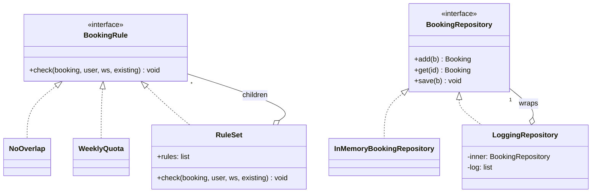

# SD-11 Creational and Structural Design Patterns

> [!info] Topic card
> **Unit:** U5 · **Time:** 5 h · **Code:**
> - `code/patterns/creational.py` (`BookingBuilder`, the `rules_from_config` factory) and `code/patterns/structural.py` (`LoggingRepository` decorator, `SmsNotificationAdapter`);
> - in LabBook itself: `RuleSet` (Composite) and `app.create_app` (factory / composition root);
> - tests in `tests/test_patterns_structural_creational.py`; all SD tests pass, and mypy reports no issues.

## 1. Learning objectives
1. **Describe** the intent, structure, participants and consequences of: Factory Method / simple factory, Abstract Factory, Builder, Singleton, Adapter, Decorator, Composite, Facade, Proxy.
2. **Recognise** these patterns in real code (LabBook), and **implement** them in Python.
3. **Explain** how Python features (first-class functions, modules, duck typing, protocols) simplify or replace classic patterns.
4. **Decide when NOT to use** each pattern.
5. **Relate** patterns to SOLID principles.

## 2. Why it matters
Patterns are named solutions to recurring design problems, and a shared vocabulary: "wrap it in a decorator" communicates a whole design in four words. Misapplied, they add layers of indirection to simple problems. That's why every pattern here comes with a "when not to use it".

## 3. Prerequisites
[[SD-10 SOLID Principles]] · [[SD-07 UML Class Diagrams]] · [[PY-17 Inheritance, Composition and Polymorphism]] · [[PY-18 Iterators, Generators, Decorators and Context Managers]] (Python's `@decorator` syntax is related to the Decorator pattern, but not the same).

## 4. Intuition
- **Creational patterns** answer "**who creates objects, and how?**" They hide construction details so that callers depend on what they get, not how it's made.
- **Structural patterns** answer "**how do objects fit together?**"
  - Adapter: make an incompatible piece fit.
  - Decorator: add a layer.
  - Composite: treat a group like a single item.
  - Facade: put one simple front door on a complex subsystem.
  - Proxy: put a stand-in in front of a real object.

## 5. Rigorous explanation

### 5.1 Creational patterns
| Pattern | Intent | Python form | LabBook / example |
|---|---|---|---|
| **Factory Method / simple factory** | Encapsulate the choice of concrete class | A function or registry dict returning an object | `rules_from_config` turns `[{"type": "weekly-quota", "max_hours": 4}]` into rule objects; `create_app("sqlite")` chooses the repository |
| **Abstract Factory** | Create *families* of related objects that must match | An object with several creation methods | A `StorageFactory` creating a matching repository, unit of work and migrations for SQLite or PostgreSQL |
| **Builder** | Construct complex objects step by step, with readable defaults | A fluent class, or keyword arguments plus dataclass defaults | `BookingBuilder().by("u-baraka").on("LAB1-02").at(t, hours=2).confirmed().build()` |
| **Singleton** | Ensure exactly one instance, globally accessible | A module-level object, or a cached function | Clinic F3's `Config`: an **anti-example** |

### 5.2 Structural patterns
| Pattern | Intent | LabBook / example |
|---|---|---|
| **Adapter** | Convert one interface into another that clients expect | `SmsNotificationAdapter` makes a vendor's `transmit(msisdn, text)` look like an EventBus handler `(Event) -> None` |
| **Decorator** | Add responsibilities dynamically, keeping the same interface | `LoggingRepository(InMemoryBookingRepository(), log)`: the service can't tell the difference |
| **Composite** | Treat individual objects and compositions uniformly | `RuleSet` *is a* `BookingRule` and *contains* rules, so the service calls `rules.check(...)` either way |
| **Facade** | Provide a simple interface to a complex subsystem | `BookingService` hides the directory, rules, repository and event bus behind `book`, `cancel` and `check_in` |
| **Proxy** | Control access to an object (lazy loading, caching, access checks, remote calls) | An `AuthorizingRepository` that checks permissions before delegating (practice 7) |

Decorator vs Proxy: the structure is the same (wrapping with the same interface). The difference is **intent**: a decorator adds behaviour, while a proxy controls access.

### 5.3 Python simplifications
- A **factory** is often just a function, or a dictionary of constructors (`RULE_TYPES`).
- **Strategy and Command** objects can be plain functions (SD-12).
- **Singletons:** a module is already a single instance. Prefer passing objects explicitly (DIP) over global access.
- **Duck typing and Protocols:** adapters and decorators don't need inheritance; they only need the right methods.
- **Keyword arguments with defaults** often replace a Builder for production objects. Builders remain useful for **test data**.

### 5.4 When NOT to use each pattern
| Pattern | Don't use it when… |
|---|---|
| Factory | There's only one concrete class and no realistic second one. Call the constructor |
| Abstract Factory | Product families don't need to match; it's pure ceremony |
| Builder | The object has 2–3 fields: use a dataclass with defaults |
| Singleton | Almost always. It hides dependencies, makes tests share state, and complicates concurrency. Use one instance created in the composition root and pass it in |
| Adapter | You own both interfaces; just change one of them |
| Decorator | Stacking many decorators makes behaviour hard to trace. Also, if the behaviour is always needed, put it in the class |
| Composite | The hierarchy is fixed and shallow; a simple list loop is clearer |
| Facade | It grows into a god object that does the work itself, rather than delegating |
| Proxy | Transparency hides costs (a remote proxy makes slow network calls look like cheap local ones) |

## 6. Terminology
| Term | Meaning |
|---|---|
| Intent | The problem a pattern solves |
| Participants | The roles in the pattern (Component, Leaf, Composite…) |
| Consequences | The trade-offs of applying it |
| Wrapper | An object that holds another and forwards calls (Adapter, Decorator, Proxy) |
| Registry | A mapping from names to constructors, used by factories |
| Fluent interface | Methods returning `self` so calls can be chained (Builder) |

## 7. Step-by-step: choosing a structural pattern
1. Is the interface **wrong** for the client (a vendor SDK)? → **Adapter**.
2. Is the interface right, but you need **extra behaviour** around calls (logging, caching, metrics)? → **Decorator**.
3. Is the interface right, but you need to **control access** (permissions, lazy loading)? → **Proxy**.
4. Do clients need to treat **one item and a group alike**? → **Composite**.
5. Is the subsystem **too complex** for clients? → **Facade**.
6. None of these? Don't use a pattern.

## 8. Diagram: Composite and Decorator in LabBook

*Text version: RuleSet implements BookingRule and contains BookingRules (Composite). LoggingRepository implements BookingRepository and wraps another BookingRepository (Decorator).*

## 9. Worked examples

### Example 1 (basic): Decorator, tested
```python
log = []
repo = LoggingRepository(InMemoryBookingRepository(), log)
svc = BookingService(repo, demo_directory(), EventBus())
b = svc.book("u-amina", "LAB1-01", TimeSlot(datetime(2026, 3, 2, 9), datetime(2026, 3, 2, 10)))
svc.cancel("u-amina", b.booking_id)
# log == ["add #1 LAB1-01", "get #1", "save #1 cancelled"]
```
The service code wasn't modified (OCP), and the decorator works with **any** repository, SQLite included (LSP + DIP).

### Example 2 (intermediate): Adapter for a vendor SDK, tested
The vendor's client expects `transmit(msisdn, text, sender_id)`. The event bus calls handlers as `handler(event)`. `SmsNotificationAdapter` translates between them, looks up the phone number, and skips users without one. The test shows exactly one SMS for Amina (`"LabBook: confirmed #1"`) and none for Baraka. If the vendor changes its SDK, only the adapter changes.

The vendor client here is a stand-in that records calls; no SMS is actually sent.

### Example 3 (challenging): Singleton, critiqued and replaced
Clinic F3:
```python
class Config:
    _instance = None
    max_hours = 10
    def __new__(cls):
        if cls._instance is None:
            cls._instance = super().__new__(cls)
        return cls._instance
```
**Problems:**
- Any code anywhere can read or change `Config().max_hours`: global mutable state.
- Tests share it: one test sets `max_hours = 2`, and later tests fail mysteriously.
- The dependency is invisible in constructors.

**Replacement:** a frozen dataclass `Settings(max_hours=10)`, created once in `app.create_app` and passed to whoever needs it, or turned into rule parameters via `rules_from_config`. You still have a single instance in practice, but it's explicit, testable and replaceable.

## 10. Application: per-university configuration (from SD-05 Practice 9)
For 12 universities, store each one's rules as JSON:
```json
[{"type": "in-service"}, {"type": "opening-hours"}, {"type": "no-overlap"},
 {"type": "weekly-quota", "max_hours": 6}]
```
`rules_from_config` (Factory) builds a `RuleSet` (Composite) per tenant. The tested behaviour: a 4-hour quota rejects a 5-hour booking, and unknown rule types raise `ValueError` (fail loudly, rather than silently skipping a rule).

## 11. Common mistakes
| Mistake | Fix |
|---|---|
| Starting with patterns ("let's use Abstract Factory") | Start from the problem; apply a pattern when it fits |
| Singletons for configuration or databases | Create once in the composition root; inject |
| Decorators that change the interface | Then it's an adapter; keep the same interface |
| A facade that contains the business logic | A facade delegates; logic stays in domain objects |
| Confusing Python's `@decorator` with the Decorator pattern | `@decorator` wraps functions at definition time; the pattern wraps objects at runtime. Related, but distinct |
| Factories silently ignoring unknown types | Fail loudly (`ValueError`) |

## 12. Comparison: the wrapper patterns
| | Adapter | Decorator | Proxy | Facade |
|---|---|---|---|---|
| Interface | Changes it | Keeps it | Keeps it | A new, simpler one |
| Purpose | Compatibility | Adding behaviour | Controlling access | Simplifying a subsystem |
| Wraps | One object | One object (stackable) | One object | Many objects |
| LabBook | `SmsNotificationAdapter` | `LoggingRepository` | (practice 7) | `BookingService` |

## 13. Practice
**L1** 1. Name the three creational and four structural patterns covered. 2. Which pattern does `RuleSet` implement?

**L2** 3. What's the difference between Decorator and Proxy? 4. Why is Singleton considered an anti-pattern in most applications?

**L3** 5. Write a `CachingDirectory` decorator that caches `user()` lookups, and test that a second lookup doesn't hit the inner directory. 6. Write an adapter that lets LabBook publish events to a (pretend) webhook client with the method `post_json(url, payload)`.

**L4** 7. Implement an `AuthorizingRepository` proxy that refuses `save` for bookings not owned by the current user unless they're a technician. Compare it with the checks in `BookingService.cancel`: which location is better, and why? 8. Explain why `rules_from_config` raises on unknown types rather than skipping them, with a security argument.

**L5** 9. Write a short design note proposing patterns for the hostel system (notifications via email and SMS, configurable assignment policies, report exports in CSV and PDF). For each pattern you propose, give a "not used because…" for one tempting alternative.

## 14. Hints
> [!tip]- Hints
> 3: the same structure, different intent. 5: a dict cache in the wrapper, with a counter in a fake inner directory. 7: domain rules belong in the service or domain; a proxy is a second line of defence. 8: a typo in configuration could silently remove a quota or a security rule.

## 15. Worked solutions
> [!success]- Solutions 1–2
> 1. Creational: Factory (Method/simple), Abstract Factory, Builder, Singleton (four, counting Abstract Factory). Structural: Adapter, Decorator, Composite, Facade, Proxy. 2. Composite: it implements `BookingRule` and contains child rules.

> [!success]- Solution 3
> Both wrap an object behind the same interface. A **Decorator** adds behaviour (logging, caching, metrics) while preserving the semantics. A **Proxy** controls access to the real object: it may refuse calls (protection proxy), create the object late (virtual proxy), or forward calls over a network (remote proxy).

> [!success]- Solution 4
> It creates global mutable state with hidden dependencies: classes reach out to it, rather than receiving it. That makes tests interfere with each other, makes substitution (a test configuration) hard, couples everything to one class, and can cause concurrency issues. The "only one instance" need is better met by creating one object at the composition root and passing it in.

> [!success]- Solution 5
> ```python
> class CachingDirectory:
>     def __init__(self, inner):
>         self.inner, self._users = inner, {}
>
>     def user(self, user_id):
>         if user_id not in self._users:
>             self._users[user_id] = self.inner.user(user_id)
>         return self._users[user_id]
>
>     def workstation(self, ws_id):
>         return self.inner.workstation(ws_id)
>
>
> class CountingDirectory:
>     def __init__(self, inner):
>         self.inner, self.calls = inner, 0
>
>     def user(self, user_id):
>         self.calls += 1
>         return self.inner.user(user_id)
>
>     def workstation(self, ws_id):
>         return self.inner.workstation(ws_id)
>
>
> def test_caching_directory():
>     from labbook.app import demo_directory
>     counting = CountingDirectory(demo_directory())
>     cached = CachingDirectory(counting)
>     assert cached.user("u-amina").name == "Amina"
>     assert cached.user("u-amina").name == "Amina"
>     assert counting.calls == 1
> ```
> **Caveat:** caching user records means role changes aren't seen until the cache is cleared. Add expiry or invalidation (a classic decorator trade-off).

> [!success]- Solution 7
> ```python
> class AuthorizingRepository:
>     def __init__(self, inner, actor):
>         self.inner, self.actor = inner, actor
>
>     def save(self, booking):
>         if booking.user_id != self.actor.user_id and self.actor.role is not Role.TECHNICIAN:
>             raise PermissionDenied("proxy: not your booking")
>         self.inner.save(booking)
>     # add, get, for_workstation and for_user delegate unchanged
> ```
> **Comparison:** the *primary* location for the rule is the service or domain, where it's explicit and tied to the use case (`BookingService.cancel` checks it, with a clear message). A proxy is a useful **defence in depth** (e.g. protecting the repository from other services or scripts), but duplicating rules in two places risks them drifting apart. If both exist, write tests for both.

> [!success]- Solution 8
> Configuration is data, and data can contain typos (`"weekly-qouta"`). If unknown types were skipped, a university might believe its quota or GPU-access rule was active when it wasn't: a silent failure of a business, and possibly security, control. Failing loudly at start-up turns a hidden policy failure into an obvious, immediately fixable configuration error (fail-safe, fail-fast; [[SD-17 Secure and Reliable Software Design]]).

> [!success]- Solution 9 (outline)
> - **Notifications:** an Adapter per channel (an email adapter, an SMS adapter) subscribed to events (Observer). *Not a Facade over all channels:* separate adapters keep each vendor isolated.
> - **Assignment policy:** Strategy (SD-12), configured by a Factory from settings. *Not inheritance per category:* the policies vary independently of the request types.
> - **Exports:** a Strategy or Factory for the exporter (CSV, PDF). *Not a Decorator:* exporting isn't extra behaviour around an existing call.
> - **Settings:** an explicit object created at start-up. *Not a Singleton.*

## 16. Self-test (pass ≥ 4/5)
1. Which pattern converts interfaces? 2. Which LabBook class is a Facade? 3. When is Builder overkill? 4. Name one Python feature that simplifies the Factory pattern. 5. What's a Composite's key property?
> [!success]- Answers
> 1. Adapter. 2. `BookingService`. 3. For objects with few fields: use a dataclass with defaults. 4. First-class classes and functions in a registry dict (or simply a function). 5. Clients treat individual objects and groups uniformly through the same interface.

## 17. Flashcards
#flashcards/software-design
Adapter?::Converts an interface into the one clients expect (e.g. a vendor SDK to an event handler).
Decorator?::Wraps an object with the same interface, adding behaviour; stackable.
Composite?::A tree of objects where groups and items share one interface (RuleSet of rules).
Facade?::A simple interface to a complex subsystem (BookingService).
Why avoid Singleton?::Global mutable state, hidden dependencies, test interference. Create once and inject instead.
Decorator vs Proxy?::Same structure; a decorator adds behaviour, a proxy controls access.
Factory in Python?::Often a function or a registry dict mapping names to constructors.

## 18. Blank-page recall
For each of the 9 patterns: its intent in one line, a LabBook example, and one "don't use when".

## 19. Revision summary
- Creational: Factory (choose the class), Abstract Factory (matching families), Builder (step-by-step construction), Singleton (one instance; usually avoid it).
- Structural: Adapter (convert the interface), Decorator (add behaviour), Composite (uniform trees), Facade (simplify), Proxy (control access).
- Python makes many patterns lighter: functions, registries, Protocols, modules.
- Every pattern has a cost. Use one only when it solves a present problem.

## 20. Links
Prev: [[SD-10 SOLID Principles]] · Next: [[SD-12 Behavioral Design Patterns]] · Related: [[SD Flawed Design Clinic]], [[PY-18 Iterators, Generators, Decorators and Context Managers]], [[SD-CASE LabBook Running Case Study]]

## 21. Sources
- Gamma, E., Helm, R., Johnson, R. & Vlissides, J., *Design Patterns: Elements of Reusable Object-Oriented Software*, Addison-Wesley, 1994.
- Freeman, E. & Robson, E., *Head First Design Patterns*, 2nd ed., O'Reilly, 2020.
- Norvig, P., "Design Patterns in Dynamic Languages", presentation, 1996 (many GoF patterns are simpler or invisible in dynamic languages).
- *(Not checked online during the build, because there was no network access.)*

## 22. Mastery checklist
- [ ] I can explain the intent and the "don't use when" of each pattern
- [ ] I can spot the patterns in LabBook and implement new ones with tests
- [ ] I can critique a Singleton and replace it with injection
- [ ] Reviews scheduled
