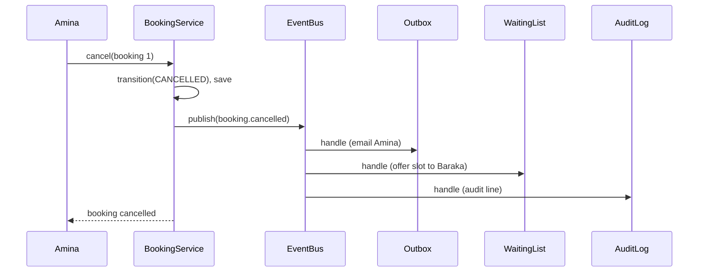

# SD-12 Behavioral Design Patterns

> [!info] Topic card
> **Unit:** U5 · **Time:** 5 h · **Code:**
> - in LabBook: `rules.py` (Strategy), `events.py` (Observer), `domain.ALLOWED` (a table-driven state machine);
> - in `code/patterns/behavioral.py`: `WaitingList` (Observer, case-study exercise 1), `BookCommand` + `CommandHistory` (Command with undo), `RepairTicket` (State pattern, class per state);
> - tests in `tests/test_patterns_behavioral.py`. All SD tests pass, and mypy reports no issues.

## 1. Learning objectives
1. **Describe** the intent, structure and consequences of Strategy, Observer, State, Command, Template Method, Chain of Responsibility and Iterator.
2. **Implement** them in Python, using functions and protocols where simpler.
3. **Choose** between a table-driven state machine and the State pattern.
4. **Decide when NOT to use** each pattern.
5. **Trace** behaviour through event-driven code, and handle its failure modes.

## 2. Why it matters
Behavioural patterns organise **who decides what and when**. They let LabBook add rules without touching the service (Strategy), add reactions to bookings without touching booking code (Observer), and make illegal state changes impossible (State). They also bring classic pitfalls: invisible control flow, event storms, and class explosions.

## 3. Prerequisites
[[SD-10 SOLID Principles]] · [[SD-11 Creational and Structural Design Patterns]] · [[SD-08 UML Sequence, Activity and State Diagrams]] · [[PY-18 Iterators, Generators, Decorators and Context Managers]] (the Iterator pattern is built into Python).

## 4. Intuition
- **Strategy:** swap the *algorithm* (rule) like changing a drill bit.
- **Observer:** a newsletter. The publisher doesn't know who reads it.
- **State:** the object behaves differently depending on its mood (state); each mood is a separate object.
- **Command:** turn a request into an object you can queue, log or undo.
- **Template Method:** a fixed recipe with steps that subclasses fill in.
- **Chain of Responsibility:** pass a request along a line of handlers until one deals with it.

## 5. Rigorous explanation

### 5.1 The patterns
| Pattern | Intent | LabBook / example | Consequences |
|---|---|---|---|
| **Strategy** | Define a family of interchangeable algorithms behind one interface | `BookingRule` with `NoOverlap`, `WeeklyQuota`, … | + OCP, testable in isolation; − clients must choose and configure the strategies |
| **Observer** (publish/subscribe) | When one object changes, notify its dependants without coupling to them | `EventBus` with `Outbox`, `AuditLog`, `WaitingList`, `SmsNotificationAdapter` | + loose coupling, extensibility; − hidden control flow, ordering and failure handling |
| **State** | Let an object change behaviour when its internal state changes, through one state object per state | `RepairTicket` with `Open`, `Assigned`, `InProgress`, `Resolved` | + per-state logic localised; − many small classes |
| **Command** | Encapsulate a request as an object | `BookCommand` + `CommandHistory` (undo) | + undo/redo, queues, audit, macros; − more objects |
| **Template Method** | A base algorithm with overridable steps | A `Report` base with `header()`, `rows()`, `footer()` | + reuse of the skeleton; − inheritance coupling; strategies are often better |
| **Chain of Responsibility** | Pass a request along handlers until one handles it | Approval routing: technician → lab manager → head of department | + flexible routing; − requests may go unhandled; harder to debug |
| **Iterator** | Access elements sequentially without exposing the representation | Python's `for`, generators (`yield`) | Built into the language |

### 5.2 State pattern vs transition table
LabBook's `Booking` uses a **transition table** (`ALLOWED`) plus one `transition()` method. That's ideal when states differ only in **which transitions are allowed**. `RepairTicket` uses the **State pattern**, which pays off when states differ in **behaviour and data rules**: assigning while `Assigned` updates the technician, while assigning when `InProgress` is forbidden; resolving requires a non-empty note. With 6 states and simple rules, a table is clearer. With 4 states, each with distinct logic, classes are clearer.

### 5.3 Observer in practice: the hard parts
- **Failure isolation:** one failing subscriber mustn't break the publisher or other subscribers. `EventBus.publish` catches exceptions per handler and records them (`test_failing_subscriber_does_not_break_booking`).
- **Ordering:** don't let correctness depend on subscriber order.
- **Synchronous vs asynchronous delivery:** in-process synchronous delivery is simple, but slow subscribers slow the request. Durable asynchronous delivery (an outbox table plus a worker, or a message broker) survives crashes.
- **Event storms and loops:** a subscriber that publishes events can trigger cascades. Keep events facts ("booking.cancelled"), not commands.
- **Traceability:** log each publication and handler outcome, otherwise "why did this email go out?" is hard to answer.

### 5.4 When NOT to use each pattern
| Pattern | Avoid when… |
|---|---|
| Strategy | There's only one algorithm, and no realistic second one. Or a plain function parameter would do (in Python, a strategy can just *be* a function) |
| Observer | The reaction is an essential part of the operation (it must succeed or the whole thing fails). Call it directly, inside the transaction. Observer suits *side effects* |
| State | Few states, differing only in allowed transitions: use a table |
| Command | No undo, queuing or audit need. A method call is enough |
| Template Method | Variation is better expressed by composition (pass in strategies) |
| Chain of Responsibility | The handler is always known; just call it |

## 6. Terminology
| Term | Meaning |
|---|---|
| Context | The object that uses a strategy or state (BookingService, RepairTicket) |
| Subject / publisher | The source of notifications (EventBus) |
| Observer / subscriber | A receiver of notifications (Outbox, WaitingList) |
| Invoker / receiver | Runs commands (CommandHistory) / does the work (BookingService) |
| Hook method | An overridable step in a Template Method |
| Outbox pattern | Store events in the database in the same transaction, deliver them later |

## 7. Step-by-step: adding the waiting list without touching booking code
1. **Identify the trigger:** a cancellation, which is already published as `booking.cancelled`.
2. **Write the observer:** `WaitingList.__call__(event)` looks up the booking, finds the queue for (workstation, slot), and offers the slot to the first user.
3. **Subscribe it** in the composition root: `bus.subscribe("booking.cancelled", wl)`.
4. **Test it** end to end:
   - Baraka is refused (overlap) and joins the queue at position 1, Dr Mushi at position 2;
   - Amina cancels, so the offer goes to Baraka;
   - Baraka books successfully.
5. **Changes:** `service.py`: none. `events.py`: none. This is OCP in action (`test_waiting_list_observer`).

## 8. Diagram: Observer flow for cancellation


## 9. Worked examples

### Example 1 (basic): Strategy as plain functions
In Python, a strategy can just be a function:
```python
from labbook.errors import RuleViolation


def no_bookings_before_8(booking, user, ws, existing):
    if booking.slot.start.hour < 8:
        raise RuleViolation("early", "bookings start at 08:00 in exam weeks")


class FunctionRule:
    """Adapter so a plain function can sit in a RuleSet next to rule objects."""

    def __init__(self, fn):
        self.fn, self.name = fn, fn.__name__

    def check(self, *args):
        self.fn(*args)
```
LabBook uses classes for rules because some carry configuration (`WeeklyQuota(max_hours=…)`) and a `name`. A closure, `functools.partial`, or this small adapter would work too.

### Example 2 (intermediate): Command with undo (tested)
`CommandHistory().run(BookCommand(svc, "u-amina", "LAB1-01", SLOT))` books the slot. `undo_last()` cancels it (the booking becomes CANCELLED). A failing command (an out-of-service workstation) raises before anything is recorded, so it's never undone by mistake. Undoing with an empty history raises `LabBookError("nothing to undo")`. The undo here is a **compensating action** (cancel), not a deletion, so the audit trail stays intact, which matters for NFR-01.

### Example 3 (challenging): the State pattern (tested)
`RepairTicket` for a broken workstation:
- `start()` while Open raises `InvalidTransition`;
- `assign("u-juma")` then `assign("u-neema")` is allowed (reassignment before work starts);
- `start()`, then `assign` is refused;
- `resolve("   ")` is refused (a note is required);
- `resolve("Replaced faulty PSU")` moves it to Resolved, after which `resolve` is refused.

Each rule lives in the class of the state it belongs to. Adding a state "WaitingForParts" means one new class and changes to the two states that lead into it. Compare `Booking`, where a new state means one new line in `ALLOWED`.

## 10. Application: patterns for the hostel system
- **Strategy:** the technician-assignment policy (round-robin, least-loaded, by specialisation).
- **Observer:** notifications, plus SLA timers that react to status changes.
- **State or table:** the request lifecycle (SD-08 §10). Use a table unless states carry distinct behaviour.
- **Command:** the warden's bulk actions with undo (reassign 20 requests, then undo).

## 11. Common mistakes
| Mistake | Fix |
|---|---|
| Essential steps done in observers | Keep core consistency in the operation; observers handle side effects |
| Subscribers that throw and break the publisher | Isolate the failures (as `EventBus` does) and log them |
| A State pattern for a simple lifecycle | Use a transition table |
| Strategy classes with no state | Plain functions are fine in Python |
| Undo implemented as deletion | Compensating actions, to preserve the audit trail |
| Events named as commands ("send.email") | Name them as facts ("booking.confirmed") |

## 12. Comparison: Strategy vs State vs Template Method
| | Strategy | State | Template Method |
|---|---|---|---|
| What varies | An algorithm, chosen by the client | Behaviour, chosen by the object's current state | Steps of a fixed algorithm |
| Who switches | The client or configuration | The state objects themselves | Fixed by the subclass |
| Mechanism | Composition | Composition | Inheritance |
| LabBook | Rules | RepairTicket | (practice 6) |

## 13. Practice
**L1** 1. What's the intent of Observer? 2. Which pattern lets you queue and undo requests?

**L2** 3. Give one reason to use a transition table instead of the State pattern. 4. In LabBook, which classes are the "context" for Strategy and for Observer?

**L3** 5. Extend `WaitingList` so that offers expire after 15 minutes (inject a clock), with tests. 6. Write a Template Method `Report` with CSV and plain-text subclasses, then rewrite it with composition (a formatter strategy). Which do you prefer, and why?

**L4** 7. Design a Chain of Responsibility for reservation approval (auto-approve under 2 h → lab manager under 8 h → head of department otherwise), with tests. 8. The audit subscriber must *never* miss an event, even if the process crashes. Explain why `EventBus` can't guarantee this, and design an outbox solution.

**L5** 9. Write a "pattern decision record" for LabBook: for each of the 7 patterns in this lesson, either where it's used and why, or why it isn't used. Cite code locations.

## 14. Hints
> [!tip]- Hints
> 3: states differ only in allowed transitions. 5: store `(user, ws, slot, offered_at)`; `expired = clock() - offered_at > 15 min`. 7: each handler either approves or passes to the next. 8: write the event to a table in the same database transaction as the booking; a worker delivers it and marks it sent.

## 15. Worked solutions
> [!success]- Solutions 1–2
> 1. To notify dependent objects automatically when a subject changes, without the subject knowing their concrete types. 2. Command.

> [!success]- Solution 3
> When states differ only in which transitions are allowed (not in behaviour), a table is shorter, shows the whole lifecycle in one place, and is easy to test exhaustively (iterate over `ALLOWED`).

> [!success]- Solution 4
> Strategy: `BookingService` uses a `BookingRule` (often the `RuleSet` composite), and `RuleSet` itself uses its child rules. Observer: the subject is `EventBus` (the service publishes through it); the observers are `Outbox`, `AuditLog`, and the added `WaitingList` and `SmsNotificationAdapter`.

> [!success]- Solution 7
> ```python
> class Approver:
>     def __init__(self, next_=None):
>         self.next = next_
>
>     def handle(self, hours):
>         return self.next.handle(hours) if self.next else "rejected: no approver"
>
>
> class AutoApprove(Approver):
>     def handle(self, hours):
>         return "auto-approved" if hours < 2 else super().handle(hours)
>
>
> class LabManager(Approver):
>     def handle(self, hours):
>         return "lab manager" if hours < 8 else super().handle(hours)
>
>
> class HeadOfDepartment(Approver):
>     def handle(self, hours):
>         return "head of department"
>
>
> chain = AutoApprove(LabManager(HeadOfDepartment()))
> assert [chain.handle(h) for h in (1, 5, 20)] == ["auto-approved", "lab manager", "head of department"]
> ```
> Also test that a chain without the final handler returns "rejected: no approver" for 20 h. That's the classic "unhandled request" risk.

> [!success]- Solution 8
> `EventBus` is in-memory and synchronous. If the process crashes after the booking is saved but before `publish` runs (or while handlers are running), the event is lost. Saving and publishing aren't atomic. **Outbox:**
> 1. In the **same database transaction** as the booking insert or update, insert a row into `outbox(event_id, name, payload, created_at, delivered_at NULL)`.
> 2. A background worker polls for undelivered rows, calls the subscribers (or a broker), and sets `delivered_at`.
> 3. Delivery is at least once, so subscribers must be **idempotent** (e.g. the audit log ignores duplicate `event_id`s).
>
> Now a committed booking always has its event.

> [!success]- Solution 9 (format)
> | Pattern | Used? | Where / why not |
> |---|---|---|
> | Strategy | Yes | `labbook/rules.py`: rules vary per institution |
> | Observer | Yes | `labbook/events.py`; `patterns/behavioral.WaitingList` |
> | State | Table instead | `domain.ALLOWED`: states differ only in transitions; State pattern shown in `RepairTicket` |
> | Command | Optional | `patterns/behavioral.BookCommand`: only needed if undo is required in the UI |
> | Template Method | No | Reports aren't built yet; prefer formatter strategies |
> | Chain of Responsibility | Planned | For reservation approval (practice 7) |
> | Iterator | Implicit | Python lists and generators; nothing custom needed |

## 16. Self-test (pass ≥ 4/5)
1. Which pattern does `RuleSet` *use* (besides being a Composite)? 2. What should happen when one observer fails? 3. When does the State pattern beat a table? 4. Why implement undo as a compensating action? 5. Name the risk of Chain of Responsibility.
> [!success]- Answers
> 1. Strategy: it calls each rule's `check`. 2. Isolate the failure: the others still run and the publisher succeeds; record the error. 3. When states have distinct behaviour or data rules, not just allowed transitions. 4. To keep the audit history (nothing is deleted) and to follow the domain's legal transitions. 5. A request may reach the end of the chain unhandled.

## 17. Flashcards
#flashcards/software-design
Strategy?::Interchangeable algorithms behind one interface, chosen by the client (LabBook rules).
Observer?::Subscribers are notified of a subject's events without coupling (LabBook EventBus).
State pattern?::One object per state; behaviour is delegated to the current state object.
Command?::A request as an object, which enables queues, logging and undo.
When not to use Observer?::When the reaction is essential to the operation's success; call it directly.
Outbox pattern?::Write events in the same transaction as the data change; deliver them later, at least once.

## 18. Blank-page recall
Draw the cancellation Observer sequence and the RepairTicket state diagram from memory.

## 19. Revision summary
- Strategy (vary algorithms), Observer (decouple reactions), State (behaviour per state), Command (requests as objects, undo), Template Method (fixed skeleton), Chain of Responsibility (pass along), Iterator (built into Python).
- LabBook uses Strategy and Observer centrally, and a transition table for its state.
- Observers are for side effects; isolate their failures. Use an outbox when delivery must survive crashes.
- Choose the simplest construct that solves the problem.

## 20. Links
Prev: [[SD-11 Creational and Structural Design Patterns]] · Next: [[SD-13 Implementation, Code Organization and Version Control]] · Related: [[SD-08 UML Sequence, Activity and State Diagrams]], [[SD-17 Secure and Reliable Software Design]], [[PY-18 Iterators, Generators, Decorators and Context Managers]]

## 21. Sources
- Gamma, E., Helm, R., Johnson, R. & Vlissides, J., *Design Patterns*, Addison-Wesley, 1994 (the behavioural patterns chapter).
- Richardson, C., *Microservices Patterns*, Manning, 2018 (transactional outbox).
- Python docs, iterator protocol and generators: https://docs.python.org/3/library/stdtypes.html#iterator-types
- *(Not checked online during the build, because there was no network access.)*

## 22. Mastery checklist
- [ ] I can implement Strategy, Observer, State and Command in Python with tests
- [ ] I can choose between a State pattern and a transition table
- [ ] I can explain observer failure modes and the outbox solution
- [ ] Reviews scheduled
