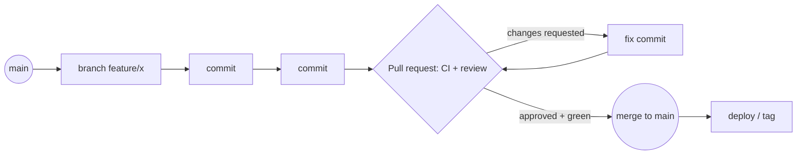

# SD-13 Implementation, Code Organization and Version Control

> [!info] Topic card
> **Unit:** U6 · **Time:** 4 h · **Real outputs:** the merge-conflict session in §9 was run with Git 2.43.0 in a throwaway repository during the build. Commit hashes are replaced by `<hash>`, because they differ on every run. · **Case:** the LabBook code layout in `07 - Software Design and Development/code/`

## 1. Learning objectives
1. **Organise** a Python project into packages, with a clear layout for source, tests, configuration and documentation.
2. **Apply** coding standards (PEP 8, naming, docstrings, type hints) and automated checks (linters, formatters, type checkers).
3. **Use** Git confidently: commits, branches, merges, conflict resolution, remotes, tags.
4. **Choose** a branching strategy (trunk-based, GitHub Flow, Git Flow), and **write** good commit messages.
5. **Run** a pull-request workflow with CI and code review.

## 2. Why it matters
Design only becomes value once it's implemented, and implementation happens in teams, over months, with mistakes. Version control is the safety net (undo anything), the collaboration tool (parallel work), and the history (why was this changed?). Good organisation and standards make code readable by others, including you, six months from now.

## 3. Prerequisites
[[PY-13 Modules, Packages, Imports and Virtual Environments]] · [[PY-19 Type Hints, Documentation, Clean Code and Refactoring]] · [[SD-06 Modular Design, Cohesion and Coupling]].

## 4. Intuition
Git is a **time machine with parallel universes**. Every commit is a saved moment. A branch is a parallel timeline where you can experiment safely. A merge brings timelines back together, and a conflict is Git asking: "these two timelines changed the same line differently; which reality do you want?"

## 5. Rigorous explanation

### 5.1 Project layout
LabBook's layout, which is typical for a small Python project:
```text
code/
├── labbook/            # the application package (domain, rules, service, adapters)
│   ├── __init__.py
│   ├── __main__.py     # enables: python -m labbook
│   └── ...
├── patterns/           # teaching extensions
├── clinic/             # deliberately flawed examples
├── tests/              # pytest tests mirroring the package
├── sd_tools.py         # small analysis helpers
└── pytest.ini          # test configuration (pythonpath, testpaths)
```
For a distributable project, add `pyproject.toml` (metadata, dependencies, tool configuration), `README.md`, `LICENSE`, `.gitignore`, `CHANGELOG.md`, and often a `src/` layout. A `src/` layout prevents accidentally importing the uninstalled working copy ([[PY-25 Performance, Packaging and Project Organization]]).

### 5.2 Coding standards and automation
- **Style:** PEP 8 (naming: `snake_case` functions, `PascalCase` classes, `UPPER_CASE` constants; line length; imports grouped stdlib → third-party → local).
- **Docstrings** (PEP 257) explain *why* and *what*, not a line-by-line *how*.
- **Type hints**, checked with **mypy**. LabBook passes `mypy labbook patterns` with no issues.
- **Linters and formatters:** e.g. ruff or flake8 (lint), black or ruff format (formatting). They weren't installed in the build environment, so no output is shown; run them locally.
- Automate these in **pre-commit hooks** and **CI**, so that style debates disappear and reviewers focus on design.

### 5.3 Git essentials
| Command | Purpose |
|---|---|
| `git init`, `git clone URL` | Create or copy a repository |
| `git status`, `git diff`, `git log --oneline --graph` | Inspect |
| `git add -p`, `git commit -m "..."` | Stage selected changes; record a snapshot |
| `git switch -c feature/x`, `git switch main` | Create or switch branches |
| `git merge feature/x`, `git rebase main` | Combine histories (merge keeps the history; rebase rewrites it, so don't rebase shared branches) |
| `git pull`, `git push -u origin feature/x` | Sync with a remote |
| `git revert <hash>` | Undo a commit safely by adding an inverse commit |
| `git restore file`, `git reset` | Discard or unstage local changes (careful) |
| `git tag v1.0.0` | Mark releases |
| `git stash` | Shelve uncommitted work temporarily |

**Never commit secrets.** If one leaks, rotate it ([[CS-12 Secure Software Development and Database Security]]). Use `.gitignore` for build outputs, virtual environments, databases and caches (this vault ignores `__pycache__/`, `.pytest_cache/`, `.mypy_cache/`, `.venv/`, `*.db`).

### 5.4 Commit messages
- A short imperative summary (around 50 characters): "Lower weekly quota to 6 hours".
- A blank line, then the body: *why*, context, links to issues.
- One logical change per commit, so history is readable and `git revert` and `git bisect` are useful.

### 5.5 Branching strategies
| Strategy | How | Suits |
|---|---|---|
| **Trunk-based** | Everyone integrates into `main` at least daily; short-lived branches; feature flags | Mature CI, continuous delivery |
| **GitHub Flow** | Feature branch → pull request → review + CI → merge to `main` → deploy | Most teams, student projects |
| **Git Flow** | `develop`, `release/*`, `hotfix/*` and `main` branches | Scheduled versioned releases; heavier |

### 5.6 Pull requests and CI
A pull request bundles a branch's changes for **review** and **automated checks** (tests, type checks, linters, security scans). Protect `main`: require CI to pass and at least one approval before merging. That's how the LabBook tests keep the design rules (dependency direction, traceability) enforced as the team grows.

## 6. Terminology
| Term | Meaning |
|---|---|
| Commit | A snapshot of tracked files, with a message, author and parent(s) |
| Branch | A movable pointer to a line of commits |
| HEAD | Your current position (branch or commit) |
| Merge commit | A commit with two parents, combining histories |
| Conflict | Both sides changed the same region; it needs a human decision |
| Rebase | Replaying commits onto a new base (rewrites history) |
| Remote | A shared copy of the repository (origin) |
| Pull request (PR) | A request to merge a branch, with review and CI |
| Semantic versioning | MAJOR.MINOR.PATCH: breaking change, feature, fix |

## 7. Step-by-step: a feature, start to finish (GitHub Flow)
1. `git switch -c feature/sunday-rule`
2. Write the test first (`test_sunday_closed`), see it fail, implement `SundayClosed`, and see it pass ([[SD-14 Software Testing, Verification and Validation]]).
3. `python -m pytest -q && python -m mypy labbook`
4. `git add -p`, then `git commit -m "Add SundayClosed booking rule"`
5. `git push -u origin feature/sunday-rule`, then open a PR describing what, why and how it was tested.
6. CI runs; a reviewer comments; you push fixes.
7. Merge when approved and green. Delete the branch, and tag a release if needed.

## 8. Diagram: GitHub Flow


## 9. Worked examples

### Example 1 (basic): what to commit
| File | Commit? |
|---|---|
| `labbook/rules.py` | Yes |
| `tests/test_labbook.py` | Yes |
| `__pycache__/`, `.pytest_cache/`, `.mypy_cache/` | No (generated) |
| `labbook.db` | No (data). Commit the schema/migrations instead |
| `.env` containing a database password | **Never.** Commit a `.env.example` with placeholder names only |
| `pyproject.toml` / `requirements.txt` | Yes (pin dependency versions) |

### Example 2 (intermediate): a real merge conflict, resolved
Session from the build (Git 2.43.0). `main` set the quota to 8; the branch `feature/quota-6h` set it to 6:
```text
$ git merge feature/quota-6h
Auto-merging settings.py
CONFLICT (content): Merge conflict in settings.py
Automatic merge failed; fix conflicts and then commit the result.

$ cat settings.py
<<<<<<< HEAD
MAX_HOURS = 8
=======
MAX_HOURS = 6
>>>>>>> feature/quota-6h
OPENS = 7

$ git status --short
UU settings.py
```
**Resolution:** this is a *business* decision, not a technical one, so ask. The head of department confirmed 6 h. Edit the file, remove the markers, add a comment, then:
```text
$ git add settings.py
$ git commit -m "Merge feature/quota-6h: resolve quota conflict (6 h agreed)"
$ git log --oneline --graph --all
*   <hash> Merge feature/quota-6h: resolve quota conflict (6 h agreed)
|\
| * <hash> Lower weekly quota to 6 hours
* | <hash> Set quota to 8 hours for semester 2
|/
* <hash> Add booking settings
```
**Lesson:** conflicts often reveal *requirements* conflicts. The commit message records the decision and who made it.

### Example 3 (challenging): undoing safely
A commit `a1b2c3d` merged into `main` broke production.
- **Wrong:** `git reset --hard HEAD~1` and force-push. That rewrites shared history and breaks teammates' clones.
- **Right:** `git revert a1b2c3d` creates a new commit that undoes it. Push, and deploy the revert.

For a merge commit, use `git revert -m 1 <merge-hash>` (keep the first parent, which is main's side). Then fix the bug on a branch and re-merge it. Use `git bisect` to find which commit introduced a regression when you don't know: Git binary-searches the history while you mark commits good or bad (an O(log n) search, [[PY-12 Searching, Sorting and Complexity]]).

## 10. Application: your FYP repository
- One repository, with a README (setup and run instructions), `.gitignore`, tests and CI.
- GitHub Flow, with small PRs reviewed by a teammate or yourself (a checklist).
- Tags for milestones: `v0.1-proposal-demo`, `v0.5-midterm`, `v1.0-final`.
- Commit history is evidence of your process for the supervisor. Commit regularly, with meaningful messages.

## 11. Common mistakes
| Mistake | Fix |
|---|---|
| Huge commits ("final changes") | Small, logical commits with clear messages |
| Committing secrets, databases or caches | `.gitignore`; secret scanning; rotate leaked secrets |
| Long-lived branches that drift | Integrate often; keep branches short |
| Force-pushing shared branches | Revert instead; rebase only private work |
| Resolving conflicts by blindly taking "ours" | Understand both changes; ask when it's a business decision |
| No CI, so the tests rot | Run tests and type checks on every PR |
| Inconsistent style debates in review | Formatters and linters in pre-commit and CI |

## 12. Comparison: merge vs rebase
| | Merge | Rebase |
|---|---|---|
| History | Preserves the true history, with merge commits | Linear, rewritten history |
| Safety on shared branches | Safe | Unsafe (changes commit IDs) |
| Conflict handling | Once, at the merge | Possibly once per replayed commit |
| Use | Integrating shared branches | Tidying your private branch before a PR |

## 13. Practice
**L1** 1. What does `git status --short` show as `UU`? 2. Name the three parts of a semantic version.

**L2** 3. Write a good commit message for adding the waiting-list feature. 4. List 6 entries for a Python project's `.gitignore`.

**L3** 5. Recreate the merge conflict from Example 2 yourself, and resolve it. 6. Compare GitHub Flow and Git Flow for a 4-person FYP team.

**L4** 7. A teammate force-pushed `main` and your work disappeared from it. Explain how to recover using `git reflog`, and how to prevent this in future. 8. Design a CI pipeline for the LabBook code: the steps, the commands, and what blocks a merge.

**L5** 9. Set up a real repository for one of your projects with branch protection, a PR template, CI running pytest and mypy, and a pre-commit hook. Document it in the README.

## 14. Hints
> [!tip]- Hints
> 1: unmerged; both sides modified. 3: imperative summary plus a body explaining why. 7: reflog records where your branch pointed locally; then protect the branch on the server. 8: install dependencies → pytest → mypy → (lint) → status check.

## 15. Worked solutions
> [!success]- Solutions 1–2
> 1. An unmerged path where both sides modified the file (a conflict to resolve). 2. MAJOR.MINOR.PATCH: an incompatible change, a backwards-compatible feature, a backwards-compatible fix.

> [!success]- Solution 3
> ```text
> Add waiting list for fully booked slots
>
> Users refused with a no-overlap violation can join a FIFO queue for that
> workstation and slot. On booking.cancelled the first user receives an
> offer. Implemented as an EventBus subscriber, so BookingService is unchanged.
>
> Refs: FR-13, case-study exercise 1. Tests: test_waiting_list_observer.
> ```

> [!success]- Solution 4
> `__pycache__/`, `*.pyc`, `.venv/`, `.pytest_cache/`, `.mypy_cache/`, `*.db`, `.env`, `dist/`, `build/`, `.DS_Store` (any six).

> [!success]- Solution 6
> **GitHub Flow:** one long-lived branch (`main`), short feature branches, PRs, deploy from main. It's simple, and it fits a small team demoing continuously. **Git Flow:** extra `develop`, `release` and `hotfix` branches. It suits scheduled releases with parallel maintenance, which is overhead a 4-person, one-semester team rarely needs. **Recommendation:** GitHub Flow, plus tags for milestone releases.

> [!success]- Solution 7
> On *your* machine, `git reflog` lists where `HEAD` and the branches pointed recently, including your lost commits. Find the hash (e.g. `HEAD@{3}`), then `git branch rescue <hash>`, and merge or cherry-pick your commits back onto the current `main` through a normal PR. **Prevention:** branch protection on the server (no force pushes to `main`, PRs required), plus team agreement to use `--force-with-lease` only on personal branches.

> [!success]- Solution 8
> On every push and PR:
> 1. Check out the code; set up Python 3.10, 3.12 and 3.13 (a matrix).
> 2. `pip install pytest mypy` (pinned versions).
> 3. `python -m pytest -q`: it must pass, including the dependency-rule and traceability tests.
> 4. `python -m mypy labbook patterns`: it must report no issues.
> 5. Lint/format check (ruff), if adopted.
> 6. Optionally, a secret scan.
>
> Branch protection requires these checks plus one approving review before merging to `main`.

> [!success]- Solution 9 (guidance)
> Evidence to include in the README: a branch protection screenshot, a link to a green CI run, the PR template's checklist (tests added, docs updated, no secrets), and the pre-commit configuration.

## 16. Self-test (pass ≥ 4/5)
1. Command to undo a pushed commit safely? 2. When is rebase dangerous? 3. What should a commit message body explain? 4. Which strategy integrates into main at least daily? 5. What do the conflict markers `<<<<<<<` / `=======` / `>>>>>>>` delimit?
> [!success]- Answers
> 1. `git revert <hash>`. 2. On branches others have already pulled, because rewritten history breaks their copies. 3. Why the change was made (context, decision, references). 4. Trunk-based development. 5. Your side (HEAD), then the separator, then the incoming side.

## 17. Flashcards
#flashcards/software-design
Undo a shared commit?::git revert <hash> (never force-push shared history).
Merge vs rebase?::Merge preserves history; rebase rewrites it into a linear sequence (private branches only).
GitHub Flow?::Feature branch → PR (CI + review) → merge to main → deploy.
Good commit message?::An imperative summary, a blank line, then why and context.
Never commit?::Secrets, generated caches, local databases, virtual environments.
git bisect?::Binary search through history to find the commit that introduced a bug.

## 18. Blank-page recall
Write the GitHub Flow steps, and resolve Example 2's conflict from memory.

## 19. Revision summary
- Organise code into cohesive packages with tests and configuration; automate style and type checks.
- Git: commit small and often, branch for features, merge via reviewed PRs with CI, revert rather than rewrite shared history.
- Conflicts can reveal requirement conflicts: resolve them deliberately and record the decision.
- Never commit secrets or generated files.

## 20. Links
Prev: [[SD-12 Behavioral Design Patterns]] · Next: [[SD-14 Software Testing, Verification and Validation]] · Related: [[PY-13 Modules, Packages, Imports and Virtual Environments]], [[PY-25 Performance, Packaging and Project Organization]], [[CS-12 Secure Software Development and Database Security]]

## 21. Sources
- Chacon, S. & Straub, B., *Pro Git*, 2nd ed., Apress, 2014: https://git-scm.com/book
- PEP 8, *Style Guide for Python Code*; PEP 257, *Docstring Conventions*: https://peps.python.org/
- GitHub Docs, "GitHub flow": https://docs.github.com/en/get-started/using-github/github-flow
- Driessen, V., "A successful Git branching model", 2010 (Git Flow), nvie.com.
- Semantic Versioning 2.0.0: https://semver.org/
- *(Not checked online during the build, because there was no network access.)*

## 22. Mastery checklist
- [ ] I can organise a Python project and automate its checks
- [ ] I can branch, merge, resolve conflicts and revert safely
- [ ] I write clear commit messages and use PRs with CI
- [ ] Reviews scheduled
