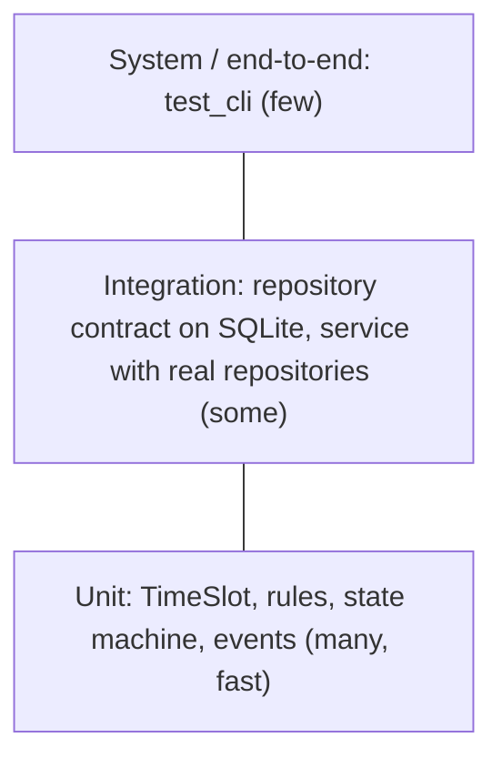

# SD-14 Software Testing, Verification and Validation

> [!info] Topic card
> **Unit:** U6 · **Time:** 5 h · **Code:**
> - LabBook tests: unit, contract (parametrised over two repositories), use-case, CLI, architecture (dependency rules) and traceability tests. **41 tests passed when this lesson was written, plus 1 expected failure (`xfail`) documenting the concurrency defect.** That defect was fixed in [[SD-17 Secure and Reliable Software Design]]; the suite now has 47 passing tests, and the xfail marker has been removed.
> - `code/line_coverage.py`, a minimal statement-coverage tool written because `coverage.py` wasn't installed in the build environment. Its numbers approximate coverage.py, so use the real tool in your projects.

## 1. Learning objectives
1. **Distinguish** verification from validation, static from dynamic testing, and the test levels (unit, integration, system, acceptance).
2. **Design** black-box tests with equivalence partitioning, boundary value analysis, decision tables and state-transition testing.
3. **Design** white-box tests, and **interpret** statement and branch coverage, including their limits.
4. **Use** test doubles (stubs, fakes, mocks) and contract tests appropriately.
5. **Write** a test plan, and **explain** regression testing, CI and the test pyramid.

## 2. Why it matters
Testing is how a team gains justified confidence that software does what it should, and keeps doing it after every change. It can show the presence of bugs, never their absence (Dijkstra), so *which* tests you write matters more than *how many*. Systematic test design finds the bugs at the boundaries where they actually live.

## 3. Prerequisites
[[PY-20 Testing, Debugging and Test-Driven Development]] (pytest, fixtures, TDD) · [[SD-03 Requirements Engineering]] (acceptance criteria) · [[SD-08 UML Sequence, Activity and State Diagrams]] (state machines).

## 4. Intuition
Testing is **asking the software hard questions**. Testing random inputs is like checking a bridge by driving a bicycle over it. Systematic testing drives the heaviest permitted lorry (the boundary), slightly over the limit (an invalid boundary), and in a storm (an error path).

## 5. Rigorous explanation

### 5.1 V&V and test levels
- **Verification:** does it meet the specification? (Reviews, static analysis, tests against the requirements.)
- **Validation:** does it meet the real need? (Acceptance testing, usability tests, pilots.)
- **Static testing:** reviews, inspections, linters and type checkers (mypy). **Dynamic testing:** executing the code.

| Level | Scope | LabBook example |
|---|---|---|
| Unit | One function or class in isolation | `test_timeslot_validation_and_overlap`, `test_opening_hours` |
| Integration | Components working together | `test_repository_contract[sqlite]` (code plus a real SQLite database) |
| System | The whole system, through its interfaces | `test_cli` (runs the CLI entry point end to end) |
| Acceptance | User or customer criteria | The Given/When/Then criteria from SD-03, run with users |

Also:
- **Regression testing:** re-running tests after changes; CI automates this.
- **Non-functional testing:** performance, load, security, usability.

### 5.2 Black-box techniques
- **Equivalence partitioning (EP):** split inputs into classes that the system should treat the same way, and test one value per class.
- **Boundary value analysis (BVA):** bugs cluster at edges, so test at, just below and just above each boundary.
- **Decision tables:** combinations of conditions mapped to actions; test each rule (column).
- **State-transition testing:** cover the states and transitions (valid and invalid), as in SD-08 §7.

### 5.3 White-box techniques and coverage
- **Statement coverage:** the fraction of executable statements run by the tests.
- **Branch coverage:** the fraction of decision outcomes (true and false) taken. It's stronger than statement coverage.
- **Path coverage:** all paths. Infeasible for loops.
- **Limits:** 100% coverage doesn't prove correctness. It shows which code *ran*, not whether the assertions were right, and missing requirements produce no code to miss. Use coverage to **find untested code**, not as a target to game.
- **Mutation testing** checks test *strength*: introduce small bugs (mutants) and see whether the tests fail.

### 5.4 Test doubles
| Double | What it does | LabBook |
|---|---|---|
| Dummy | A placeholder that's never used | — |
| Stub | Returns canned answers | `AllowAll` rule in `test_service_with_fake_rules_is_easy_to_test` |
| Fake | A working lightweight implementation | `InMemoryBookingRepository`, `Outbox` |
| Spy | Records calls for later assertions | `LoggingRepository` with a log list; `AuditLog` |
| Mock | Pre-programmed expectations, verified automatically | `unittest.mock.Mock` (use sparingly) |

**Contract tests** check that every implementation of an interface behaves the same way. `test_repository_contract` runs against both the in-memory and SQLite repositories. This is what makes fakes trustworthy: if the fake passes the same contract as the real thing, tests that use the fake mean something.

### 5.5 Strategy
- **Test pyramid:** many fast unit tests, fewer integration tests, few end-to-end tests.
- **Test-first or TDD** where requirements are clear.
- Every bug fix gets a regression test that would have caught it.
- Tests should be **independent**, **deterministic** (inject clocks and randomness), **fast**, and **readable** (Arrange–Act–Assert).
- **Test plan** (in the spirit of ISO/IEC/IEEE 29119): scope, features to be tested and not tested, approach, environment, entry and exit criteria, risks, schedule and responsibilities.

## 6. Terminology
| Term | Meaning |
|---|---|
| Test case | Inputs + preconditions + expected result |
| Oracle | The way to decide whether an output is correct |
| Equivalence class | Inputs expected to behave the same way |
| Boundary value | A value at or adjacent to an edge of a class |
| Regression | A previously working feature now broken |
| Flaky test | A test that passes or fails non-deterministically |
| Statement / branch coverage | Statements executed / decision outcomes taken |
| Contract test | A shared test suite every implementation of an interface must pass |

## 7. Step-by-step: BVA for the weekly quota (FR-04)
Rule: student hours in a Monday–Sunday week, with existing hours plus new hours ≤ 10. Taking existing = 8 h:

| Class / boundary | New booking | Total | Expected | Covered by |
|---|---|---|---|---|
| Valid, well inside | 1 h | 9 | Allowed | (add one) |
| **Boundary: exactly at the limit** | 2 h | 10 | Allowed | `test_weekly_quota_students_only` |
| **Just above** | 3 h | 11 | Refused | same test |
| Week boundary: next Monday | 4 h on Mon 9 March | 4 (new week) | Allowed | same test |
| Week boundary: Sunday 23:00 of the same week | 1 h | 9 | Allowed | (Practice 4) |
| Different role (lecturer) | 6 h | 12 | Allowed (the quota doesn't apply) | same test |
| Cancelled bookings | — | excluded | Allowed | (Practice 4) |

Half-hour granularity (e.g. 2.5 h giving 10.5 h) is another boundary worth testing. `TimeSlot.hours` returns floats.

## 8. Diagram: test pyramid for LabBook

*Text version: the base has many unit tests, the middle some integration tests, and the top a few end-to-end tests.*

## 9. Worked examples

### Example 1 (basic): equivalence classes for `TimeSlot`
| Class | Example | Expected |
|---|---|---|
| Valid: 0 < duration ≤ 8 h | 09:00–11:00 | Created |
| Invalid: end ≤ start | 10:00–09:00 | `ValidationError` |
| Boundary: zero duration | 09:00–09:00 | `ValidationError` (end must be *after* start) |
| Boundary: exactly 8 h | 07:00–15:00 | Created |
| Invalid: > 8 h | 07:00–16:00 | `ValidationError` |

The existing test covers end-before-start and 9 hours, but **not** zero duration or exactly 8 hours. Add them (Practice 3). BVA finds gaps even in "tested" code.

### Example 2 (intermediate): coverage found an untested feature (real numbers)
`python line_coverage.py labbook` on the suite **before** this lesson's additions:
```text
file                         stmts   hit  cover  missing lines
labbook/__init__.py              2     2   100%  []
labbook/__main__.py              2     0     0%  [1, 3]
labbook/app.py                  19    19   100%  []
labbook/cli.py                  26    25    96%  [32]
labbook/domain.py               68    68   100%  []
labbook/errors.py               16    16   100%  []
labbook/events.py               35    35   100%  []
labbook/repository.py           71    69    97%  [43, 99]
labbook/rules.py                61    61   100%  []
labbook/service.py              57    56    98%  [73]
TOTAL                          357   351    98%
```
Reading the gaps:
- `service.py:73` is the whole body of `my_bookings`. **A user-facing feature had no test at all**, and it wasn't in the requirements list either (backward traceability, SD-04, would have flagged it).
- `repository.py:43` and `:99` are the error paths of `save`.
- `cli.py:32` and `__main__.py` are the `if __name__ == "__main__"` entry points, which are acceptable to leave uncovered.

Added `test_my_bookings_sorted` (FR-10) and `test_save_unknown_booking_raises` (NFR-06), and updated the traceability matrix. **After:** `repository.py` and `service.py` are both at 100%, and the total is 354/357 = **99%**, with only the entry points missing. Note that 98% *looked* excellent while an entire feature was untested.

### Example 3 (challenging): decision table for cancellation permission
| Rule | R1 | R2 | R3 | R4 |
|---|---|---|---|---|
| Actor is the booker | Y | Y | N | N |
| Actor is a technician | – | – | Y | N |
| Booking is CONFIRMED (not checked in) | Y | N | Y | Y |
| **Action** | Cancel | `InvalidTransition` | Cancel | `PermissionDenied` |

The existing tests cover R3 (the technician cancels) and R4 (Baraka is refused) in `test_cancel_permissions`. R1 is covered in `test_waiting_list_observer`. **R2** (the booker cancels after checking in) isn't covered by any test. Add it:
```python
def test_cannot_cancel_after_check_in():
    svc, _, _ = create_app()
    b = svc.book("u-amina", "LAB1-01", slot(2, 9, 10))
    svc.check_in("u-amina", b.booking_id)
    with pytest.raises(InvalidTransition):
        svc.cancel("u-amina", b.booking_id)
```

## 10. Application: a test plan outline for LabBook v1.0
- **Scope:** booking, cancellation, check-in, rules, notifications, storage. **Out of scope:** the web UI (not built), load above 300 users.
- **Approach:**
  - unit tests plus contract tests in CI on every PR;
  - BVA/EP for every rule;
  - state-transition tests for every transition;
  - a decision table for permissions;
  - acceptance sessions with 5 students and 2 technicians.
- **Entry/exit criteria:**
  - all tests green;
  - mypy clean;
  - statement coverage ≥ 90% (as a *signal*, not the goal);
  - no open high-severity defects;
  - all Must requirements traced to passing tests.
- **Risks:** concurrency (the double booking from SD-08) isn't covered by unit tests, so plan a dedicated concurrency test (SD-17).

## 11. Common mistakes
| Mistake | Fix |
|---|---|
| Testing only the happy path | EP/BVA, error paths, decision tables |
| Chasing 100% coverage | Use coverage to find gaps; judge tests by requirements and boundaries |
| Tests depending on each other or on the current time | Independent fixtures; inject clocks |
| Mocking everything | Prefer fakes that pass contract tests; mock only at true boundaries |
| No regression test for a fixed bug | Write the failing test first, then fix |
| Ignoring validation | Acceptance tests with real users |

## 12. Comparison: black-box vs white-box
| | Black-box | White-box |
|---|---|---|
| Based on | Specification (requirements, use cases) | Code structure |
| Techniques | EP, BVA, decision tables, state transitions | Statement, branch and path coverage |
| Finds | Missing or incorrect behaviour against the spec | Untested code paths |
| Misses | Untested internal paths | Missing features (no code to cover) |
| Use | Both, combined |

## 13. Practice
**L1** 1. Define verification and validation. 2. Name the four test levels.

**L2** 3. Add the two missing `TimeSlot` boundary tests from Example 1, and run them. 4. Add the "Sunday 23:00" and "cancelled bookings excluded" quota tests from §7.

**L3** 5. Add the R2 decision-table test from Example 3 to the suite, and update the traceability matrix. 6. Explain why `InMemoryBookingRepository` is a fake and not a mock, and why that makes the service tests trustworthy.

**L4** 7. Write a mutation test by hand: change `<=` to `<` in `WeeklyQuota` (`used + hours > max` → `>=`), and check that a test fails. Which one? 8. Write a test plan for the hostel maintenance system (1 page).

**L5** 9. Write a concurrency test that demonstrates the double-booking race (SD-08 Example 3) using two threads and a shared SQLite file. Then implement the fix (SD-09 Practice 7), and show that the test passes.

## 14. Hints
> [!tip]- Hints
> 3: `slot(2, 9, 9)` raises; `TimeSlot(7:00, 15:00)` succeeds. 4: 8 March 2026 is a Sunday; cancel one booking and check that its hours don't count. 7: the boundary case (exactly 10 h) should fail after the mutation. 9: use `threading.Barrier(2)` to start both bookings together.

## 15. Worked solutions
> [!success]- Solutions 1–2
> 1. Verification: does the product conform to its specification? Validation: does it satisfy the users' real needs? 2. Unit, integration, system, acceptance.

> [!success]- Solution 3
> ```python
> def test_timeslot_boundaries():
>     with pytest.raises(ValidationError):
>         slot(2, 9, 9)                                            # zero duration
>     assert TimeSlot(datetime(2026, 3, 2, 7), datetime(2026, 3, 2, 15)).hours == 8.0   # exactly 8 h
> ```

> [!success]- Solution 4
> ```python
> def test_quota_week_edges_and_cancelled():
>     rule = WeeklyQuota(max_hours=10)
>     existing = [Booking(1, "s", "W1", slot(2, 9, 13), BookingStatus.CONFIRMED),
>                 Booking(2, "s", "W1", slot(3, 9, 13), BookingStatus.CONFIRMED)]          # 8 h
>     sunday_late = Booking(None, "s", "W1", TimeSlot(datetime(2026, 3, 8, 21), datetime(2026, 3, 8, 22)))
>     rule.check(sunday_late, STUDENT, WS, existing)                                     # 9 h, same week
>     existing.append(Booking(3, "s", "W1", slot(4, 9, 11), BookingStatus.CANCELLED))    # does not count
>     rule.check(Booking(None, "s", "W1", slot(5, 9, 11)), STUDENT, WS, existing)        # 10 h total
> ```

> [!success]- Solution 6
> A **fake** is a real, working implementation (it stores and returns bookings), only lighter. A **mock** is scripted to expect particular calls. Because the in-memory repository passes the **same contract test** as the SQLite repository, the service tests that use it exercise genuine repository behaviour (add, get, save, queries). They don't just check that certain methods were called. So a passing service test predicts a passing system with SQLite.

> [!success]- Solution 7
> Mutating `if used + booking.slot.hours > self.max_hours` to `>=` makes exactly 10 h fail. `test_weekly_quota_students_only` fails at its first check (8 + 2 = 10 should be allowed), so the mutant is **killed**. If no test failed, the boundary would be untested.

> [!success]- Solution 9 (approach)
> ```python
> import threading
> from labbook.repository import SqliteBookingRepository
>
> def test_no_double_booking_under_concurrency(tmp_path):
>     path = str(tmp_path / "lb.db")
>     results, barrier = [], threading.Barrier(2)
>
>     def worker(user):
>         svc = create_app("sqlite", path)[0]           # separate connection per thread
>         barrier.wait()
>         try:
>             results.append(svc.book(user, "LAB1-01", slot(2, 9, 10)).status)
>         except RuleViolation:
>             results.append("refused")
>
>     threads = [threading.Thread(target=worker, args=(u,)) for u in ("u-amina", "u-baraka")]
>     [t.start() for t in threads]; [t.join() for t in threads]
>     assert sorted(map(str, results)) == ["BookingStatus.CONFIRMED", "refused"]
> ```
> **Measured during the build:** with the current code, 200 out of 200 runs ended with **both** bookings CONFIRMED, so the race isn't hypothetical. The test was added as `tests/test_sd14_additions.py::test_no_double_booking_under_concurrency`, marked `xfail(strict=True)` with the reason "KNOWN DEFECT". `strict=True` meant that once the repository was fixed (transactional check-and-insert, SD-09 Practice 7), pytest would report the unexpected pass. That's exactly what happened in [[SD-17 Secure and Reliable Software Design]], and the marker was then removed. Documenting a known defect with a failing test is more honest than hiding it.

## 16. Self-test (pass ≥ 4/5)
1. For "10 ≤ x ≤ 20", which values does BVA test? 2. What does statement coverage *not* tell you? 3. Fake vs mock? 4. Which LabBook test is a contract test? 5. Which feature did coverage reveal as untested?
> [!success]- Answers
> 1. 9, 10, 11 and 19, 20, 21 (on, below and above each boundary). 2. Whether the assertions are right, or whether required features exist at all. 3. A fake works (a simplified implementation); a mock checks expected interactions. 4. `test_repository_contract` (parametrised over memory and sqlite). 5. `BookingService.my_bookings` (now FR-10, with a test).

## 17. Flashcards
#flashcards/software-design
Verification vs validation?::Built right (meets the spec) vs right thing (meets the need).
Test levels?::Unit, integration, system, acceptance.
Boundary value analysis?::Test at, just below and just above each boundary.
Statement vs branch coverage?::Statements executed vs decision outcomes (true and false) taken.
Contract test?::One test suite that every implementation of an interface must pass.
Test pyramid?::Many unit tests, fewer integration tests, few end-to-end tests.
Coverage limitation?::It shows which code ran, not correctness or missing features.

## 18. Blank-page recall
Build the BVA table for the quota and the decision table for cancellation from memory.

## 19. Revision summary
- V&V: static and dynamic; unit → integration → system → acceptance; regression testing in CI.
- Black-box: EP, BVA, decision tables, state transitions. White-box: statement and branch coverage. Combine them.
- Coverage finds untested code: LabBook's 98% hid an entirely untested feature.
- Prefer fakes backed by contract tests; keep tests independent, deterministic and fast.
- A test plan states the scope, approach, criteria and risks.

## 20. Links
Prev: [[SD-13 Implementation, Code Organization and Version Control]] · Next: [[SD-15 Refactoring, Technical Debt, Code Review and Quality]] · Related: [[PY-20 Testing, Debugging and Test-Driven Development]], [[X-04 Testing as Software Quality Assurance]], [[SD-04 Use Cases, User Stories and Traceability]]

## 21. Sources
- ISO/IEC/IEEE 29119-1:2022, *Software and systems engineering: Software testing: Part 1: General concepts* (and parts 2–4).
- ISTQB, *Certified Tester Foundation Level Syllabus*, v4.0, 2023.
- Myers, G. J., Sandler, C. & Badgett, T., *The Art of Software Testing*, 3rd ed., Wiley, 2011.
- Meszaros, G., *xUnit Test Patterns*, Addison-Wesley, 2007 (test doubles).
- Dijkstra, E. W., "The humble programmer", *Communications of the ACM*, 15(10), 1972, pp. 859–866 ("testing can show the presence of bugs, never their absence" is paraphrased from his writings of this period).
- coverage.py documentation: https://coverage.readthedocs.io/
- *(Not checked online during the build, because there was no network access.)*

## 22. Mastery checklist
- [ ] I can design EP/BVA, decision-table and state tests
- [ ] I can measure and interpret coverage honestly
- [ ] I can choose the right test doubles and write contract tests
- [ ] I can write a test plan · reviews scheduled
