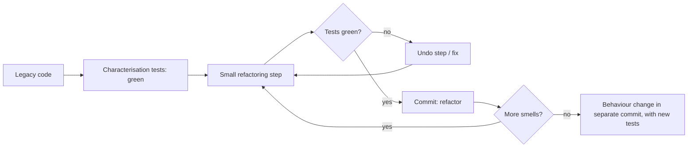

# SD-15 Refactoring, Technical Debt, Code Review and Quality

> [!info] Topic card
> **Unit:** U6 · **Time:** 5 h · **Code:**
> - the flawed god class `clinic/flawed_god_class.py`, whose current behaviour is pinned by characterisation tests in `tests/test_clinic.py`;
> - the refactored design, which is LabBook itself.
>
> **Metrics** (computed with `sd_tools.cyclomatic_complexity`): `LabManager.do_booking` = **14**; the most complex `BookingService` method = **3**; the most complex rule = **6** (`WeeklyQuota.check`).

## 1. Learning objectives
1. **Define** refactoring, and **explain** why it must preserve behaviour and be protected by tests.
2. **Recognise** common code smells, and **apply** catalogue refactorings (Extract Function/Class, Rename, Introduce Parameter Object, Replace Conditional with Polymorphism, and more).
3. **Explain** technical debt with the debt quadrant, and **plan** its repayment.
4. **Conduct** an effective code review using a checklist.
5. **Use** quality metrics (complexity, duplication, coupling, test results) as signals, not targets.

## 2. Why it matters
All code decays as features are added under pressure. Refactoring is the routine maintenance that keeps it changeable. Without it, every feature costs more than the last, until rewriting looks attractive (and rewrites are risky). Code review is the most effective defect-finding activity per hour that many teams have, and it spreads knowledge.

## 3. Prerequisites
[[SD-14 Software Testing, Verification and Validation]] · [[SD-10 SOLID Principles]] · [[PY-19 Type Hints, Documentation, Clean Code and Refactoring]] · [[SD Flawed Design Clinic]].

## 4. Intuition
Refactoring is **cleaning the kitchen while you cook**: small tidy-ups as you go, so the next dish is quick. Technical debt is like a loan. Borrowing (a shortcut) can be smart for a deadline, but you pay interest (slower changes) until you repay it (refactor). Unpaid, the interest compounds.

## 5. Rigorous explanation

### 5.1 Refactoring
"A change made to the internal structure of software to make it easier to understand and cheaper to modify **without changing its observable behaviour**" (Fowler). Rules:
1. Have tests first. For legacy code, write **characterisation tests** that pin down current behaviour, bugs included.
2. Take small steps; run the tests after each one.
3. Separate refactoring commits from behaviour-change commits ("two hats").
4. Refactor when you're about to change code (the "boy scout rule"), and when it's hard to understand.

### 5.2 Code smells and their refactorings
| Smell | Symptom | Refactoring |
|---|---|---|
| Long function | `do_booking` at about 40 lines with 14 paths | Extract Function |
| Large class / god class | `LabManager` does everything | Extract Class (by responsibility) |
| Long parameter list | `do_booking(who, ws, s, e, role, send, fmt)` | Introduce Parameter Object (`TimeSlot`), remove the flags |
| Flag arguments | `send=True`, `fmt="html"` | Split functions; Strategy |
| Primitive obsession | Times as strings, compared as strings | A value object (`TimeSlot` with `overlaps`) |
| Duplicated code | The same datetime parsing repeated | Extract Function |
| Switch on type | `if fmt == "text" … elif fmt == "html"` | Replace Conditional with Polymorphism |
| Magic numbers | `7`, `22`, `10` | Named constants or configured rules |
| Global data | `DB`, `SENT` | Dependency injection |
| Feature envy / message chains | `booking["user"]["contact"]["email"]` | Move Method; Law of Demeter |
| Refused bequest | `OutOfServiceWorkstation.book` raises | Replace Inheritance with Composition or data |
| Comments explaining confusing code | `# string comparison of times` | Rename, or extract with a clear name |

### 5.3 Technical debt
- **Debt** is the extra future cost of a quick-and-dirty solution.
- **Interest** is the extra effort each change costs because of it.
- **Fowler's debt quadrant:**

| | Reckless | Prudent |
|---|---|---|
| **Deliberate** | "We don't have time for design" | "We must ship now and deal with the consequences" (with a repayment plan) |
| **Inadvertent** | "What's layering?" | "Now we know how we should have done it" |

- **Managing debt:**
  - make it visible (backlog items tagged "debt", with the interest described);
  - prioritise by interest (debt in frequently changed code first);
  - budget repayment time (e.g. 15–20% per sprint);
  - prevent new reckless debt through review and a Definition of Done.

### 5.4 Code review
Goals: find defects, improve design, share knowledge, enforce standards. Effective practices:
- small PRs (around 200–400 lines);
- a clear description;
- automated checks first (CI), so humans focus on design;
- a checklist;
- comments on code, not people;
- distinguish blocking issues from suggestions.

**Checklist (LabBook):**
1. Does it meet the requirement, and is it traced (RTM)?
2. Are there tests for the boundaries and error paths?
3. Does the design respect the layers (does the dependency test still pass)?
4. Is the naming clear, and the functions small? Complexity below about 10 per function?
5. Security: input validated, authorisation checked, no secrets, safe SQL?
6. Errors handled with domain exceptions, and logged appropriately?
7. Docs or ADRs updated?

### 5.5 Quality metrics
- Cyclomatic complexity: the number of independent paths. 1–10 is generally manageable; above 20, consider splitting.
- Duplication.
- Coupling and instability (SD-06).
- Test pass rate and coverage (SD-14).
- Defect density.
- Lead time for changes.

**Goodhart's law:** "when a measure becomes a target, it ceases to be a good measure." Use metrics to start conversations, not to rank people.

## 6. Terminology
| Term | Meaning |
|---|---|
| Refactoring | A behaviour-preserving structural change |
| Code smell | A surface symptom suggesting a deeper design problem |
| Characterisation test | A test pinning down existing behaviour before changing legacy code |
| Technical debt | The future cost of expedient choices |
| Boy scout rule | Leave the code a little better than you found it |
| Cyclomatic complexity | The number of linearly independent paths through code |
| Strangler fig | Replacing a legacy system piece by piece behind a stable interface |

## 7. Step-by-step: refactoring the god class (clinic F1) safely
1. **Characterise:** `test_god_class_defects` pins the current behaviour: valid bookings print "OK"; the 22:30 end is accepted; the all-time quota refuses a booking a month later; an apostrophe raises an error.
2. **Extract Function:** move the parsing into `parse_slot(s, e)`, which returns a pair of datetimes. Run the tests: still green.
3. **Introduce a value object:** replace the pair with `TimeSlot`; move the overlap logic into `TimeSlot.overlaps` (this fixes the string comparison). The run, the tests: green, but the *characterised bugs* now need a decision.
4. **Change hats:** fixing the 22:30 bug and the quota period are **behaviour changes**. Agree them with stakeholders, update the characterisation tests into real requirement tests (FR-03, FR-04), then commit separately.
5. **Extract Class per responsibility:** rules → `rules.py` (Strategy); SQL → a repository (parameterised, which fixes the injection); email → an event subscriber; output formatting → the CLI adapter.
6. **Remove globals:** inject the repository and the bus (DIP), with `app.py` assembling them.
7. **Verify:** the LabBook tests pass. Complexity falls from 14 to at most 6 per function, and the dependency test enforces the layers.

## 8. Diagram: refactoring flow


## 9. Worked examples

### Example 1 (basic): Extract Function plus a value object
Before (from the god class):
```python
# not-runnable: a fragment of the god class, for reading only
s2 = datetime.strptime(s, "%Y-%m-%d %H:%M")
e2 = datetime.strptime(e, "%Y-%m-%d %H:%M")
...
if not (e <= r[0] or s >= r[1]):      # compares strings!
```
After:
```python
from datetime import datetime

from labbook.domain import TimeSlot


def parse_slot(start: str, end: str, fmt: str = "%Y-%m-%d %H:%M") -> TimeSlot:
    return TimeSlot(datetime.strptime(start, fmt), datetime.strptime(end, fmt))


a = parse_slot("2026-03-02 09:00", "2026-03-02 11:00")
b = parse_slot("2026-03-02 10:30", "2026-03-02 12:00")
print(a.overlaps(b), a.hours)
```
Output (run during the build): `True 2.0`. The parsing now exists once. Comparisons use real datetimes, with validation (end after start, at most 8 h) built in.

### Example 2 (intermediate): Replace Conditional with Polymorphism
The god class's `fmt` flag (`text` / `html`, with the HTML unescaped!) becomes formatter strategies:
```python
import html


def format_text(b):
    return f"OK {b['who']} {b['ws']} {b['start']}-{b['end']}"


def format_html(b):
    return f"<p>OK {html.escape(b['who'])} {html.escape(b['ws'])}</p>"


FORMATTERS = {"text": format_text, "html": format_html}
print(FORMATTERS["html"]({"who": "<b>x</b>", "ws": "LAB1-01", "start": "09:00", "end": "11:00"}))
```
Output: `<p>OK &lt;b&gt;x&lt;/b&gt; LAB1-01</p>`. Adding a format no longer edits the booking logic (OCP), and the XSS issue (CS-11) is fixed at the same time. In LabBook, formatting lives entirely in the CLI adapter.

### Example 3 (challenging): prioritising technical debt
| Debt item | Interest (how often it hurts) | Cost to fix | Decision |
|---|---|---|---|
| Non-atomic overlap check (the xfail test at the time) | High: data integrity on every busy day | Medium | **Fix next sprint** (a correctness and reliability defect). It was fixed in SD-17 |
| `Directory` in memory rather than in the database | Medium: blocks multi-instance deployment | Medium | Plan for the v1.1 deployment |
| Naive datetimes (no time zone) | Low for a single campus | High | Accept; document as an assumption (ADR) |
| No `BookingReader` interface | Low (no reports yet) | Very low | Do it with the first report (YAGNI) |

Pay down debt where the interest is highest, not where it's most annoying to look at.

## 10. Application: a review comment set
For a PR that adds `ReportService.weekly_usage(lab_id)` with an f-string SQL query and no tests:
- **Blocking:** SQL is built with an f-string (injection risk, CS-12). Use a parameter, or a repository method.
- **Blocking:** there are no tests. Add tests for an empty week, a cancelled booking excluded, and the week boundary.
- **Blocking:** `report.py` imports `sqlite3`, which bypasses the repository (DIP). The dependency test will need a new rule.
- **Suggestion:** rename `x` to `total_hours`.
- **Praise:** good docstring explaining the week definition.

## 11. Common mistakes
| Mistake | Fix |
|---|---|
| "Refactoring" without tests | Characterise first |
| Mixing refactoring with feature changes in one commit | Two hats, two commits |
| Big-bang rewrites | Incremental refactoring; strangler fig |
| Debt that's invisible to the product owner | Backlog items with the interest described |
| Reviews that only check style | Automate style; review design, correctness, security |
| Treating metrics as targets | Use them as signals that prompt investigation |
| Fixing characterised "bugs" silently during refactoring | Agree behaviour changes; update the tests deliberately |

## 12. Comparison: refactor vs rewrite
| | Refactor incrementally | Rewrite from scratch |
|---|---|---|
| Risk | Low per step | High (lost behaviour and knowledge) |
| Delivery during the work | Continues | Often frozen |
| Needs | Tests, discipline | A complete specification (rarely available) |
| Choose when | Almost always | The platform is obsolete *and* the code is untestable *and* there's a strangler path |

## 13. Practice
**L1** 1. Define refactoring. 2. Name five code smells.

**L2** 3. Classify each debt in the quadrant: (a) skipping tests to demo tomorrow, with a ticket to add them; (b) a junior's god class because they didn't know about layering. 4. Compute the cyclomatic complexity of a function with one `if`, one `for` and one `and` condition.

**L3** 5. Refactor `clinic/flawed_coupling.py`'s `ReminderService` step by step, with a test after each step (compare with SD-10 Example 3). 6. Write a review checklist for your FYP team.

**L4** 7. Refactor the god class fully into LabBook-style modules in a new folder, with the characterisation tests turned into requirement tests. Record the complexity before and after. 8. Propose a debt-repayment plan for LabBook for the next 3 sprints, using Example 3.

**L5** 9. Take a past project of yours. Measure it (complexity, duplication, tests), list its smells, prioritise its debt by interest, and refactor the top two items with tests. Write a 1-page report.

## 14. Hints
> [!tip]- Hints
> 3: (a) deliberate/prudent; (b) inadvertent/reckless. 4: 1 + 1 (if) + 1 (for) + 1 (and) = 4. Check it with `cyclomatic_complexity`. 7: start with Extract Function for the parsing, then Extract Class for the rules.

## 15. Worked solutions
> [!success]- Solutions 1–2
> 1. Changing the internal structure of code to improve understandability or modifiability without changing its observable behaviour. 2. Long function, god class, long parameter list, flag arguments, primitive obsession (also duplicated code, magic numbers, global data, feature envy, refused bequest…).

> [!success]- Solution 3
> (a) **Deliberate and prudent:** a conscious trade-off, with a repayment plan. (b) **Inadvertent and reckless:** created through lack of knowledge, without awareness of the cost (training and review prevent it).

> [!success]- Solution 4
> 1 + 1 + 1 + 1 = **4**. The `sd_tools` test asserts exactly this for a similar function (`g` with `if x and y` and a `for`).

> [!success]- Solution 6 (sample)
> 1. Linked issue or requirement ID; the PR description says what and why.
> 2. Tests: new or changed behaviour is covered, including boundaries and errors; CI is green.
> 3. Design: respects the layers; no new globals; dependencies injected.
> 4. Readability: names, small functions, no dead code, comments explain why.
> 5. Security: validation, authorisation, parameterised SQL, no secrets.
> 6. Docs: README, API docs or ADR updated.
> 7. Size: under about 400 lines, otherwise split it.

> [!success]- Solution 8 (outline)
> - **Sprint 1:** the atomic overlap check (repository transaction plus a database constraint); turn the xfail test into a passing test; release v1.0.1.
> - **Sprint 2:** a persistent `Directory` (users and workstations tables with FKs, SD-09 Practice 5); migration scripts.
> - **Sprint 3:** inject a clock; implement NO_SHOW handling (exercise 6) with deterministic tests.
>
> Each sprint keeps 80% of its capacity for features. Record the decisions on naive time zones and on `BookingReader` (deferred) as ADRs.

## 16. Self-test (pass ≥ 4/5)
1. What must exist before refactoring legacy code? 2. Which refactoring fixes primitive obsession? 3. What's "interest" on technical debt? 4. Why separate refactoring and feature commits? 5. What does Goodhart's law warn about?
> [!success]- Answers
> 1. Tests that pin the current behaviour (characterisation tests). 2. Replace Primitive with a Value Object (e.g. `TimeSlot`). 3. The extra effort every future change costs because of the debt. 4. So each commit is reviewable and revertible, and any behaviour change is deliberate and visible. 5. Metrics stop reflecting quality once people optimise them as targets.

## 17. Flashcards
#flashcards/software-design
Refactoring?::A behaviour-preserving improvement to internal structure, done in small, tested steps.
Characterisation test?::Pins existing (even buggy) behaviour before changing legacy code.
Debt quadrant axes?::Deliberate vs inadvertent; reckless vs prudent.
Smell → refactoring: flag argument?::Split the function, or use Strategy / Replace Conditional with Polymorphism.
Smell → refactoring: primitive obsession?::Introduce a value object.
Prioritise debt by?::Interest: how often, and how badly, it slows changes.

## 18. Blank-page recall
List 8 smells with their refactorings, and draw the debt quadrant.

## 19. Revision summary
- Refactor in small, tested, behaviour-preserving steps; characterise legacy code first; wear one hat at a time.
- Smells point to refactorings: Extract Function/Class, Parameter Object, Replace Conditional with Polymorphism, value objects, injection.
- Technical debt: make it visible, prioritise by interest, repay it continuously.
- Code review: small PRs, automated checks first, a checklist, kind and specific comments.
- Metrics are signals: the god class's complexity of 14 vs LabBook's ≤ 6 tells the story, but tests and requirements decide.

## 20. Links
Prev: [[SD-14 Software Testing, Verification and Validation]] · Next: [[SD-16 Deployment, Maintenance and Documentation]] · Related: [[SD Flawed Design Clinic]], [[PY-19 Type Hints, Documentation, Clean Code and Refactoring]], [[SD-10 SOLID Principles]]

## 21. Sources
- Fowler, M., *Refactoring: Improving the Design of Existing Code*, 2nd ed., Addison-Wesley, 2018.
- Feathers, M., *Working Effectively with Legacy Code*, Prentice Hall, 2004 (characterisation tests).
- Fowler, M., "Technical Debt Quadrant", martinfowler.com, 2009.
- McCabe, T. J., "A complexity measure", *IEEE Transactions on Software Engineering*, SE-2(4), 1976, pp. 308–320.
- Google, *Engineering Practices: Code Review Developer Guide*: https://google.github.io/eng-practices/review/
- *(Not checked online during the build, because there was no network access.)*

## 22. Mastery checklist
- [ ] I can name smells and apply the matching refactorings with tests
- [ ] I can explain and prioritise technical debt
- [ ] I can review code with a checklist and write constructive comments
- [ ] I refactored a clinic case safely · reviews scheduled
