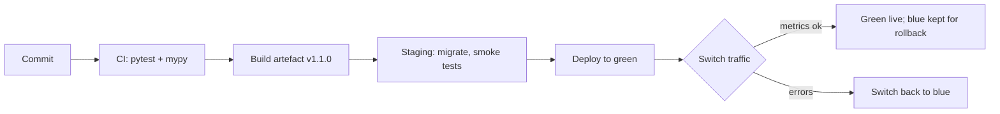

# SD-16 Deployment, Maintenance and Documentation

> [!info] Topic card
> **Unit:** U7 · **Time:** 4 h · **Code:** `create_app_from_env` (twelve-factor configuration) and `health` (a readiness probe) in `code/labbook/app.py`, tested in `tests/test_deployment.py`. The deployment pipeline and strategies below are **designs**: no server deployment was performed during the build.

## 1. Learning objectives
1. **Describe** the path from commit to production: build, test, package, release, deploy, verify, with environments (dev, test/staging, production).
2. **Apply** configuration principles (twelve-factor: config in the environment, fail fast on bad config) and semantic versioning with a changelog.
3. **Compare** deployment strategies (big bang, rolling, blue–green, canary, feature flags) and **plan** rollback.
4. **Plan** maintenance: corrective, adaptive, perfective and preventive work; SLAs; monitoring; end of life.
5. **Write** the documentation each audience needs (README, user guide, API reference, architecture/ADRs, runbook, changelog).

## 2. Why it matters
Software only creates value in production, and most of its life is spent there, being operated, fixed and changed. A deployment that can't be repeated or rolled back turns every release into a gamble. Good documentation determines whether the next developer (or you in a year) can maintain the system at all.

## 3. Prerequisites
[[SD-13 Implementation, Code Organization and Version Control]] · [[SD-14 Software Testing, Verification and Validation]] · [[CS-10 Operating System Security and Hardening]] (server baseline) · [[PY-25 Performance, Packaging and Project Organization]].

## 4. Intuition
Deployment should be **boring**: the same automated steps every time, small changes, easy to undo. Excitement in deployment means risk. Documentation is a **letter to a future stranger** who must keep your system alive: write what they'll need at 2 a.m. when it breaks.

## 5. Rigorous explanation

### 5.1 The delivery pipeline
1. **Commit → CI:** lint, type-check, unit and integration tests (LabBook: `pytest` + `mypy`).
2. **Build and package:** an immutable artefact (a wheel, a container image) tagged with the version.
3. **Deploy to staging:** an environment like production; run smoke and acceptance tests; security scans (DAST, CS-18).
4. **Release to production**, using a strategy (5.3), then **verify**: health checks, smoke tests, monitoring.
5. **Promote or roll back.**

The same artefact moves between environments. Only **configuration** differs.

### 5.2 Configuration and versioning
- **Twelve-factor app (config):** keep configuration (database location, credentials, feature flags) in the environment, not in code. `create_app_from_env` reads `LABBOOK_STORAGE` and `LABBOOK_DB`.
- **Fail fast:** invalid configuration stops start-up with a clear error (tested: `LABBOOK_STORAGE=mongodb` raises `ValueError`; `sqlite` without `LABBOOK_DB` raises). Don't start half-working.
- **Secrets:** come from a secrets manager or protected environment, never from the repository (CS-12).
- **Semantic versioning:** MAJOR.MINOR.PATCH. Keep a **CHANGELOG** grouped by Added / Changed / Fixed / Removed / Security, and tag releases in Git.
- **Database migrations:** versioned and forward-only, with the schema change compatible with both the old and new code during a rolling deploy (the "expand–contract" approach).

### 5.3 Deployment strategies
| Strategy | How | + | − |
|---|---|---|---|
| Big bang | Stop the old version, start the new one | Simple | Downtime; high risk |
| Rolling | Replace instances one by one | No downtime | Mixed versions run at the same time |
| Blue–green | Run a new environment (green) alongside the old (blue); switch traffic | Instant rollback (switch back) | Double the infrastructure; database changes are tricky |
| Canary | Send a small % of traffic to the new version, watch the metrics, then expand | Limits the blast radius | Needs good monitoring and traffic control |
| Feature flags | Deploy the code dark; turn features on separately | Decouples deploy from release | Flag debt; testing combinations |

**Rollback plan:** for every release, know how to revert (the previous artefact, a blue/green switch, turning a flag off), and how schema changes are handled.

### 5.4 Operations and maintenance
- **Monitoring:**
  - health and readiness endpoints (`health()` returns `{"status": "ok", "storage": ...}` or an error);
  - logs ([[CS-15 Logging, Monitoring, Incident Response and Recovery]]);
  - metrics: the "golden signals" of latency, traffic, errors and saturation;
  - alerts tied to SLOs.
- **SLA / SLO / SLI:** an agreement with users / the internal objective (e.g. "99.5% of availability checks succeed each month") / the measured indicator.
- **Maintenance types** (SD-01): corrective, adaptive (a new Python version or OS), perfective, preventive (refactoring, dependency updates).
- **Maintenance process:** change requests, impact analysis (using the RTM), prioritisation, regression testing, release notes.
- **End of life:** a deprecation notice, data export and retention, decommissioning, archiving the documentation.

### 5.5 Documentation by audience
| Document | Audience | Content |
|---|---|---|
| README | Developers, evaluators | Purpose, setup, running, testing, configuration variables, licence |
| User guide / help | End users | Tasks in their language, screenshots, FAQs, error messages explained |
| API reference | Integrators | Endpoints, schemas, errors, examples (OpenAPI) |
| Architecture docs + ADRs | Maintainers | C4 views, key decisions and reasons (SD-05) |
| Runbook | Operators / on-call | Deploy, rollback, health checks, common incidents and their fixes |
| CHANGELOG / release notes | Everyone | What changed in each version |
| Code docstrings / comments | Developers | Why and how, at the point of use |

Keep docs **close to the code** (in the repository), review them in PRs, and test the examples where possible.

## 6. Terminology
| Term | Meaning |
|---|---|
| Artefact | A built, versioned deliverable (wheel, image) |
| Environment | A deployment target: dev, staging, production |
| Smoke test | A quick check that the main functions work after a deploy |
| Readiness / liveness probe | Is the service ready for traffic? / Is it alive? |
| SLO / SLI / SLA | Objective / indicator / agreement for service levels |
| Runbook | Operational procedures for a service |
| Expand–contract migration | Add the new schema, migrate, then remove the old: a zero-downtime schema change |

## 7. Step-by-step: releasing LabBook 1.1.0
1. **Prepare:** the PR merged to `main`, CI green (tests, mypy). Update `__version__ = "1.1.0"` and the CHANGELOG (Added: waiting list; Fixed: atomic overlap check).
2. **Tag** `v1.1.0`. CI builds the artefact.
3. **Staging:** deploy with `LABBOOK_STORAGE=sqlite`, `LABBOOK_DB=/var/lib/labbook/labbook.db`; run the migration; smoke-test book, cancel and check-in; `health()` returns ok.
4. **Production:** a blue–green switch during a low-traffic window (e.g. 06:00, before the labs open).
5. **Verify:** health ok, error rate normal, a test booking with a test account.
6. **Rollback criteria:** error rate above 2% or health failing for 5 minutes → switch back to blue.
7. **Announce** with release notes; close the change ticket ([[PM-14 Procurement and Change Management]]).

## 8. Diagram: pipeline with blue–green release


## 9. Worked examples

### Example 1 (basic): configuration from the environment (tested)
```bash
LABBOOK_STORAGE=sqlite LABBOOK_DB=/var/lib/labbook/labbook.db python -m your_web_entrypoint
```
`create_app_from_env({})` gives an in-memory app, and `health()` gives `{"status": "ok", "storage": "InMemoryBookingRepository"}`. With SQLite and a path, the result is `{"status": "ok", "storage": "SqliteBookingRepository"}`, and the database file is created. A misconfiguration fails fast with `ValueError`. (`your_web_entrypoint` is a placeholder: LabBook's CLI uses in-memory storage only.)

### Example 2 (intermediate): CHANGELOG entry
```text
## [1.1.0] - 2026-04-14
### Added
- Waiting list: users refused for an occupied slot can queue; first in queue is offered the slot on cancellation (FR-13).
### Fixed
- Concurrent bookings could double-book a workstation; overlap check and insert now run in one transaction (FR-02).
### Security
- Booking API takes user identity from the session only (SD-09 §8.2).
```
(The dates and the 1.1.0 content are a plan for the exercises, not a record of a past release.)

### Example 3 (challenging): a zero-downtime schema change
Goal: rename `bookings.ws_id` to `workstation_id` without downtime under rolling deploys.
1. **Expand:** add the `workstation_id` column. Deploy code that **writes both** columns and reads the old one.
2. **Migrate:** backfill `workstation_id` from `ws_id`.
3. Deploy code that **reads the new** column (and still writes both).
4. **Contract:** deploy code that writes only the new column, then drop `ws_id`.

At every step, the old and new versions of the code both work against the schema, which is what rolling and blue–green deploys require. A single `ALTER TABLE … RENAME` would break the old version while it's still running.

## 10. Application: a runbook outline for LabBook
- **Service:** what it does; owners and contacts.
- **Deploy:** the commands, the expected durations.
- **Rollback:** the blue/green switch; restore the database from backup (RPO 24 h; [[CS-15 Logging, Monitoring, Incident Response and Recovery]]).
- **Health:** the `health()` meaning and thresholds.
- **Common incidents:**
  - "database locked": long transactions; check the writer;
  - "users report double bookings": fixed by the atomic repository check (SD-17); if it recurs, check that no script writes to the database directly, bypassing the repository;
  - "emails not sent": check the subscriber errors list.
- **Escalation:** whom to call, when.

## 11. Common mistakes
| Mistake | Fix |
|---|---|
| Different builds for each environment | One artefact, different configuration |
| Configuration hard-coded or committed with secrets | Environment variables, a secrets manager; fail fast |
| No rollback plan | Define it before every release |
| Schema changes that break the running version | Expand–contract migrations |
| Deploying large batches rarely | Small, frequent releases |
| Docs that are stale or missing | Docs in the repository, reviewed with the code; a runbook for operators |
| Monitoring added after the first outage | Health checks and alerts from day one |

## 12. Comparison: blue–green vs canary vs rolling
| | Blue–green | Canary | Rolling |
|---|---|---|---|
| Traffic shift | All at once | Gradual (%) | Instance by instance |
| Rollback speed | Instant | Fast (route back) | Slower (roll back each instance) |
| Infrastructure cost | 2× | 1× plus | 1× |
| Detects problems with | Smoke tests before the switch | Real traffic on a small subset | Early instances |
| Mixed versions at once? | No (except during the switch) | Yes | Yes |

## 13. Practice
**L1** 1. What's a readiness probe? 2. Expand MAJOR.MINOR.PATCH.

**L2** 3. Write the README "Configuration" section for LabBook. 4. Classify these maintenance tasks: upgrade to Python 3.14; fix an off-by-one in the quota; add CSV export; refactor the god class.

**L3** 5. Choose a deployment strategy for the exam-results portal on results day, and justify it. 6. Write a runbook entry for "health returns error".

**L4** 7. Plan the migration that adds a `lab_id` foreign key to bookings with zero downtime. 8. Define 3 SLOs and SLIs for LabBook, and the alert for each.

**L5** 9. Write the complete documentation set (README, a user guide page, an ADR, a runbook, a CHANGELOG) for your FYP's first release.

## 14. Hints
> [!tip]- Hints
> 2: breaking / feature / fix. 4: adaptive, corrective, perfective, preventive. 5: avoid releasing *on* results day; freeze earlier, and if you must, use blue–green with instant rollback. 8: availability, latency, booking error rate.

## 15. Worked solutions
> [!success]- Solutions 1–2
> 1. An endpoint or check that tells the deployment platform whether the instance is ready to receive traffic (dependencies reachable, start-up complete). LabBook's `health()` checks storage. 2. MAJOR: incompatible changes; MINOR: backwards-compatible features; PATCH: backwards-compatible fixes.

> [!success]- Solution 3
> ```text
> ## Configuration
> | Variable        | Values           | Default  | Notes                                  |
> |-----------------|------------------|----------|----------------------------------------|
> | LABBOOK_STORAGE | memory, sqlite   | memory   | memory is for demos and tests only     |
> | LABBOOK_DB      | file path        | (none)   | required when LABBOOK_STORAGE=sqlite   |
> Invalid values stop start-up with a clear error (fail fast).
> ```

> [!success]- Solution 4
> Python 3.14 upgrade: adaptive. Off-by-one fix: corrective. CSV export: perfective. Refactoring the god class: preventive.

> [!success]- Solution 5
> The best strategy is a **code freeze**: deploy the final version at least a week before results day, rehearse with production-like load, and make no releases on the day itself. If an emergency fix is needed: **blue–green**, with smoke tests on green using test accounts and instant switch-back. Canary is less suitable, because a small percentage of students seeing a broken version on results day is still unacceptable, and the traffic spike makes the metrics noisy.

> [!success]- Solution 6
> **Symptom:** `health()` returns `{"status": "error", ...}`. **Check:**
> 1. The detail field (e.g. `OperationalError`: database file missing or locked; a permissions problem).
> 2. Disk space.
> 3. File permissions on `LABBOOK_DB` (owner `labbook`, 600; [[CS-10 Operating System Security and Hardening]]).
> 4. A recent deploy or migration.
>
> **Act:** if it was caused by a deploy, roll back; if the disk is full, free space, then restart; if the database is corrupted, restore from the last backup and inform users of possible data loss up to the RPO. **Escalate** after 15 minutes without recovery.

> [!success]- Solution 7
> 1. Expand: add a nullable `lab_id` column (no constraint yet), and deploy code that writes `lab_id` on new bookings.
> 2. Backfill `lab_id` from the workstation's lab for existing rows.
> 3. Verify there are no NULLs, then add the NOT NULL and FOREIGN KEY constraints. (In SQLite, adding constraints means rebuilding the table, so do it during a short maintenance window, or use a database that supports adding them online.)
> 4. Deploy code that reads `lab_id`.

> [!success]- Solution 8
> | SLO | SLI | Alert |
> |---|---|---|
> | 99.5% of availability requests succeed monthly | Successful / total availability requests | Error rate > 2% for 5 min |
> | 95% of availability pages within 2 s | Latency p95 | p95 > 2 s for 10 min |
> | 99.9% of booking attempts end in a correct outcome (confirmed or a rule message, never a 500) | 500 responses / booking attempts | Any 500s > 0.5% over 10 min |

## 16. Self-test (pass ≥ 4/5)
1. What differs between environments, if not the artefact? 2. Which strategy gives the fastest rollback? 3. Why "fail fast" on bad configuration? 4. Who reads a runbook? 5. What's expand–contract?
> [!success]- Answers
> 1. Configuration (and secrets). 2. Blue–green (switch back). 3. To avoid running in a half-broken state that corrupts data or fails unpredictably later. 4. Operators and on-call engineers. 5. A staged schema change (add, migrate, switch, remove) that keeps the old and new code compatible during deploys.

## 17. Flashcards
#flashcards/software-design
Twelve-factor config rule?::Store configuration in the environment, not in code.
Blue–green deployment?::Two identical environments; switch traffic to the new one; switch back to roll back.
Canary release?::Route a small share of traffic to the new version, watch the metrics, then expand.
Semantic versioning?::MAJOR (breaking).MINOR (feature).PATCH (fix).
Runbook?::Operational procedures: deploy, rollback, health checks, incident fixes.
Expand–contract?::A zero-downtime schema change: add, migrate, switch reads, remove the old.

## 18. Blank-page recall
Draw the pipeline with blue–green, and list the documentation set with its audiences.

## 19. Revision summary
- Pipeline: CI → artefact → staging → production → verify, with one artefact and configuration per environment.
- Configuration in the environment; fail fast; secrets outside the repository; semantic versioning plus a CHANGELOG.
- Strategies: rolling, blue–green, canary, feature flags. Always have a rollback plan; use expand–contract migrations.
- Operate with health checks, monitoring and SLOs; plan all four maintenance types.
- Document for each audience: README, user guide, API, ADRs, runbook, changelog.

## 20. Links
Prev: [[SD-15 Refactoring, Technical Debt, Code Review and Quality]] · Next: [[SD-17 Secure and Reliable Software Design]] · Related: [[CS-15 Logging, Monitoring, Incident Response and Recovery]], [[PM-17 Monitoring, Control, Closure and Lessons Learned]], [[PY-25 Performance, Packaging and Project Organization]]

## 21. Sources
- Wiggins, A., *The Twelve-Factor App*, 2011: https://12factor.net/
- Humble, J. & Farley, D., *Continuous Delivery*, Addison-Wesley, 2010.
- Beyer, B. et al. (eds), *Site Reliability Engineering*, O'Reilly, 2016 (SLOs, monitoring, the golden signals): https://sre.google/books/
- Keep a Changelog: https://keepachangelog.com/ · Semantic Versioning 2.0.0: https://semver.org/
- ISO/IEC/IEEE 14764:2022, *Software engineering: Software life cycle processes: Maintenance*.
- *(Not checked online during the build, because there was no network access.)*

## 22. Mastery checklist
- [ ] I can design a delivery pipeline and choose a deployment strategy with rollback
- [ ] I can configure an app from the environment, failing fast
- [ ] I can plan maintenance and write SLOs
- [ ] I can produce the documentation set · reviews scheduled
