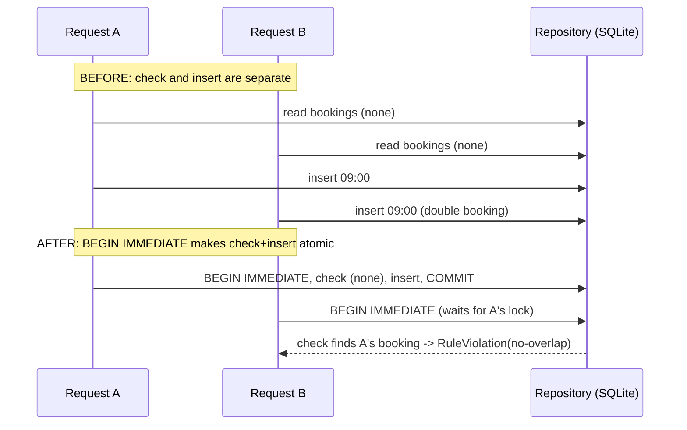

# SD-17 Secure and Reliable Software Design

> [!info] Topic card
> **Unit:** U7 · **Time:** 5 h · **Code:**
> - The **real fix** for LabBook's double-booking race in `code/labbook/repository.py`: an atomic check-and-insert, using a SQLite `BEGIN IMMEDIATE` transaction and a lock in the in-memory repository.
> - It's guarded by `test_no_double_booking_under_concurrency`. Before the fix, 200/200 concurrent runs double-booked; after it, 200/200 correctly refused the second booking, for both repositories (measured during the build).
> - The suite has 47 passing tests, and mypy reports no issues. Two further findings from writing this lesson are in the warning box after §9.

## 1. Learning objectives
1. **Apply** the classic secure-design principles (Saltzer & Schroeder) plus defence in depth to a software design.
2. **Integrate** threat modelling and security requirements into design artefacts (DFDs, ADRs, tests).
3. **Design** for reliability: atomicity and concurrency control, timeouts, retries with backoff, idempotency, circuit breakers, graceful degradation.
4. **Handle** errors safely: fail securely, validate at trust boundaries, give no sensitive details to users, and log enough for diagnosis.
5. **Evaluate** a design against security and reliability scenarios, and **prove** fixes with tests.

## 2. Why it matters
Security and reliability failures are design failures far more often than coding typos. LabBook's own history shows it: every unit test passed, yet two concurrent users could book the same PC every single time. Designing for adversaries (security) and for failures (reliability) means asking "what if?" at every boundary, and turning the answers into tests.

## 3. Prerequisites
[[CS-02 Threat Modeling and Security Requirements]] · [[CS-04 Authorization and Access Control]] · [[SD-05 Software Architecture and Architectural Styles]] · [[SD-14 Software Testing, Verification and Validation]].

## 4. Intuition
- **Secure design:** assume someone is actively trying to make your system misbehave. Make the default "no", give each part only the keys it needs, and check every door every time.
- **Reliable design:** assume everything will fail sometimes (networks, disks, other services, concurrency). Make failures contained, visible and recoverable.

## 5. Rigorous explanation

### 5.1 Secure-design principles (Saltzer & Schroeder, 1975, plus modern additions)
| Principle | Meaning | LabBook application |
|---|---|---|
| Economy of mechanism | Keep security mechanisms simple | One `authorize`-style check per use case; no clever custom crypto |
| Fail-safe defaults | Deny unless explicitly allowed | `cancel` denies unless booker or technician; unknown rule types fail at start-up |
| Complete mediation | Check every access, every time | Permission checked on every `cancel`/`check_in`, not cached from the UI |
| Open design | Security mustn't depend on secret designs | Rely on keys, passwords and sessions, not hidden URLs |
| Separation of privilege | Require more than one condition for critical actions | Lab reservations need lecturer request **and** head-of-department approval |
| Least privilege | Minimum rights needed | A database account without DDL; `BookingReader` for reports (SD-10 ISP) |
| Least common mechanism | Minimise shared mechanisms between users | Per-user sessions; no shared admin account |
| Psychological acceptability | Security people will actually use | SSO login; clear rule messages |
| **Defence in depth** (modern) | Several independent layers | Rules in the service **and** CHECK constraints **and** the atomic repository check |
| **Secure by default** (modern) | Safe configuration out of the box | `create_app_from_env` defaults to safe in-memory storage; HTTPS-only in production |

### 5.2 Security in the design process
1. **Threat model** the DFD with STRIDE ([[LAB-CS-07 Threat Modeling a Sample Web Application]]): trust boundaries at the web adapter, the database and the email service.
2. Turn the mitigations into **security requirements** (SD-03), trace them to tests (SD-04), and record the major decisions as ADRs (SD-05).
3. **Validate input at trust boundaries:** in LabBook, `TimeSlot` validates on construction. The API takes identity from the session, never from the body (SD-09).
4. **Authorise in the application layer**, close to the use case: `BookingService.cancel` and `check_in`.
5. **Handle errors securely:**
   - domain exceptions are mapped to safe user messages;
   - internal details (stack traces, SQL) go only to the logs;
   - fail closed (if the authorisation lookup fails, deny).

### 5.3 Reliability building blocks
| Concern | Technique | LabBook |
|---|---|---|
| Concurrency / data integrity | Atomic transactions, locks, DB constraints, optimistic concurrency (version columns) | `BEGIN IMMEDIATE` check-and-insert; a lock in memory |
| Failure of a dependency | **Timeouts** on every external call; **retries with exponential backoff and jitter** (only for idempotent operations); **circuit breaker** (stop calling a failing dependency for a while) | Email via the event bus; a durable outbox for guaranteed delivery (SD-12) |
| Partial failure | **Isolation / bulkheads:** one failing part doesn't sink the rest | `EventBus.publish` isolates subscribers (NFR-04) |
| Duplicate requests | **Idempotency keys**, so a retried POST doesn't create two bookings | API design (SD-09 §8.2) |
| Overload | Rate limiting, queues, graceful degradation (read-only mode) | A read-only availability page if writes fail |
| Recovery | Backups, restore tests, health checks, runbooks | `health()`, runbook (SD-16) |

**Reliability metrics:**
- **availability** = uptime / total time;
- **MTBF** (mean time between failures);
- **MTTR** (mean time to repair);
- availability ≈ MTBF / (MTBF + MTTR).

## 6. Terminology
| Term | Meaning |
|---|---|
| Race condition | The outcome depends on the timing of concurrent operations |
| Check-then-act | A pattern vulnerable to races: the condition changes between the check and the act |
| Atomicity | All of an operation happens, or none of it |
| Idempotency | Repeating a request has the same effect as doing it once |
| Circuit breaker | Stops calls to a failing dependency, then probes for recovery |
| Graceful degradation | Reduced but safe functionality under failure |
| Fail closed / fail safe | On failure, deny access / move to a safe state |
| Complete mediation | Every access is checked |

## 7. Step-by-step: diagnosing and fixing the double booking
1. **Symptom (SD-08 Example 3, a design review):** a `par` sequence diagram showed that both requests could pass `NoOverlap` before either inserted.
2. **Reproduce (SD-14):** a two-thread test with a barrier, on a shared SQLite file. Result: **200/200 runs double-booked.** It was recorded as `xfail(strict=True)`.
3. **Root cause:** **check-then-act** across two separate operations. The rule reads existing bookings, and then the repository inserts. Nothing makes the two steps atomic.
4. **Design the fix:** keep `NoOverlap` in the rules (it gives fast, friendly feedback), **and** make the repository's `add` re-check overlap and insert inside **one write transaction** (defence in depth):
   ```python
   # not-runnable: excerpt from labbook/repository.py (SqliteBookingRepository.add)
   self.conn.execute("BEGIN IMMEDIATE")          # take the write lock before checking
   try:
       clash = self.conn.execute("SELECT 1 FROM bookings WHERE ws_id = ? AND status IN (...)"
                                 " AND start_at < ? AND end_at > ? LIMIT 1", (...)).fetchone()
       if clash:
           raise RuleViolation("no-overlap", "... was booked by someone else just now")
       cur = self.conn.execute("INSERT INTO bookings ... VALUES (?,?,?,?,?)", (...))
       self.conn.execute("COMMIT")
   except BaseException:
       self.conn.execute("ROLLBACK")
       raise
   ```
   The in-memory repository does the same under a `threading.Lock`, so both implementations still satisfy one contract.
5. **Verify:** the strict xfail test started *passing*, so pytest flagged it, and the marker was removed. Re-running the experiment gave **200/200 "one confirmed, one refused"** for both SQLite and in-memory. The full suite and mypy were green.
6. **Record:** the ADR "Atomic overlap enforcement in the repository". Its consequences: a second writer waits up to the 5 s timeout. A multi-server deployment on PostgreSQL should use an exclusion constraint instead.

## 8. Diagram: before and after


## 9. Worked examples

### Example 1 (basic): apply the principles
| Situation | Principle violated | Fix |
|---|---|---|
| The web UI hides the "cancel" button for other users' bookings, but the API doesn't check | Complete mediation | Check in `BookingService.cancel` (as LabBook does) |
| The app connects to the database as the superuser | Least privilege | A dedicated account with only the required grants |
| An unknown rule in the configuration is silently skipped | Fail-safe defaults | Fail at start-up (`rules_from_config` raises) |
| A single admin password shared by all technicians | Least common mechanism, accountability | Individual accounts with roles |

### Example 2 (intermediate): retries done safely
Sending a confirmation email can fail transiently. A safe design:
- **Timeout:** 5 s per attempt.
- **Retry:** up to 3 times, with exponential backoff (1 s, 2 s, 4 s) plus random jitter.
- **Retry only idempotent work:** use the event ID as a de-duplication key at the email provider, or in an outbox table, so retries don't send duplicates.
- **Circuit breaker:** after 5 consecutive failures, stop trying for 60 s and mark the messages pending.
- **Never** let the email failure cancel the booking (NFR-04). The booking is the essential operation; email is a side effect.

### Example 3 (challenging): a security and reliability review of LabBook
| Scenario | Current design | Finding | Action |
|---|---|---|---|
| A student books as another user via the API | The CLI trusts `--user`; there's no authentication | **Critical for any networked deployment** | SSO; take identity from the session (SD-09) |
| Two users book the same slot simultaneously | Atomic repository check (fixed) | Resolved; covered by a test | Keep the test in CI |
| The email provider is down | Subscribers isolated | Emails are lost on a crash | Outbox + worker (SD-12 Practice 8) |
| An attacker floods booking requests | No rate limiting | Availability risk | Rate limiting per user and IP at the web adapter |
| The database file is readable by other OS users | Depends on deployment | Confidentiality risk | `600` permissions, a service account (CS-10) |
| A malicious rule configuration | Unknown types fail fast | Partly mitigated | Validate the configuration schema, and restrict who can edit it |

> [!warning] Found while writing this lesson: two real defects
> 1. **Double counting (fixed).** While testing the quota race in Solution 6, a setup step failed with `weekly-quota: 12 h exceeds 10 h per week` after only 4 h of bookings. The cause: `BookingService.book` concatenated `for_workstation(ws_id)` and `for_user(user_id)`, so a student's bookings **on the same workstation appeared twice** and were counted twice. The rule's unit tests passed, because they call `WeeklyQuota.check` directly with a hand-built list. Only the service-level path was wrong. **Fix:** de-duplicate by `booking_id`. The regression test is `test_quota_does_not_double_count_same_workstation` (traced to FR-04). Lesson: unit-testing a component doesn't test how it's *wired*.
> 2. **Quota race (open, Practice 7).** With the double counting fixed, two concurrent 2 h bookings by a student with 8 h used, on *different* workstations, **both succeeded in 100/100 runs**, leaving 12 h. The overlap fix doesn't cover it, because the bookings are on different workstations. It's recorded as Practice 7 and as technical debt.

## 10. Application: secure design checklist for your FYP
1. A threat model (DFD + STRIDE) in the design chapter.
2. Security requirements with IDs, traced to tests.
3. Authentication and authorisation designed per use case, deny by default.
4. Input validated at every trust boundary; output encoded; parameterised SQL.
5. Secrets out of the repository; least-privilege database user.
6. Concurrency: identify every check-then-act on shared data, and make it atomic.
7. External calls: timeouts, retries only when idempotent, graceful degradation.
8. Logging, without secrets, sufficient for incident response.
9. Backups and restore tested; health checks.

## 11. Common mistakes
| Mistake | Fix |
|---|---|
| Security checks only in the UI | Complete mediation in the service layer |
| Check-then-act on shared data without a transaction | Atomic operations, locks, constraints |
| Retrying non-idempotent operations | Idempotency keys first, then retries |
| No timeouts on external calls | A timeout on every network call |
| Detailed errors shown to users | Safe messages; details in the logs |
| "Unit tests pass, so it's reliable" | Concurrency, failure-injection and load tests |
| Security bolted on at the end | Threat model in design; requirements and tests from the start |

## 12. Comparison: concurrency control options
| Option | How | + | − | Where |
|---|---|---|---|---|
| Pessimistic lock (`BEGIN IMMEDIATE`, `SELECT … FOR UPDATE`) | Lock, then check and write | Simple and correct | Waiting; reduced throughput | LabBook's SQLite repository |
| Database constraint (UNIQUE, exclusion) | The database rejects violating rows | Strongest; holds for every writer | Not every rule is expressible | PostgreSQL exclusion on time ranges |
| Optimistic concurrency (version column) | Detect conflicting updates on write | No waiting | Retries needed | Editing a booking's details |
| Single writer / queue | Serialise writes | Simple reasoning | A bottleneck | High-contention hot spots |

## 13. Practice
**L1** 1. Name four Saltzer & Schroeder principles. 2. What's a check-then-act race?

**L2** 3. Explain why LabBook keeps `NoOverlap` in the rules *and* adds the repository check. 4. Calculate availability for MTBF = 720 h and MTTR = 2 h.

**L3** 5. Write a timeout + retry + idempotency design for the SMS adapter (SD-11). 6. Identify two more check-then-act risks in LabBook (consider the weekly quota under concurrency).

**L4** 7. Make the weekly quota safe under concurrent bookings by the same student. Describe the approach, then implement it and add a test like the overlap one. 8. Write the ADR for the atomic overlap fix, including the alternatives considered.

**L5** 9. Perform a full security and reliability design review of [[PRJ-PY-05 Hostel Maintenance System]] using the tables in this lesson, then implement and test the top two fixes.

## 14. Hints
> [!tip]- Hints
> 3: user-friendly early feedback vs a guaranteed invariant. 4: 720 / 722. 6: two concurrent bookings by the same student in the same week can both pass `WeeklyQuota`. 7: move the quota re-check inside the same `BEGIN IMMEDIATE` transaction, or serialise per user. 8: alternatives were a UNIQUE index (insufficient for overlaps), PostgreSQL exclusion (not available in SQLite), and an application-level global lock (not multi-process).

## 15. Worked solutions
> [!success]- Solutions 1–2
> 1. Any four of: economy of mechanism, fail-safe defaults, complete mediation, open design, separation of privilege, least privilege, least common mechanism, psychological acceptability. 2. Code checks a condition, then acts on it as a separate step. Between the two, another actor changes the state, so the action is taken on a stale assumption (two users both see a free slot and both book it).

> [!success]- Solution 3
> The rule gives fast, clear feedback in the normal case, and keeps the business logic in one readable place. The repository check is the **guarantee** under concurrency: it holds even if two requests pass the rule at the same moment. That's defence in depth. Either alone is weaker: the rule alone allows races, and the repository alone puts business messages deep in the infrastructure, with no early feedback.

> [!success]- Solution 4
> Availability = 720 / (720 + 2) = 0.99723…, about **99.72%** (about 2 hours of downtime per 30 days).

> [!success]- Solution 5
> - **Timeout:** 3 s per vendor call.
> - **Retry:** max 3 attempts, with backoff of 1, 2 and 4 s plus jitter, only on network errors or 5xx responses (not on 4xx).
> - **Idempotency:** pass the event ID as the vendor's client reference if supported, or record the sent event IDs in an outbox table and skip already-sent ones.
> - **Circuit breaker:** after 5 failures in a row, open for 60 s.
> - **Degrade gracefully:** mark the SMS as pending and show "notification delayed"; never block or undo the booking.

> [!success]- Solution 6
> 1. **Weekly quota:** two concurrent bookings by the same student (different workstations) both read 8 h used, both pass, and the student ends with 12 h. **Measured: 100/100 runs.** (The same experiment also showed that a student can hold two workstations at the same time, so decide whether that should be a rule.) 2. **Check-in vs cancel:** a technician cancels while the student checks in; both read CONFIRMED, and the last write wins. Optimistic concurrency (a version column: `UPDATE … WHERE booking_id = ? AND status = 'confirmed'`, then check `rowcount`) detects the conflict.

> [!success]- Solution 8 (outline)
> ```text
> ADR-006: Enforce no-overlap atomically in the repository
> Status: Accepted
> Context: Concurrent requests double-booked (SD-14: 200/200 runs). Rules run outside any transaction.
> Decision: Repository.add re-checks overlap and inserts within one write transaction
>           (SQLite BEGIN IMMEDIATE; in-memory threading.Lock). NoOverlap rule kept for early feedback.
> Alternatives: UNIQUE(ws_id, start_at) - only catches identical starts, not overlaps;
>               PostgreSQL exclusion constraint - ideal, not available in SQLite;
>               process-wide lock in service - fails with several processes/servers.
> Consequences: + correctness proven by concurrency test; + both repos share the contract.
>               - writers serialise (fine at LabBook scale); - multi-server deployment must move to
>               PostgreSQL + exclusion constraint (revisit trigger).
> ```

## 16. Self-test (pass ≥ 4/5)
1. Which principle means "check every access"? 2. Why must retries be idempotent? 3. What did the concurrency experiment measure before and after the fix? 4. What does a circuit breaker prevent? 5. Fail-safe default for an authorisation lookup error?
> [!success]- Answers
> 1. Complete mediation. 2. Otherwise a retried request repeats its effect (a double booking, a duplicate email). 3. Before: 200/200 double bookings. After: 200/200 one confirmed and one refused (SQLite and in-memory). 4. Hammering a failing dependency, cascading failures, and wasted waiting on doomed calls. 5. Deny access.

## 17. Flashcards
#flashcards/software-design
Fail-safe defaults?::Deny unless explicitly permitted.
Complete mediation?::Check authorisation on every access, not just once in the UI.
Check-then-act race fix?::Make the check and the action atomic (transaction or lock) or enforce it with a database constraint.
Safe retry recipe?::Timeout + exponential backoff with jitter + idempotency key + retry limit + circuit breaker.
Availability from MTBF and MTTR?::MTBF / (MTBF + MTTR).
LabBook concurrency fix?::BEGIN IMMEDIATE check-and-insert in SQLite; a lock in memory; proven by a two-thread test.

## 18. Blank-page recall
Write the 8 Saltzer & Schroeder principles with a LabBook example each, then redraw the before/after sequence diagram.

## 19. Revision summary
- Secure design: least privilege, fail-safe defaults, complete mediation, economy of mechanism, open design, separation of privilege, least common mechanism, psychological acceptability, plus defence in depth.
- Threat-model in design, turn mitigations into traced requirements and tests, validate at boundaries, fail securely.
- Reliability: atomicity for shared invariants, timeouts, idempotent retries, circuit breakers, isolation, graceful degradation, recovery.
- LabBook's race was found by design review, proven by a test, fixed atomically, and guarded in CI.

## 20. Links
Prev: [[SD-16 Deployment, Maintenance and Documentation]] · Back to: [[SD 00 Dashboard]] · Related: [[CS-02 Threat Modeling and Security Requirements]], [[CS-11 Web Application Security]], [[X-03 Security Requirements in Software Architecture]], [[LAB-CS-07 Threat Modeling a Sample Web Application]]

## 21. Sources
- Saltzer, J. H. & Schroeder, M. D., "The protection of information in computer systems", *Proceedings of the IEEE*, 63(9), 1975, pp. 1278–1308.
- Nygard, M. T., *Release It!*, 2nd ed., Pragmatic Bookshelf, 2018 (timeouts, circuit breakers, bulkheads).
- Kleppmann, M., *Designing Data-Intensive Applications*, O'Reilly, 2017 (transactions, race conditions, idempotency).
- SQLite documentation, "Transaction" (`BEGIN IMMEDIATE`): https://www.sqlite.org/lang_transaction.html
- OWASP, *Secure Product Design Cheat Sheet*: https://cheatsheetseries.owasp.org/
- *(Not checked online during the build, because there was no network access.)*

## 22. Mastery checklist
- [ ] I can apply the secure-design principles to a design and name violations
- [ ] I can find check-then-act races and fix them atomically, with a test
- [ ] I can design timeouts, retries, idempotency and circuit breakers
- [ ] Reviews scheduled
