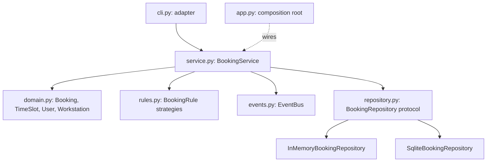

# SD-CASE LabBook Running Case Study

> [!info] What this is
> **LabBook** is a *fictional* booking system for a university's computer laboratories. Every SD lesson uses it, so that requirements, architecture, UML, patterns, tests and deployment all describe the same system. The reference implementation is in `code/labbook/` (Python 3.10+, standard library only). Its tests (17 for LabBook, plus traceability and tool tests; 25 in total) run against both the in-memory and SQLite repositories, and mypy reports no issues.

## 1. Vision
*"Students, lecturers and technicians can see lab availability and book workstations or whole labs quickly and fairly, without double bookings or paper sign-up sheets."*

## 2. Stakeholders
| Stakeholder | Interest |
|---|---|
| Students | Find and book a free workstation; fair access before deadlines |
| Lecturers | Reserve whole labs for practical sessions; know who attended |
| Lab technicians | Mark equipment out of service; cancel bookings; see usage |
| Head of department | Usage statistics to justify equipment purchases |
| ICT services | Security, uptime, integration with university login |

## 3. Requirements summary (detailed in SD-03 and SD-04)
| ID | Requirement | Implemented in |
|---|---|---|
| FR-01 | A user can book a workstation for a time slot | `BookingService.book` |
| FR-02 | No two active bookings may overlap on one workstation | `rules.NoOverlap` |
| FR-03 | Bookings only within opening hours (07:00–22:00, single day) | `rules.OpeningHours` |
| FR-04 | Students may book at most 10 h per calendar week (Monday–Sunday) | `rules.WeeklyQuota` |
| FR-05 | Out-of-service workstations cannot be booked | `rules.WorkstationInService` |
| FR-06 | The booker or a technician may cancel | `BookingService.cancel` |
| FR-07 | Only the booker may check in; a booking moves REQUESTED → CONFIRMED → CHECKED_IN → COMPLETED | `domain.Booking.transition` |
| FR-08 | Users are notified of confirmations and cancellations | `events.EventBus` + `Outbox` |
| FR-09 | A slot must end after it starts and last at most 8 hours (found missing during the SD-04 traceability exercise) | `domain.TimeSlot` |
| NFR-01 | Every booking state change is auditable | `events.AuditLog` |
| NFR-02 | Business rules can be added without changing the booking service | `rules.RuleSet` (open/closed) |
| NFR-03 | Storage can change (in-memory, SQLite, later a server database) without changing the service | `repository` protocol |
| NFR-04 | A failing notification must not cancel a booking | `EventBus.publish` isolates subscribers |
| NFR-05 | The booking service is testable in isolation with substitute rules | Constructor injection in `BookingService` |

The full requirement → test matrix is kept as code in `tests/test_traceability.py`, so CI fails if a requirement loses its tests.

## 4. Architecture at a glance

*Text version: the CLI calls the service. The service uses the domain, rules, events and a repository interface, with two implementations. `app.py` chooses the concrete classes.*

## 5. Code map
| File | Responsibility | Lesson focus |
|---|---|---|
| `domain.py` | Entities, value objects, state machine | SD-07, SD-08, SD-12 (State) |
| `rules.py` | Booking rules (Strategy, Composite) | SD-10 (OCP), SD-11, SD-12 |
| `events.py` | Event bus (Observer) | SD-12, SD-17 (reliability) |
| `repository.py` | Persistence interface + 2 implementations | SD-09, SD-10 (DIP), SD-11 (Adapter-like) |
| `service.py` | Use-case orchestration | SD-04, SD-05, SD-06 |
| `app.py` | Composition root / factory | SD-11 (Factory), SD-16 |
| `cli.py` | Thin user interface adapter | SD-05 (layers) |
| `tests/test_labbook.py` | Unit, contract and use-case tests | SD-14 |
| `clinic/` | Deliberately flawed designs | [[SD Flawed Design Clinic]], SD-15 |

## 6. Try it
```bash
cd "07 - Software Design and Development/code"
python -m labbook --user u-amina --ws LAB1-01 --start 2026-03-02T09:00 --end 2026-03-02T11:00
python -m labbook --user u-amina --ws LAB1-03 --start 2026-03-02T09:00 --end 2026-03-02T11:00
python -m labbook --user u-amina --ws LAB1-01 --start 2026-03-02T21:00 --end 2026-03-02T23:00
```
Real output from the build machine:
```text
booking #1 confirmed
notify to u-amina: booking.confirmed #1 LAB1-01 2026-03-02 09:00-11:00
error: in-service: LAB1-03 is out of service
error: opening-hours: labs open 07:00-22:00 on a single day
```
Each CLI run starts with a fresh in-memory store, so bookings don't persist between runs. That's intended for the demo; `create_app("sqlite", "labbook.db")` persists them.

## 7. Known limitations (honest scope)
- No authentication: user IDs are trusted. Real deployments need university single sign-on ([[SD-17 Secure and Reliable Software Design]]).
- The overlap check isn't safe under concurrent requests: two simultaneous bookings could both pass. A real system needs a database constraint or a transaction with locking. (This is an SD-17 exercise.)
- Times are naive local datetimes: no time zones.
- Whole-lab reservations by lecturers are modelled only in the exercises.

## 8. Extension exercises (used across lessons)
1. **Waiting list** (SD-12): when a booking is cancelled, offer the slot to the first waiting user (Observer).
2. **Lab reservation** (SD-07/SD-11): a lecturer reserves all workstations in a lab; model it with Composite.
3. **Weekend rule** (SD-10): add a rule that closes labs on Sundays, without editing `service.py`.
4. **REST adapter** (SD-05/SD-09): expose `book` and `cancel` over HTTP. Design the API contract first.
5. **Concurrency fix** (SD-17): make double booking impossible at the database level, and test it.
6. **No-show handling** (SD-08): mark bookings NO_SHOW 15 minutes after the start without a check-in.

## 9. Links
[[SD 00 Dashboard]] · [[SD Flawed Design Clinic]] · [[SD-01 Software Engineering Fundamentals]] · [[PRJ-PY-05 Hostel Maintenance System]] (a similar layered design in the Python module)
