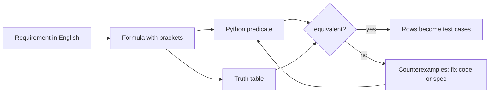

# X-01 Logic and Sets in Python and Requirements

> [!info] Topic card
> **Modules:** DM (logic, sets) · PY (conditions, sets) · SD (requirements, testing) · CS (access control) · **Time:** 2 h · **Code:** `truth_table` and `equivalent` in `08 - Cross-Module Connections/code/x_tools.py`; every example is asserted in `test_x01_requirement_vs_code`.

## 1. Learning objectives
1. **Translate** an English requirement into a propositional formula or a set expression.
2. **Implement** it in Python, respecting operator precedence.
3. **Prove** that the code matches the specification with an exhaustive truth table, or find the counterexamples.
4. **Derive** test cases from a truth table or decision table.

## 2. Why it matters
Access-control and eligibility rules are logic. A misplaced bracket in `if` lets the wrong people see exam results. DM gives you the tools to check the rule; PY implements it; SD turns it into tests; CS cares that it's right.

## 3. Prerequisites
[[DM-01 Propositions, Connectives and Truth Tables]] · [[DM-02 Logical Equivalence and Laws of Logic]] · [[DM-06 Sets, Set Operations, Power Sets and Cartesian Products]] · [[PY-04 Conditions and Branching]] · [[PY-11 Dictionaries, Sets and Comprehensions]] · [[SD-03 Requirements Engineering]] · [[CS-04 Authorization and Access Control]].

## 4. Intuition
A requirement with "and", "or", "unless" and "only if" is a formula. With $n$ conditions there are only $2^n$ cases, so for small rules you can check **every** case: that's a proof by exhaustion ([[DM-05 Direct Proof, Contrapositive and Contradiction]]).

## 5. Rigorous explanation

### 5.1 English → logic
| English | Logic | Python |
|---|---|---|
| A and B | $A \land B$ | `a and b` |
| A or B (inclusive) | $A \lor B$ | `a or b` |
| not A | $\lnot A$ | `not a` |
| A only if B | $A \to B$ | `(not a) or b` |
| A if B | $B \to A$ | `(not b) or a` |
| A unless B | $\lnot B \to A$, i.e. $A \lor B$ | `a or b` |
| A if and only if B | $A \leftrightarrow B$ | `a == b` (for bools) |

### 5.2 Precedence
In Python, `not` binds tighter than `and`, which binds tighter than `or`. So `p and o or l` means `(p and o) or l`, **not** `p and (o or l)`. In logic, write the brackets explicitly.

### 5.3 English → sets
"Students who are registered **and** have paid, **except** those under disciplinary action" is $(R \cap P) \setminus D$. In Python: `(registered & paid) - disciplinary`.

### 5.4 From truth tables to tests
Each row of the truth table is a test case with an expected result. For $n \le 4$ conditions, test all $2^n$ rows; for more, use the decision-table and boundary techniques of [[SD-14 Software Testing, Verification and Validation]] (e.g. MC/DC: show each condition can independently change the outcome).

## 6. Terminology
| Term | Meaning |
|---|---|
| Specification | The intended rule, written precisely |
| Equivalence | Two formulas with the same truth value under every assignment |
| Counterexample | An assignment where specification and implementation differ |
| Decision table | A table of conditions and actions, one column per rule |
| Exhaustive testing | Testing every input combination (feasible only for small inputs) |

## 7. Step-by-step: checking a rule
1. Name each atomic condition (published, owner, lecturer).
2. Write the specification with explicit brackets.
3. Write the implementation as a Python function.
4. Run `equivalent(spec, code, names)`.
5. If it returns counterexamples, fix the code (or the specification), and add those rows as regression tests.

## 8. Diagram

*Text version: the English requirement becomes a bracketed formula. From it you write the Python predicate and the truth table, and check them for equivalence. If equivalent, the rows become test cases; if not, the counterexamples tell you what to fix.*

## 9. Worked examples

### Example 1 (basic): eligibility as sets (tested)
Registered $R = \{S1, …, S5\}$, paid $P = \{S1, S2, S4, S6\}$, disciplinary $D = \{S2\}$. $(R \cap P) \setminus D = \{S1, S4\}$. Note that S6 paid but isn't registered.

### Example 2 (intermediate): a precedence bug (tested)
*Requirement:* "A result may be viewed only when it is published, and the viewer is either its owner or a lecturer." Specification: $p \land (o \lor l)$.

*Code:* `published and owner or lecturer`.

`equivalent` reports two counterexamples: `published=False, lecturer=True`, with `owner` either value. The code lets lecturers see **unpublished** results, which the requirement forbids. Whether lecturers *should* see unpublished results is a requirements question; the point is that the code and the specification disagree. Fixed code `published and (lecturer or owner)` is equivalent (`(True, [])`).

The specification is true in 3 of the 8 rows.

### Example 3 (challenging): "only if"
"A technician may close a request only if it is resolved": $close \to resolved$. The Python guard is `if close and not resolved: raise PermissionDenied`. That's the contrapositive form of the same rule, and it's how [[PRJ-PY-05 Hostel Maintenance System]] encodes its transitions (as a table, `ALLOWED`).

## 10. Application
Before implementing any permission rule in [[X-CASE-01 Secure Exam Results Portal]] or your FYP, write it as a formula, check it with `equivalent`, and put the counterexample rows in your test suite.

## 11. Common mistakes
| Mistake | Fix |
|---|---|
| Relying on `and`/`or` precedence | Brackets everywhere in rules |
| Reading "unless" as "and not" | "A unless B" is $A \lor B$ |
| Treating "only if" as "if" | $A \to B$, not $B \to A$ |
| Testing only the "happy" row | Test every row (or MC/DC) |
| Using lists for membership rules | Sets: clearer and $O(1)$ lookup |

## 12. Comparison
| Representation | Best for |
|---|---|
| English | Stakeholder agreement |
| Formula | Precision, equivalence proofs |
| Truth/decision table | Test design, review with stakeholders |
| Python predicate | Execution |
| Set expression | Eligibility over populations |

## 13. Practice
**L1** 1. Translate "access is granted if the user is an admin or the owner". 2. What does `not a or b` mean?

**L2** 3. Write $(R \cup W) \setminus B$ in Python, and describe it in English. 4. Build the truth table for $p \land (o \lor l)$.

**L3** 5. Use `equivalent` to check whether `not (a and b)` equals `not a or not b`.

**L4** 6. A requirement says "staff may edit a record unless it is locked, but administrators may always edit". Write the formula, the code and the tests.

**L5** 7. Take five rules from your FYP requirements, formalise them, and check your implementation exhaustively.

## 14. Hints
> [!tip]- Hints
> 5: De Morgan. 6: $admin \lor (staff \land \lnot locked)$.

## 15. Worked solutions
> [!success]- Solutions
> 1. $admin \lor owner$; `is_admin or is_owner`. 2. $\lnot a \lor b$, i.e. $a \to b$. 3. `(readers | writers) - banned`: everyone who reads or writes, except the banned. 4. True only in rows (p, o, l) = (T, T, F), (T, F, T), (T, T, T). 5. Equivalent (De Morgan's law). 6. Formula $A \lor (S \land \lnot L)$; code `is_admin or (is_staff and not locked)`; the tests are the 8 rows, with True for any row with A, and for (S, ¬L, ¬A).

## 16. Self-test
1. What does `p and o or l` mean in Python? 2. How many rows for 5 conditions? 3. Translate "A unless B". 4. What should you do with a counterexample? 5. What's $(R \cap P) \setminus D$ in Python?
> [!success]- Answers
> 1. `(p and o) or l`. 2. 32. 3. $A \lor B$. 4. Fix the code or spec, and add the row as a regression test. 5. `(R & P) - D`.

## 17. Flashcards
#flashcards/cross-module
Python precedence of not/and/or?::not, then and, then or.
"A only if B" in logic?::A → B.
"A unless B" in logic?::A ∨ B.
How to prove a small rule correct?::Exhaustive truth table (proof by exhaustion).

## 18. Blank-page recall
Write the English → logic → Python translation table from memory.

## 19. Revision summary
- Requirements are formulas; bracket them.
- Check code against the spec exhaustively for small rules.
- Truth-table rows are test cases.
- Sets express eligibility rules directly.

## 20. Links
[[X 00 Cross-Module Index]] · Next: [[X-02 Graph Theory in Algorithms, Networks and Scheduling]] · [[DM-02 Logical Equivalence and Laws of Logic]] · [[PY-04 Conditions and Branching]] · [[SD-14 Software Testing, Verification and Validation]] · [[CS-04 Authorization and Access Control]]

## 21. Sources
- Rosen, K. H., *Discrete Mathematics and Its Applications*, 8th ed., McGraw-Hill, 2019 (chapters on logic and sets).
- Python documentation, "Expressions: operator precedence".
- *(Not checked online during the build, because there was no network access.)*

## 22. Mastery checklist
- [ ] I can translate requirements into formulas and set expressions
- [ ] I've checked a rule exhaustively with `equivalent`
- [ ] I turned truth-table rows into tests
- [ ] Reviews scheduled
