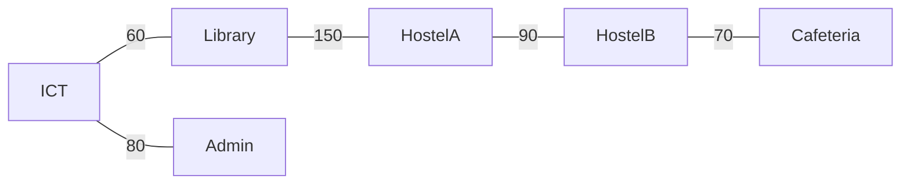

# X-02 Graph Theory in Algorithms, Networks and Scheduling

> [!info] Topic card
> **Modules:** DM (graphs, trees) · PY (algorithms) · PM (network diagrams, CPM) · SD (dependency graphs) · CS (network topology) · **Time:** 2–3 h · **Code:** `dijkstra`, `kruskal`, `longest_path_dag` and `find_cycle` in `08 - Cross-Module Connections/code/x_tools.py`; every number below is asserted in `test_x02_graphs`.

## 1. Learning objectives
1. **Recognise** the same graph problem in four modules: shortest paths, spanning trees, longest paths in DAGs, and cycle detection.
2. **Apply** Dijkstra and Kruskal to a campus network.
3. **Explain** why CPM's forward pass is a longest-path computation in a DAG, and verify it on PM-CASE-02.
4. **Detect** dependency cycles in a software design.

## 2. Why it matters
Once you see the graph, you can reuse one algorithm across subjects: the same topological order that schedules a project also orders module imports, and the same MST that minimises cable cost underlies network design.

## 3. Prerequisites
[[DM-15 Graphs, Representations, Paths and Connectivity]] · [[DM-16 Trees and Spanning Trees]] · [[PY-21 Data Structures and Algorithm Design]] · [[PM-05 Activity Sequencing, Network Diagrams and Gantt Charts]] · [[PM-06 Critical Path Method and Float]] · [[SD-06 Modular Design, Cohesion and Coupling]].

## 4. Intuition
| Question | Graph problem | Where |
|---|---|---|
| Cheapest way to connect all buildings? | Minimum spanning tree | CS/network design |
| Shortest route between two buildings? | Shortest path (Dijkstra) | DM, PY |
| Earliest finish of a project? | Longest path in a DAG | PM (CPM) |
| Can these modules be built in order? | Topological sort / cycle detection | SD, PY imports |

## 5. Rigorous explanation

### 5.1 Shortest paths
Dijkstra's algorithm finds shortest paths from one source in a graph with **non-negative** weights, in $O((V + E)\log V)$ with a binary heap. `dijkstra` raises an error on a negative weight, because the greedy choice is then unsafe.

### 5.2 Minimum spanning trees
A spanning tree of a connected graph with $V$ vertices has $V - 1$ edges. Kruskal's algorithm adds edges in increasing weight order, skipping any that would form a cycle (checked with union–find); the cut property guarantees the result is minimal.

### 5.3 CPM is a longest path
In an activity-on-node network, an activity's earliest finish is its duration plus the latest earliest finish of its predecessors. Applied in topological order, that's exactly the **longest path** recurrence. Longest paths are hard in general graphs, but easy in DAGs, and a project network must be a DAG (a cycle would mean an activity depends on itself).

### 5.4 Cycles in dependencies
A layered design (cli → services → repository → models) must be acyclic. A cycle means the modules can't be understood, tested or built independently. Depth-first search with three colours finds one: reaching a "grey" (in-progress) node again closes a cycle.

## 6. Terminology
| Term | Meaning |
|---|---|
| DAG | Directed acyclic graph |
| Topological order | A vertex order where every edge goes forward |
| Spanning tree | A tree containing every vertex |
| Relaxation | Improving a distance estimate via an edge |
| Critical path | A longest path through the project network |

## 7. Step-by-step: the campus network (tested)
Buildings and illustrative trench lengths in metres (fictional):

| Edge | m | Edge | m |
|---|---|---|---|
| Library–ICT | 60 | Library–HostelA | 150 |
| Cafeteria–HostelB | 70 | Cafeteria–Library | 180 |
| Admin–ICT | 80 | ICT–HostelA | 200 |
| HostelA–HostelB | 90 | Admin–Cafeteria | 210 |
| Admin–Library | 120 | ICT–HostelB | 260 |

1. **Kruskal:** take 60, 70, 80, 90; skip 120 (Admin and Library are already connected through ICT); take 150. Five edges for six buildings, **450 m** in total, against 1,420 m for all ten edges.
2. **Dijkstra from ICT:** Library 60, Admin 80, HostelA 200, Cafeteria 240 (via Library), HostelB 260 (direct; via HostelA would be 290).

## 8. Diagram: the MST

*Text version: the minimum spanning tree connects ICT to Library (60 m) and Admin (80 m), Library to HostelA (150 m), HostelA to HostelB (90 m), and HostelB to Cafeteria (70 m): 450 m in total.*

## 9. Worked examples

### Example 1 (basic): MST vs shortest paths
The MST minimises **total** cable; it doesn't minimise each route. In the MST, ICT reaches Cafeteria via Library–HostelA–HostelB–Cafeteria (60 + 150 + 90 + 70 = 370 m), while the shortest path in the full graph is 240 m. Different problems, different answers.

### Example 2 (intermediate): CPM = longest path (tested)
On the PM-CASE-02 network ([[PM-CASE-02 Wholesale Inventory Management System]]), `longest_path_dag` and `pm_tools.cpm` both give **21 weeks**, along A-B-E-F-H-I-J-K.

### Example 3 (challenging): a design cycle (tested)
Dependencies `cli → services → {repository, models}`, `repository → models`: `find_cycle` returns `[]`. Add `models → services` (say, a model calling a service to send a notification) and it returns `services → repository → models → services`. The fix is dependency inversion: models raise a domain event; a service handles it ([[SD-10 SOLID Principles]]). [[PRJ-PY-05 Hostel Maintenance System]] has a test that enforces its layering.

## 10. Application
- PM: draw your project network and check it's a DAG before running CPM.
- SD/PY: add an import-graph test to your FYP code (as in LabBook, [[SD-CASE LabBook Running Case Study]]).
- CS: an MST minimises cost but has no redundancy: one cut trench disconnects buildings. Availability needs extra links ([[CS-09 Network Security and Secure Communication]]).

## 11. Common mistakes
| Mistake | Fix |
|---|---|
| Dijkstra with negative weights | Bellman–Ford, or rethink the weights |
| Confusing MST with shortest paths | Total cost vs per-route cost |
| A cycle in a project network | Usually a mislabelled dependency; fix the logic |
| Treating the MST as a resilient design | Add redundant links for availability |

## 12. Comparison
| Algorithm | Problem | Complexity (typical) |
|---|---|---|
| BFS | Unweighted shortest path | $O(V + E)$ |
| Dijkstra (heap) | Non-negative weighted shortest path | $O((V + E)\log V)$ |
| Kruskal | MST | $O(E \log E)$ |
| Topological sort + DP | Longest path in a DAG (CPM) | $O(V + E)$ |
| DFS colouring | Cycle detection | $O(V + E)$ |

## 13. Practice
**L1** 1. How many edges does a spanning tree of 6 vertices have? 2. Why must a project network be acyclic?

**L2** 3. Run Kruskal by hand on the table in §7. 4. Run Dijkstra from Admin.

**L3** 5. Add a new edge ICT–Cafeteria of 100 m. Do the MST and the ICT shortest paths change? Check with the code.

**L4** 6. Prove that adding a constant to every edge weight doesn't change the MST, but can change shortest paths.

**L5** 7. Model your FYP's module dependencies as a graph, and add a cycle test to your test suite.

## 14. Hints
> [!tip]- Hints
> 5: 100 m replaces some edge in the cycle it creates? Compare it with the heaviest edge on that cycle. 6: every spanning tree has the same number of edges.

## 15. Worked solutions
> [!success]- Solutions
> 1. 5. 2. A cycle would mean an activity must finish before it can start. 3. As in §7: 450 m. 4. From Admin: ICT 80; Library 120 (direct, which beats Admin–ICT–Library at 140); Cafeteria 210 (direct; via Library it would be 300); HostelA 270 (via Library, 120 + 150, which beats 280 via ICT); HostelB 280 (Admin–Cafeteria–HostelB, 210 + 70). 5. ICT–Cafeteria (100) closes the cycle ICT–Library–HostelA–HostelB–Cafeteria–ICT, whose heaviest edge is Library–HostelA (150): the new MST swaps them, total 400 m. The shortest ICT–Cafeteria path becomes 100 m, and ICT–HostelB 170 m. (Check: run `kruskal` and `dijkstra` with the extra edge.) 6. Every spanning tree has $V - 1$ edges, so each tree's total grows by the same $(V - 1)c$; the order of trees is unchanged. Paths have different numbers of edges, so a path with fewer, heavier edges can become shorter.

## 16. Self-test
1. Which algorithm for cheapest total cabling? 2. What's CPM in graph terms? 3. What does a grey node revisited mean in DFS? 4. Why can't Dijkstra handle negative weights? 5. What's the campus MST total?
> [!success]- Answers
> 1. An MST algorithm (Kruskal or Prim). 2. The longest path in a DAG. 3. A cycle. 4. A settled vertex could later get a shorter distance, breaking the greedy invariant. 5. 450 m.

## 17. Flashcards
#flashcards/cross-module
CPM forward pass in graph terms?::Longest path in a DAG, computed in topological order.
MST edges for V vertices?::V − 1.
Cycle detection in a dependency graph?::DFS with white/grey/black colouring.
MST vs shortest path?::Minimum total cost vs minimum cost per route.

## 18. Blank-page recall
Draw the four-problem table (§4) and give one example from each module.

## 19. Revision summary
- One graph, many problems: MST, shortest paths, longest path (CPM), cycles.
- CPM works because project networks are DAGs.
- Layered designs must be acyclic; test it.

## 20. Links
[[X 00 Cross-Module Index]] · Prev: [[X-01 Logic and Sets in Python and Requirements]] · Next: [[X-03 Security Requirements in Software Architecture]] · [[DM-15 Graphs, Representations, Paths and Connectivity]] · [[DM-16 Trees and Spanning Trees]] · [[PM-06 Critical Path Method and Float]] · [[X-07 Scheduling Your Own Semester with CPM]]

## 21. Sources
- Rosen, K. H., *Discrete Mathematics and Its Applications*, 8th ed., McGraw-Hill, 2019 (graphs and trees chapters).
- Cormen, T. H., Leiserson, C. E., Rivest, R. L. & Stein, C., *Introduction to Algorithms*, 4th ed., MIT Press, 2022 (shortest paths, MSTs, DAG longest paths).
- *(Not checked online during the build, because there was no network access.)*

## 22. Mastery checklist
- [ ] I can run Kruskal and Dijkstra by hand and check with code
- [ ] I can explain CPM as a longest path
- [ ] I've added a dependency-cycle test to a project
- [ ] Reviews scheduled
