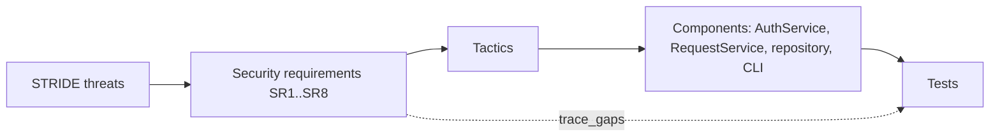

# X-03 Security Requirements in Software Architecture

> [!info] Topic card
> **Modules:** CS (threat modelling, controls) · SD (architecture, traceability) · PY (implementation, tests) · **Time:** 3 h · **Code:** `trace_gaps` in `07 - Software Design and Development/code/sd_tools.py`. The trace below runs against the **real test functions** of [[PRJ-PY-05 Hostel Maintenance System]], in `test_x03_security_requirements_trace_to_real_tests`.

## 1. Learning objectives
1. **Derive** testable security requirements from a STRIDE threat model.
2. **Map** each requirement to an architectural tactic and a component.
3. **Trace** requirements to tests, and find the gaps automatically.
4. **Judge** which gaps to fix and which to document as accepted risks.

## 2. Why it matters
Security added at the end becomes patches on a design that resists them. Security requirements written early shape the architecture: where authentication sits, which layer checks permissions, what's logged, and how data is stored.

## 3. Prerequisites
[[CS-02 Threat Modeling and Security Requirements]] · [[CS-04 Authorization and Access Control]] · [[CS-08 Password Storage and Authentication Security]] · [[SD-04 Use Cases, User Stories and Traceability]] · [[SD-05 Software Architecture and Architectural Styles]] · [[SD-17 Secure and Reliable Software Design]] · [[LAB-CS-07 Threat Modeling a Sample Web Application]].

## 4. Intuition
**Threat → requirement → tactic → component → test.** Each arrow is a decision you can review. A requirement with no test is an untested promise; a test with no requirement may be testing the wrong thing, or a requirement nobody wrote down.

## 5. Rigorous explanation

### 5.1 From STRIDE to requirements
| STRIDE threat | Property violated | Requirement pattern |
|---|---|---|
| Spoofing | Authentication | "The system shall authenticate … using …; shall resist online guessing by …" |
| Tampering | Integrity | "Changes to … shall be atomic and recorded …"; "inputs shall be validated …" |
| Repudiation | Non-repudiation | "Every state change shall record actor, time and reason …" |
| Information disclosure | Confidentiality | "Users shall only see … they own or are assigned …" |
| Denial of service | Availability | "Login attempts shall be throttled …"; "inputs shall be bounded …" |
| Elevation of privilege | Authorisation | "Only role R may perform action A …" |

A good security requirement is **testable**: "passwords stored with a memory-hard KDF in a self-describing format" can be tested; "the system shall be secure" can't ([[SD-03 Requirements Engineering]]).

### 5.2 Architectural tactics
| Tactic | Where it lives in a layered design |
|---|---|
| Authenticate | A service (`AuthService`), called before any use case |
| Authorise | The service layer: every use case checks role and ownership, so no interface can bypass it |
| Validate input | The domain layer (validation functions), plus parameterised SQL in the repository |
| Audit | The repository, in the same transaction as the change |
| Limit exposure | The interface: passwords via getpass/stdin, never argv; generic error messages |
| Secure storage | A KDF for passwords; hashes for reset tokens |

Putting authorisation in the **service layer** (not the CLI or UI) means a future web interface inherits it.

### 5.3 Traceability
A traceability matrix links each requirement to the tests that verify it. `trace_gaps(requirements, links, tests)` reports: untested requirements; links to tests that don't exist; and tests that no requirement mentions.

## 6. Terminology
| Term | Meaning |
|---|---|
| Security requirement | A testable statement of a security property the system must have |
| Tactic | A design decision that achieves a quality attribute |
| Trust boundary | Where data crosses between differently trusted components |
| Accepted risk | A known gap, documented with a reason and an owner |
| Defence in depth | Several independent controls for one threat |

## 7. Step-by-step
1. Draw the data-flow diagram, with trust boundaries ([[LAB-CS-07 Threat Modeling a Sample Web Application]]).
2. Apply STRIDE per element; list threats.
3. Write one testable requirement per threat (or group of threats).
4. Choose a tactic and a component for each.
5. Write tests; link them in the matrix.
6. Run `trace_gaps`; fix, or record accepted risks.

## 8. Diagram

*Text version: threats lead to requirements, requirements to tactics, tactics to components, and components to tests. `trace_gaps` checks the direct link from each requirement to its tests.*

## 9. Worked examples

### Example 1 (basic): one threat, end to end
*Threat (Spoofing):* an attacker guesses a warden's password. *Requirement SR3:* "After 3 consecutive failures, an account's next attempt shall be delayed by 30 s, doubling to a 15-minute cap." *Tactic:* throttling in `AuthService`. *Tests:* `test_backoff_schedule`, `test_throttling_with_fake_clock`.

### Example 2 (intermediate): the hostel system's matrix (tested)
| ID | Requirement | Tactic / component | Tests in PRJ-PY-05 |
|---|---|---|---|
| SR1 | Passwords stored with a memory-hard KDF | scrypt in `security.PasswordHasher` | `test_hash_format_and_verify`, `test_rehash_on_login_when_parameters_change` |
| SR2 | Generic authentication errors | `AuthService.authenticate` | `test_login_success_failure_and_generic_message` |
| SR3 | Login throttling | `login_delay`, `AuthService` | `test_backoff_schedule`, `test_throttling_with_fake_clock` |
| SR4 | Role and ownership checks | `RequestService` | `test_permissions`, `test_priority_and_visibility`, `test_reopen_window_and_owner` |
| SR5 | Atomic audit trail | `SqliteRepository.save_change` | `test_happy_path_and_audit_trail`, `test_update_and_history_are_atomic` |
| SR6 | Parameterised SQL and input validation | `models` validators, repository | `test_input_validation` |
| SR7 | Single-use, expiring reset tokens | `AuthService.reset_password` | `test_password_reset` |
| SR8 | MFA for staff accounts | (not implemented) | none |

Running `trace_gaps` against the 19 test functions actually in the project (42 collected tests, because of parametrisation) gives:
- **untested requirements:** `SR8`;
- **unknown tests:** none;
- **tests without a requirement:** 7, including `test_optimistic_concurrency_between_two_connections` and `test_password_policy`.

### Example 3 (challenging): interpreting the gaps
- **SR8** is a real gap: the project note lists MFA under "what a real deployment needs". In a real system it must be implemented or formally accepted, with an owner. For a teaching project, the honest response is to document it as an accepted risk.
- **The 7 unlinked tests** aren't bad tests: they verify *other* requirements (the lifecycle, concurrency NFR2, the password policy, reporting, the CLI, layering). The fix is to link them to their functional or non-functional requirement IDs, or, for the password policy, to add an SR ("passwords shall be at least 15 characters and not on a blocklist") that the matrix forgot. **The matrix found a missing requirement.**

## 10. Application
For your FYP, or for [[X-CASE-01 Secure Exam Results Portal]], produce this matrix early, and keep it in your repository with a test that runs `trace_gaps`, so a requirement can't silently lose its test.

## 11. Common mistakes
| Mistake | Fix |
|---|---|
| Untestable requirements ("secure", "robust") | A measurable statement per threat |
| Authorisation only in the UI | In the service layer |
| Audit log written separately from the change | Same transaction |
| A matrix maintained by hand and never checked | Automate it with `trace_gaps` |
| Gaps silently ignored | Fix, or record an accepted risk with an owner |

## 12. Comparison
| Approach | Strength | Weakness |
|---|---|---|
| Checklist (e.g. OWASP ASVS-style) | Broad coverage | Not specific to your threats |
| Threat-model-driven requirements | Specific, justified | Depends on the model's quality |
| Security testing only, at the end | Finds real bugs | Late; design flaws are expensive |

Use them together: threat modelling for the design, a checklist to catch omissions, testing to verify.

## 13. Practice
**L1** 1. Map each STRIDE letter to a property. 2. Why put authorisation in the service layer?

**L2** 3. Write a testable requirement for "information disclosure through error messages".

**L3** 4. Add SR9 for the password policy to the matrix, with its test, and predict `trace_gaps`' new output.

**L4** 5. Design the tactic, the component and the tests for SR8 (MFA for wardens).

**L5** 6. Build the full matrix for your FYP system, with an automated `trace_gaps` test.

## 14. Hints
> [!tip]- Hints
> 4: one test moves from "without requirement" to linked. 5: TOTP (CS-03 and the `totp` function in `cs_examples.py`).

## 15. Worked solutions
> [!success]- Solutions
> 1. S authentication, T integrity, R non-repudiation, I confidentiality, D availability, E authorisation. 2. Every interface (CLI, web, API) calls the services, so the checks can't be bypassed by adding a new interface. 3. "Error responses shall not reveal whether an account exists, stack traces, or SQL; they shall show a generic message and log the details server-side." 4. SR9 → `test_password_policy` (and `test_register_rejects_weak_and_personal_passwords`): untested stays `["SR8"]`; tests without a requirement drop from 7 to 5. 5. Tactic: a second factor (TOTP) for warden and technician roles. Component: `AuthService.authenticate` requires a valid code after the password for staff roles; enrolment stores a secret (encrypted at rest). Tests: a staff login fails without a code, and succeeds with a valid one at the injected time; a code outside the time window fails; residents are unaffected.

## 16. Self-test
1. What's the chain from threat to test? 2. What does `trace_gaps` report? 3. Which requirement did the hostel matrix leave untested? 4. What did the unlinked tests reveal? 5. Where does the audit tactic live?
> [!success]- Answers
> 1. Threat → requirement → tactic → component → test. 2. Untested requirements, unknown tests, links to unknown requirements, tests without a requirement. 3. SR8 (MFA). 4. A missing requirement (the password policy) and links to other requirement types. 5. The repository, in the same transaction as the change.

## 17. Flashcards
#flashcards/cross-module
STRIDE → properties?::Authentication, integrity, non-repudiation, confidentiality, availability, authorisation.
Where should authorisation live?::The service layer, so every interface inherits it.
What's a test without a requirement a sign of?::A missing (or unlinked) requirement, or a test of the wrong thing.

## 18. Blank-page recall
Write the STRIDE → requirement table, and the hostel matrix (SR1 to SR8), from memory.

## 19. Revision summary
- Security requirements come from threats and must be testable.
- Tactics live in specific layers; authorisation in services, audit with the data.
- Automate traceability; act on every gap.

## 20. Links
[[X 00 Cross-Module Index]] · Prev: [[X-02 Graph Theory in Algorithms, Networks and Scheduling]] · Next: [[X-04 Testing as Software Quality Assurance]] · [[CS-02 Threat Modeling and Security Requirements]] · [[SD-17 Secure and Reliable Software Design]] · [[PRJ-PY-05 Hostel Maintenance System]]

## 21. Sources
- Shostack, A., *Threat Modeling: Designing for Security*, Wiley, 2014 (STRIDE).
- Bass, L., Clements, P. & Kazman, R., *Software Architecture in Practice*, 4th ed., Addison-Wesley, 2021 (security tactics).
- *(Not checked online during the build, because there was no network access.)*

## 22. Mastery checklist
- [ ] I can derive testable security requirements from STRIDE
- [ ] I can place each tactic in the right layer
- [ ] I've run `trace_gaps` on a real project and acted on the result
- [ ] Reviews scheduled
