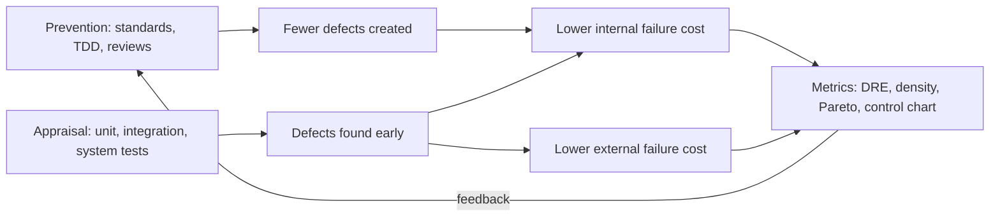

# X-04 Testing as Software Quality Assurance

> [!info] Topic card
> **Modules:** SD (V&V, test levels) · PY (pytest, TDD) · PM (quality management: cost of quality, Pareto, control charts) · **Time:** 2 h · **Code:** `defect_removal_efficiency`, `defect_density` and `cost_of_quality` in `x_tools.py`; `pareto` and `control_limits` in `pm_tools.py`. All the numbers are asserted in `test_x04_quality_metrics`.

## 1. Learning objectives
1. **Distinguish** quality assurance (process), quality control (product) and testing (one QC technique).
2. **Place** test levels and reviews in a project's quality plan, and cost them as prevention and appraisal.
3. **Compute** and interpret DRE, defect density, cost of quality, a Pareto chart and control limits.
4. **Use** the metrics to decide where to improve the process.

## 2. Why it matters
SD teaches you *how* to test; PM teaches you how to *manage* quality. Together they answer the questions a project manager asks: are we testing enough, are we finding defects early, and where should the next hour of effort go?

## 3. Prerequisites
[[SD-14 Software Testing, Verification and Validation]] · [[SD-15 Refactoring, Technical Debt, Code Review and Quality]] · [[PY-20 Testing, Debugging and Test-Driven Development]] · [[PM-13 Quality Management]].

## 4. Intuition
Testing finds defects; QA stops them being created. A defect found by a unit test costs minutes; the same defect found by users after release costs a support call, a fix, a redeployment and some trust.

## 5. Rigorous explanation

### 5.1 QA, QC and testing
| | Quality assurance | Quality control | Testing |
|---|---|---|---|
| Focus | The process | The product | Executing the product |
| Examples | Coding standards, reviews, CI, the definition of done, TDD | Inspections, test execution, acceptance | Unit, integration, system, acceptance tests |
| PM cost category | Prevention | Appraisal | Appraisal |

### 5.2 Cost of quality
- **Conformance:** prevention (training, standards, design reviews) + appraisal (testing, inspections).
- **Non-conformance:** internal failure (defects found before release: rework, retest) + external failure (after release: support, patches, reputation).

Shifting effort to prevention and early appraisal usually lowers the total ([[PM-13 Quality Management]]).

### 5.3 Defect metrics
- **Defect removal efficiency:** DRE = defects found before release ÷ (before + after). A higher DRE means fewer escape to users.
- **Defect density:** defects per KLOC (or per function point), for comparing components or releases.
- **Pareto analysis:** sort defect categories by count; typically a few categories cause most defects.
- **Control charts:** plot defects per week or sprint; a point outside the control limits signals a **special cause** worth investigating.

### 5.4 Test levels as a quality plan
| Level | Catches | Owner | Automated? |
|---|---|---|---|
| Static analysis (lint, types) | Type errors, dead code | Developer, CI | Yes |
| Unit | Logic errors in functions | Developer | Yes |
| Integration | Interface and data errors | Developer | Yes |
| System | Requirement violations end to end | Tester or team | Mostly |
| Acceptance (UAT) | Wrong requirements; usability | Users | Partly |
| Reviews | Design and requirement defects | Peers | No |

## 6. Terminology
| Term | Meaning |
|---|---|
| Verification | Building the product right (against the specification) |
| Validation | Building the right product (against real needs) |
| DRE | Defect removal efficiency |
| KLOC | Thousand lines of code |
| Special cause | A non-random cause of variation, signalled by a control chart |

## 7. Step-by-step: a quality review at the end of a release
1. Count defects by phase found (before or after release) → DRE.
2. Count defects by component and size → density.
3. Categorise defects → Pareto.
4. Plot defects per week → control chart; investigate points outside the limits.
5. Total the cost of quality → decide where to invest (e.g. more input-validation tests, a review checklist).

## 8. Diagram

*Text version: prevention reduces the defects created, and appraisal finds them early; both lower failure costs. Metrics (DRE, density, Pareto, control charts) feed back into what to prevent next.*

## 9. Worked examples

### Example 1 (basic): DRE and density (tested)
A release had 46 defects found before release and 4 by users afterwards: DRE = 46/50 = **0.92**. A component of 6,250 lines with 50 defects has a density of **8.0 per KLOC**.

### Example 2 (intermediate): cost of quality (tested)
Prevention TZS 2.0 M, appraisal 3.5 M, internal failure 4.0 M, external failure 6.5 M: conformance **5.5 M**, non-conformance **10.5 M**, total **16.0 M**. Non-conformance is almost twice conformance, a sign that more prevention and earlier testing would pay off.

### Example 3 (intermediate): Pareto (tested)
| Category | Count | Cumulative % |
|---|---|---|
| validation | 14 | 36.8 |
| authorisation | 9 | 60.5 |
| ui_text | 6 | 76.3 |
| reports | 4 | 86.8 |
| other | 3 | 94.7 |
| performance | 2 | 100.0 |

Two categories cause 60.5% of the 38 defects. Action: a validation test checklist and decision-table tests for permissions ([[X-01 Logic and Sets in Python and Requirements]]).

### Example 4 (challenging): a control chart signal (tested)
Defects per week over ten weeks: 5, 7, 4, 6, 8, 5, 6, 7, 5, 6. Mean 5.9; limits (mean ± 3 sample standard deviations, the simplification `control_limits` uses) **2.31 to 9.49**. Week 11 has **15** defects: above the upper limit, so look for a special cause, such as a large untested merge, before treating it as noise.

## 10. Application
In your FYP's evaluation chapter and in [[X-CAPSTONE Hostel Maintenance System Full Lifecycle]], report the test levels you used, the defect counts and the DRE for the prototype, honestly. Note that a student project's defect counts are small, so treat the metrics as descriptive, not statistically conclusive.

## 11. Common mistakes
| Mistake | Fix |
|---|---|
| "QA = testing" | QA is the process; testing is one QC activity |
| Testing only at the end | Test levels throughout, with CI |
| Comparing defect counts without size | Density per KLOC or function point |
| Treating every high week as a crisis | Use control limits to separate signal from noise |
| Chasing 100% coverage | Coverage shows what's untested, not that tests are good |

## 12. Comparison
| Metric | Answers | Pitfall |
|---|---|---|
| Coverage | What code ran during tests? | High coverage with weak assertions |
| DRE | How many defects escaped? | Needs post-release tracking |
| Density | Where are defects concentrated? | LOC varies with style |
| Pareto | Which category to fix first? | Categories must be consistent |
| Control chart | Is variation special? | Needs a stable baseline |

## 13. Practice
**L1** 1. Classify: code review, unit test run, user complaint fix, coding standard. 2. Define DRE.

**L2** 3. Compute DRE for 120 before and 30 after release.

**L3** 4. Run `pareto` on your own project's defect categories.

**L4** 5. A team's DRE fell from 0.92 to 0.80 after it stopped code reviews. Argue for restoring them using the cost of quality.

**L5** 6. Write a one-page quality plan for your FYP: test levels, tools, metrics and targets.

## 14. Hints
> [!tip]- Hints
> 3: 120/150. 5: more escaped defects means higher external failure cost.

## 15. Worked solutions
> [!success]- Solutions
> 1. Review: prevention/appraisal (QA process, QC of the design); unit test run: appraisal; user complaint fix: external failure; coding standard: prevention. 2. Defects found before release divided by all defects found (before and after). 3. 0.80. 4. Depends on your data. 5. With the same number of defects, DRE 0.80 vs 0.92 means 2.5 times as many escape (20% vs 8%). External failures are the most expensive category, so the saved review hours are likely outweighed by the failure costs; measure both for one release to confirm.

## 16. Self-test
1. QA vs QC? 2. Which costs are conformance costs? 3. What does a point above the UCL mean? 4. Why use density, not counts? 5. What did the Pareto example recommend?
> [!success]- Answers
> 1. Process vs product. 2. Prevention and appraisal. 3. A likely special cause: investigate. 4. To compare components of different sizes. 5. Validation checklists and decision-table permission tests.

## 17. Flashcards
#flashcards/cross-module
QA vs QC vs testing?::QA = process; QC = product checks; testing = one QC technique.
DRE formula?::Before-release defects ÷ (before + after).
Cost of quality categories?::Prevention, appraisal (conformance); internal, external failure (non-conformance).
Control chart point outside limits?::Signals a special cause; investigate.

## 18. Blank-page recall
Draw the cost-of-quality table, and compute DRE and density from the worked example.

## 19. Revision summary
- Testing is QC; QA improves the process that creates the software.
- Measure with DRE, density, Pareto and control charts; invest in prevention.
- Report your project's metrics honestly, with their limitations.

## 20. Links
[[X 00 Cross-Module Index]] · Prev: [[X-03 Security Requirements in Software Architecture]] · Next: [[X-05 Security Risk in Project Management]] · [[SD-14 Software Testing, Verification and Validation]] · [[PM-13 Quality Management]] · [[PY-20 Testing, Debugging and Test-Driven Development]]

## 21. Sources
- PMI, *PMBOK® Guide*, 6th ed., 2017 (quality management, cost of quality).
- Sommerville, I., *Software Engineering*, 10th ed., Pearson, 2016 (software testing; quality management).
- *(Not checked online during the build, because there was no network access.)*

## 22. Mastery checklist
- [ ] I can distinguish QA, QC and testing
- [ ] I can compute DRE, density, cost of quality, Pareto and control limits
- [ ] I've written a quality plan for my project
- [ ] Reviews scheduled
