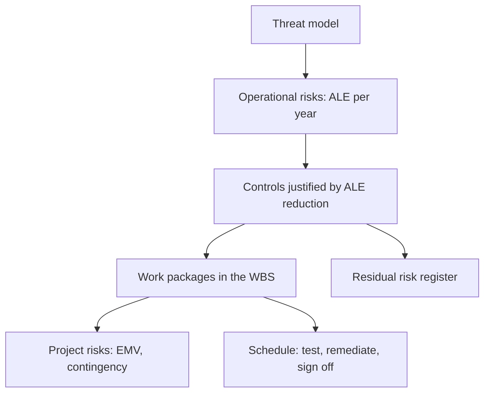

# X-05 Security Risk in Project Management

> [!info] Topic card
> **Modules:** CS (quantitative risk: SLE, ALE, controls) · PM (risk register, EMV, contingency, WBS) · **Time:** 2 h · **Code:** `ale` and `control_value` in `02 - Cyber Security/code/cs_examples.py`; `emv` in `pm_tools.py`; `rosi` in `x_tools.py`. All the numbers are asserted in `test_x05_security_risk_in_pm_terms`.

## 1. Learning objectives
1. **Distinguish** project risks (to delivery: time, cost, scope) from operational security risks (to the system once it runs), and record both.
2. **Compute** EMV for project risks and ALE for operational risks, and explain why they're not added together.
3. **Justify** a security control financially (net benefit, ROSI), and state the limits of such numbers.
4. **Build** security activities into the WBS, schedule and budget.

## 2. Why it matters
Security work that isn't in the plan doesn't get done: there's no time for the threat model, the security test is cut when the schedule slips, and the risk register lists "hacking" with no owner. The PM tools you know can carry security, if you use them properly.

## 3. Prerequisites
[[CS-01 Security Foundations - CIA, Threats, Vulnerabilities and Risk]] · [[CS-16 Risk Analysis, Policy, Governance and Compliance]] · [[PM-04 Scope Management, Requirements Traceability and WBS]] · [[PM-09 Cost Estimation and Budgeting]] · [[PM-11 Risk Management]].

## 4. Intuition
Two clocks: **project risks** threaten delivery (they happen once, during the project); **operational risks** threaten the running system (they recur, year after year). The project must deliver controls for the second kind, and those controls create work, cost and risks of the first kind.

## 5. Rigorous explanation

### 5.1 Two kinds of risk
| | Project risk | Operational security risk |
|---|---|---|
| Example | The security test finds critical flaws a week before go-live | Results are tampered with after go-live |
| Measure | EMV = P × impact (one-off) | ALE = SLE × ARO (per year), SLE = AV × EF |
| Funded by | Contingency reserve | The control budget (capex/opex), justified by risk reduction |
| Owner | Project manager / task owner | System owner / information security |

**Don't add EMV and ALE:** one is a one-off amount during the project, the other a yearly rate after it. Keep them in separate sections of the register, or label the units clearly.

### 5.2 Justifying a control
- Net annual benefit = ALE(before) − ALE(after) − annual cost of the control (`control_value`).
- ROSI = (ALE(before) − ALE(after) − cost) ÷ cost (`rosi`).

These numbers rest on estimates (especially ARO), so treat them as structured judgement, not facts: show the assumptions, and do a sensitivity check (what ARO makes the control break even?).

### 5.3 Security in the WBS and schedule
Typical work packages:
- the threat model and security requirements ([[X-03 Security Requirements in Software Architecture]]);
- secure design review;
- security testing: SAST/DAST and, **only with written authorisation and agreed scope**, penetration testing;
- vulnerability remediation, with time reserved;
- logging, monitoring and an incident response plan;
- security awareness for users and admins;
- the go-live security sign-off.

Put remediation time **after** the security test on the network diagram, and before go-live. That's a common critical-path surprise.

### 5.4 Responses
Avoid (don't build the risky feature), mitigate (controls), transfer (insurance, contracts with security obligations, [[PM-14 Procurement and Change Management]]), accept (documented, with an owner and an expiry date).

## 6. Terminology
| Term | Meaning |
|---|---|
| AV, EF | Asset value; exposure factor (fraction lost per incident) |
| SLE | Single loss expectancy = AV × EF |
| ARO | Annualised rate of occurrence |
| ALE | Annualised loss expectancy = SLE × ARO |
| EMV | Expected monetary value = P × impact |
| ROSI | Return on security investment |
| Residual risk | The risk remaining after controls |

## 7. Step-by-step
1. List operational threats from the threat model; estimate AV, EF and ARO; compute ALE.
2. Choose controls; estimate the ALE after; compute net benefit and ROSI.
3. Add each chosen control's implementation to the WBS, with estimates.
4. List project risks created by the security work (late findings, specialist availability); compute EMV; add them to the contingency.
5. Schedule security testing and remediation before go-live; check the critical path.
6. Record residual risks, with owners, in the register.

## 8. Diagram

*Text version: the threat model gives operational risks (ALE). Controls are justified by the ALE they remove, and become work packages. That work creates project risks (EMV, funded by contingency) and schedule activities. What's left goes in the residual risk register.*

## 9. Worked examples

### Example 1 (basic): ALE (tested)
For a results database (fictional): AV = TZS 160 M (the cost of a re-sit cycle, investigations and reputational damage, as estimated by the owner), EF = 0.25 → SLE **40 M**. With ARO = 0.25 (one incident every 4 years), ALE = **10 M per year**.

### Example 2 (intermediate): justifying a control (tested)
MFA for staff, a maker–checker approval for grade changes, and an audit log are estimated to cut ARO to 0.05 → ALE **2 M**. The annual cost is 3 M. Net benefit = 10 − 2 − 3 = **5 M per year**; ROSI = 5/3 ≈ **1.67**. *Sensitivity:* the control breaks even if it only cuts ALE by 3 M, i.e. if the ARO after it is 0.175 or less. Even a much weaker effect than estimated still justifies it.

### Example 3 (intermediate): project risks for the same portal (tested)
| ID | Project risk | P | Impact | EMV |
|---|---|---|---|---|
| R1 | Security test finds critical flaws late → rework | 0.10 | 40 M | 4.0 M |
| R2 | Early release of results through a misconfiguration during the pilot | 0.15 | 20 M | 3.0 M |
| R3 | Outage on results day (load) | 0.30 | 8 M | 2.4 M |
| R4 | Go-live slips past the results release date | 0.25 | 12 M | 3.0 M |
| | **Total** | | | **12.4 M** |

The contingency for these is 12.4 M: a one-off project figure, **not** comparable with the 10 M/year ALE.

### Example 4 (challenging): a schedule consequence
In [[X-CASE-01 Secure Exam Results Portal]], security testing (2 weeks) and UAT are on the critical path just before go-live. If the test finds critical issues, remediation pushes go-live back day for day, with no float. Responses: start a security review of each component as it's built (shift left, so the final test finds less), and agree with the sponsor in advance that go-live without a security sign-off isn't an option.

## 10. Application
Add a "security" section to your FYP risk register ([[FYP-T11 Risk Register]]): one or two operational risks to your prototype's data, and the project risk that ethics or security review delays you.

## 11. Common mistakes
| Mistake | Fix |
|---|---|
| "Hacking" as a single risk | Specific threats, from the threat model |
| Adding ALE and EMV | Different units; keep them apart |
| Presenting ARO guesses as facts | Show assumptions and a sensitivity check |
| No time for remediation | Schedule it after security testing |
| Penetration testing without authorisation | Written scope and permission, always |

## 12. Comparison
| Tool | Strength | Weakness |
|---|---|---|
| Qualitative matrix (P × I, 1–5) | Fast; no false precision | Hard to compare with costs |
| ALE / ROSI | Speaks the budget's language | Sensitive to ARO estimates |
| EMV / decision trees | Good for project choices | One-off; ignores recurrence |

## 13. Practice
**L1** 1. Define SLE, ALE and EMV. 2. Why not add ALE to EMV?

**L2** 3. AV 50 M, EF 0.4, ARO 0.5: compute SLE and ALE.

**L3** 4. A control costs 6 M per year and reduces the ALE in question 3 to 2 M. Net benefit and ROSI?

**L4** 5. Draw the go-live part of a network with security testing and remediation, and identify the critical path.

**L5** 6. Write the security part of your FYP risk register, with ALE and EMV where you can justify the estimates.

## 14. Hints
> [!tip]- Hints
> 3: SLE = AV × EF. 4: 10 − 2 − 6.

## 15. Worked solutions
> [!success]- Solutions
> 1. SLE = AV × EF (per incident); ALE = SLE × ARO (per year); EMV = P × impact (one-off, expected). 2. ALE is a yearly operational rate; EMV is a one-off project expectation. Adding them mixes units. 3. SLE 20 M; ALE 10 M. 4. Net 2 M per year; ROSI 2/6 ≈ 0.33. 5. For example: system test → security test (2) → remediation (1) → UAT (1) → go-live; with security test and remediation in series, both are critical unless they're overlapped with other work.

## 16. Self-test
1. Which is per year, ALE or EMV? 2. What's ROSI's formula? 3. In Example 2, at what ARO does the control break even? 4. Where does remediation go in the schedule? 5. Which response category is insurance?
> [!success]- Answers
> 1. ALE. 2. (ALE before − ALE after − cost) ÷ cost. 3. 0.175 (ALE after = 7 M = 40 M × 0.175). 4. After security testing, before go-live. 5. Transfer.

## 17. Flashcards
#flashcards/cross-module
ALE vs EMV?::ALE = yearly operational loss expectancy; EMV = one-off project expectation.
Net benefit of a control?::ALE before − ALE after − annual cost.
Where to schedule remediation?::After security testing, before go-live.
Security work packages?::Threat model, design review, security testing, remediation, monitoring, awareness, sign-off.

## 18. Blank-page recall
Recompute Examples 1–3 from memory, and list the security work packages.

## 19. Revision summary
- Record project risks (EMV) and operational security risks (ALE) separately.
- Justify controls with net benefit and ROSI, showing the assumptions.
- Put security work, including remediation time, in the WBS and on the network.

## 20. Links
[[X 00 Cross-Module Index]] · Prev: [[X-04 Testing as Software Quality Assurance]] · Next: [[X-06 Research Methodology Applied to the Final Year Project]] · [[CS-16 Risk Analysis, Policy, Governance and Compliance]] · [[PM-11 Risk Management]] · [[PM-A06 Risk Register]]

## 21. Sources
- PMI, *PMBOK® Guide*, 6th ed., 2017 (risk management).
- Stallings, W. & Brown, L., *Computer Security: Principles and Practice*, 4th ed., Pearson, 2018 (risk assessment).
- *(Not checked online during the build, because there was no network access.)*

## 22. Mastery checklist
- [ ] I can compute and separate ALE and EMV
- [ ] I can justify a control, with a sensitivity check
- [ ] My plan schedules security testing and remediation
- [ ] Reviews scheduled
