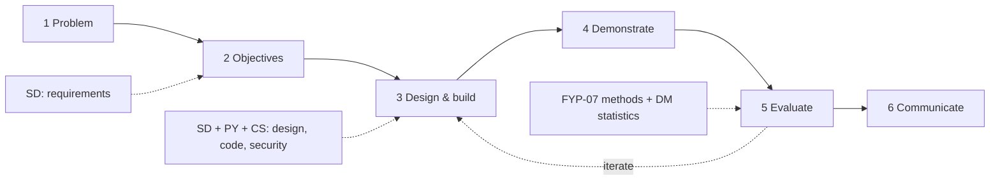

# X-06 Research Methodology Applied to the Final Year Project

> [!info] Topic card
> **Modules:** all six · **Time:** 2 h · **Calculators:** `fyp_tools.py` (sampling, alpha, SUS), `pm_tools.py` (CPM, risk), `sd_tools.py` (traceability) · **Running example:** the hostel maintenance system ([[FYP 00 Dashboard]], [[PRJ-PY-05 Hostel Maintenance System]]).

## 1. Learning objectives
1. **Map** the design science research (DSR) activities onto a software development lifecycle.
2. **Identify** which module's methods answer each part of an FYP.
3. **Separate** the research contribution from the engineering work, and justify both.
4. **Plan** an FYP in which every claim has evidence produced by an appropriate method.

## 2. Why it matters
Examiners often find that a proposal describes a good system but not a study, or a study with no rigorous artefact. Combining methodology (FYP) with engineering (SD, PY), planning (PM), security and ethics (CS) and quantitative reasoning (DM) avoids both failures.

## 3. Prerequisites
[[FYP-05 Research Paradigms and Methodology]] · [[FYP-07 Data Collection Instruments, Sampling and Evaluation Planning]] · [[SD-02 Software Process Models]] · [[SD-14 Software Testing, Verification and Validation]] · [[PM-06 Critical Path Method and Float]] · [[DM-18 Introductory Discrete Probability]].

## 4. Intuition
The **software process** tells you how to build the artefact well. The **research method** tells you how to know, and show, that the artefact solves the problem. DSR is the bridge: building *is* part of the research, provided you evaluate it rigorously.

## 5. Rigorous explanation

### 5.1 DSR activities and the SDLC
| DSR activity (Peffers et al., 2007) | SDLC phase | Methods and modules | Evidence produced |
|---|---|---|---|
| 1. Problem identification and motivation | Feasibility, initiation | Interviews, survey (FYP-07); literature (FYP-03/04) | A problem statement with evidence |
| 2. Objectives of a solution | Requirements | Elicitation, use cases, SMART objectives (SD-03/04, FYP-02/06) | SRS, a traceability matrix |
| 3. Design and development | Design, implementation | Architecture, UML, patterns (SD-05 to SD-12); Python (PY) | A tested prototype |
| 4. Demonstration | System test, pilot | A scenario walkthrough with users | A demonstration record |
| 5. Evaluation | Acceptance, evaluation | Usability tests, SUS, interviews (FYP-07); metrics (X-04) | Results against the objectives |
| 6. Communication | Documentation, the report | Proposal, report, defence (FYP-11/12) | The proposal and final report |

The SDLC can be iterative (Scrum sprints, [[PM-16 Agile, Scrum and Hybrid Delivery]]); the DSR activities can iterate too: evaluation can send you back to design.

### 5.2 What each module contributes
| Module | Contribution to the FYP |
|---|---|
| FYP | The research questions, methodology, ethics, the proposal and defence |
| SD | Requirements, architecture, design models, testing strategy |
| PY | The prototype; analysis scripts (statistics, SUS, alpha) |
| PM | WBS, CPM schedule, risk register, progress reporting |
| CS | Threat model, privacy and data protection, secure implementation |
| DM | Logic for rules (X-01), graphs (X-02), probability for sampling and inference |

### 5.3 Research contribution vs engineering
A working system alone is engineering. The **research contribution** is what others can learn: validated requirements for a context, a design and its evaluated effect, or a comparison. State it explicitly in Chapter 1 and the conclusion, and make sure your evaluation can support it.

### 5.4 Rigour checks
- **Alignment:** every RQ has a method and evidence (`alignment_gaps`, [[FYP-11 Writing the Research Proposal]]).
- **Traceability:** every requirement has a test (`trace_gaps`, [[X-03 Security Requirements in Software Architecture]]).
- **Validity:** sampling justified (`finite_correction`, saturation), instruments piloted (`cronbach_alpha`).
- **Ethics:** approvals before contact with participants ([[FYP-10 Research Ethics, Privacy, Academic Integrity and Citation]]).
- **Honesty:** limitations stated; numbers reproducible from your scripts.

## 6. Terminology
| Term | Meaning |
|---|---|
| Artefact | The constructs, models, methods or instantiations produced in DSR |
| Demonstration | Showing the artefact solving an instance of the problem |
| Evaluation | Measuring how well it does so, against the objectives |
| Contribution | What the study adds that others can use |

## 7. Step-by-step: planning your FYP with all six modules
1. Problem and RQs (FYP-01/02), with preliminary evidence.
2. Literature and gap (FYP-03/04).
3. Methodology: DSR plus the data-collection methods (FYP-05/07).
4. Requirements and traceability (SD-03/04, FYP-06).
5. Threat model and privacy plan (CS-02, CS-19, FYP-10).
6. Architecture and design (SD-05 onwards, FYP-08).
7. Schedule and risks (PM-04/06/11, FYP-09).
8. Build and test (PY, SD-13/14) in FYP II.
9. Evaluate (FYP-07; analysis scripts in PY).
10. Write and defend (FYP-11/12).

## 8. Diagram

*Text version: DSR runs from problem to objectives, design and build, demonstration, evaluation and communication, with evaluation feeding back into design. SD supplies the requirements work; SD, PY and CS the design and build; FYP-07 methods and DM statistics the evaluation.*

## 9. Worked examples

### Example 1 (basic): which method for which RQ?
For the running example: RQ1 (the current process) → interviews and a resident survey; RQ2 (requirements) → elicitation and validation with wardens; RQ3 (design) → DSR build with tests; RQ4 (usability and usefulness) → a usability test, SUS and interviews. See [[FYP-T03 Research Questions]].

### Example 2 (intermediate): numbers that come from the modules
- Survey of a hostel population of 2,400 at 95% confidence, ±5%: `finite_correction(cochran_n0(), 2400)` = **332** responses; at a 50% response rate, **664** invitations ([[FYP-07 Data Collection Instruments, Sampling and Evaluation Planning]]).
- The FYP I plan: **18 weeks** by CPM, compressed to 15 with zero buffer ([[FYP-09 Project Scheduling, Milestones and Risk Assessment]]).
- Security traceability: one untested security requirement (MFA) in the prototype ([[X-03 Security Requirements in Software Architecture]]).

### Example 3 (challenging): a contribution statement
> "This study contributes (1) a set of requirements for maintenance request handling in a low-resource university hostel, validated with wardens and maintenance staff; (2) a prototype design implementing prioritisation and status tracking, with its security requirements traced to tests; and (3) an evaluation of the prototype's usability (SUS) and perceived usefulness with residents and wardens, including its limitations."

Each part maps to an RQ and an evidence source; nothing claims more than the evaluation can support.

## 10. Application
Use this lesson to check your proposal's Chapter 3: for each DSR activity, name the method, the module it comes from, and the evidence it produces.

## 11. Common mistakes
| Mistake | Fix |
|---|---|
| Describing Scrum as the research methodology | Scrum is a process model; DSR (or another strategy) is the methodology |
| No evaluation, or evaluating only "it works" | Evaluate against the objectives with users |
| Claims beyond the evidence | Match the contribution to the evaluation |
| Security and ethics as afterthoughts | Plan them in FYP I |

## 12. Comparison
| | Software process (SD) | Research methodology (FYP) |
|---|---|---|
| Question | How do we build it well? | How do we know it solves the problem? |
| Output | A working, tested system | Knowledge, supported by evidence |
| Quality criterion | Meets requirements; maintainable | Valid, reliable, ethical, honest |

## 13. Practice
**L1** 1. List the six DSR activities. 2. Is Scrum a research methodology?

**L2** 3. Map your RQs to methods and modules.

**L3** 4. Write your contribution statement, and check that each part has evidence.

**L4** 5. A classmate's project has no evaluation planned. Propose one that fits their RQs.

**L5** 6. Produce a one-page "six modules in my FYP" table for your supervisor.

## 14. Hints
> [!tip]- Hints
> 2: [[FYP-05 Research Paradigms and Methodology]] self-test. 5: start from their objectives.

## 15. Worked solutions
> [!success]- Solutions 1–2, 5
> 1. Problem identification; objectives; design and development; demonstration; evaluation; communication. 2. No: it's a software process framework. It can be how you run the build within DSR. 5. Take each objective, choose a measure (e.g. task success ≥ 90%, SUS, time to report a fault vs the paper process), an instrument and participants, and add ethics approval to the plan.

## 16. Self-test
1. Which DSR activity uses SUS? 2. What does `trace_gaps` contribute to rigour? 3. What's the research contribution of a DSR project? 4. Which module supplies the schedule? 5. Where do ethics approvals go in the plan?
> [!success]- Answers
> 1. Evaluation. 2. Evidence that every requirement is verified. 3. Knowledge others can use (requirements, a design and its evaluated effect), not just the system. 4. PM. 5. Before any contact with participants, early, on the critical path.

## 17. Flashcards
#flashcards/cross-module
DSR activities?::Problem, objectives, design and development, demonstration, evaluation, communication.
Process model vs methodology?::How you build vs how you know it works.
What makes an FYP contribution credible?::Each claim maps to an RQ and to evidence from an appropriate method.

## 18. Blank-page recall
Draw the DSR–SDLC mapping table from memory.

## 19. Revision summary
- DSR links research and engineering; each activity maps to an SDLC phase.
- Every module contributes a method; the FYP integrates them.
- Contributions must be backed by evaluation.

## 20. Links
[[X 00 Cross-Module Index]] · Prev: [[X-05 Security Risk in Project Management]] · Next: [[X-07 Scheduling Your Own Semester with CPM]] · [[FYP 02 Idea-to-Defense Workflow]] · [[X-CAPSTONE Hostel Maintenance System Full Lifecycle]]

## 21. Sources
- Peffers, K., Tuunanen, T., Rothenberger, M. A. & Chatterjee, S., "A design science research methodology for information systems research", *Journal of Management Information Systems*, 24(3), 2007, pp. 45–77.
- Hevner, A. R., March, S. T., Park, J. & Ram, S., "Design science in information systems research", *MIS Quarterly*, 28(1), 2004, pp. 75–105.
- *(Not checked online during the build, because there was no network access.)*

## 22. Mastery checklist
- [ ] I can map DSR to the SDLC
- [ ] My FYP plan names a method for every RQ, from the right module
- [ ] My contribution statement is backed by planned evidence
- [ ] Reviews scheduled
