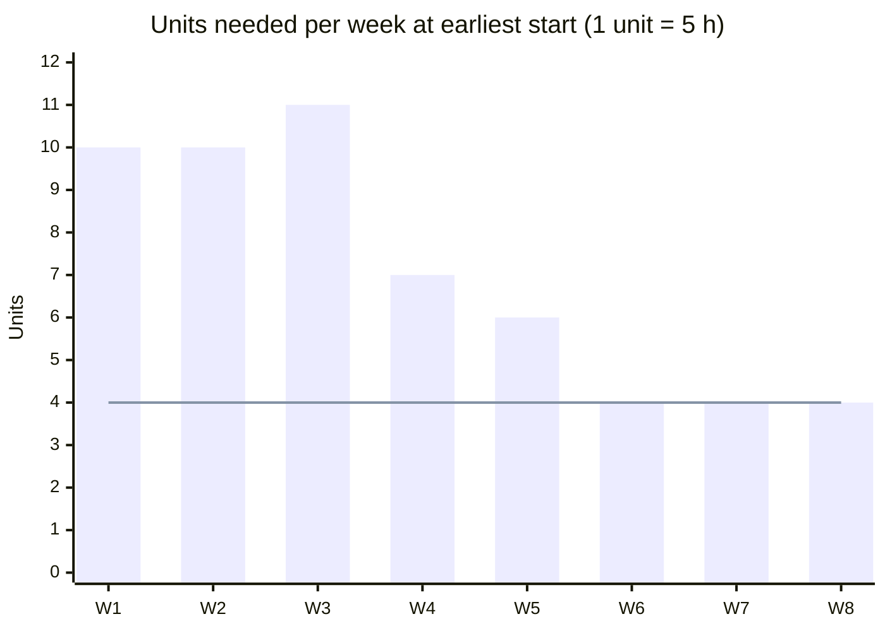

# X-07 Scheduling Your Own Semester with CPM

> [!info] Topic card
> **Modules:** PM (CPM, resource-constrained scheduling) · FYP (your project plan) · DM (graphs) · all modules (the workload) · **Time:** 1.5 h, then 20 minutes a week · **Code:** `cpm`, `resource_profile` and `resource_constrained` in `pm_tools.py`; the example is asserted in `test_x07_semester_plan`.

> [!warning] A fictional workload
> The activities, durations and hours below are illustrative. They are **not** this semester's real assessments or deadlines, which weren't supplied. Use your own timetable and handbooks.

## 1. Learning objectives
1. **Model** your semester's coursework as an activity network with durations and dependencies.
2. **Find** the critical path, and the float on everything else.
3. **Show** that your study hours are the binding constraint, and compute the real finish time under a weekly limit.
4. **Plan** each week from the schedule, and update it as things change.

## 2. Why it matters
CPM assumes unlimited resources. You have one resource, yourself, with a fixed number of hours a week. Applying PM-08's resource-constrained scheduling to your own semester shows, with numbers, why "I'll do it all in the last weeks" fails.

## 3. Prerequisites
[[PM-05 Activity Sequencing, Network Diagrams and Gantt Charts]] · [[PM-06 Critical Path Method and Float]] · [[PM-08 Resource Allocation and Levelling]] · [[X-02 Graph Theory in Algorithms, Networks and Scheduling]].

## 4. Intuition
The critical path tells you which work can't slip. Your weekly hour limit tells you how much work fits in a week. When the limit binds, the project gets longer than the critical path, so start early, and spend float deliberately.

## 5. Rigorous explanation

### 5.1 The model
- **Activities:** pieces of work with a deliverable (e.g. "PY project build").
- **Durations:** in weeks, at the planned intensity.
- **Dependencies:** e.g. the build follows the design; exam revision follows all coursework.
- **Demand:** study units per week (here, 1 unit = 5 hours of independent study).
- **Limit:** your realistic weekly units.

### 5.2 What CPM gives and doesn't give
CPM gives the earliest finish **with unlimited hours**, plus float. The resource profile shows the hours needed each week. If the peak exceeds your limit, you need resource-constrained scheduling: `resource_constrained` delays activities until capacity allows (a heuristic that favours activities with the least slack).

### 5.3 A lower bound
Total work ÷ weekly limit gives a lower bound on the duration. No schedule can beat it.

## 6. Terminology
| Term | Meaning |
|---|---|
| Resource profile | Units needed in each period |
| Resource-constrained schedule | A schedule that respects a capacity limit |
| Float | Slack before an activity delays the end |
| Lower bound | The minimum possible duration given total work and capacity |

## 7. Step-by-step (tested example)
| ID | Activity (fictional) | Weeks | Units/week | Depends on |
|---|---|---|---|---|
| A | PY project design | 2 | 2 | — |
| B | PY project build | 3 | 3 | A |
| C | PY tests and docs | 1 | 2 | B |
| D | SD UML assignment | 2 | 2 | — |
| E | SD report | 1 | 2 | D |
| F | CS lab reports 1–4 | 2 | 1 | — |
| G | CS lab reports 5–8 | 2 | 1 | F |
| H | PM group plan (CPM, EVM) | 2 | 2 | — |
| I | PM status report | 1 | 1 | H |
| K | FYP literature | 2 | 2 | — |
| J | FYP proposal draft | 3 | 3 | K |
| L | FYP defence preparation | 1 | 2 | J |
| M | DM problem sets | 3 | 1 | — |
| N | Exam revision | 2 | 4 | C, E, G, I, L, M |

1. **CPM:** 8 weeks, critical path **A-B-C-K-J-L-N** (two chains, the PY project and the FYP, both 6 weeks before revision). Float: D, E, H, I, M 3 weeks; F, G 2 weeks.
2. **Resource profile at earliest starts:** 10, 10, 11, 7, 6, 4, 4, 4 units, i.e. a peak of **55 hours** of independent study in week 3. Impossible alongside lectures.
3. **Total work:** 56 units = **280 hours**.
4. **With a limit of 4 units (20 h/week):** `resource_constrained` gives **15 weeks** (the lower bound is 56/4 = 14). With 5 units (25 h/week): **12 weeks** (lower bound 11.2). With 7 units: 10 weeks.

## 8. Diagram

*Text version: at the earliest-start schedule, the first three weeks need 10, 10 and 11 units (50–55 hours), falling to 4 units by week 6. The line shows a 4-unit (20-hour) weekly limit, far below the early peak.*

## 9. Worked examples

### Example 1 (basic): reading the float
The SD assignment (D, E) has 3 weeks of float: you can start it as late as week 4 without delaying the end at unlimited hours. But with limited hours, "float" is consumed by capacity, so don't spend it by default.

### Example 2 (intermediate): the cost of a low limit (tested)
At 20 h/week the plan takes 15 weeks, almost double the 8-week CPM figure. If your semester has, say, 13 teaching weeks before exams, this workload doesn't fit at 20 h/week. Options: raise your weekly hours (25 h/week gives 12 weeks), reduce scope (e.g. agree a smaller project with your supervisor, where allowed), or start the long chains (PY project, FYP) earlier.

### Example 3 (challenging): what the schedule says to do first
With a 5-unit limit, `resource_constrained` starts A (PY design), K (FYP literature) and F (CS labs) in week 1: the two critical chains start immediately, and the low-intensity lab reports fill the remaining unit. The DM problem sets (M), with float, start in week 7. The schedule tells you what to do *this* week, which is the point.

## 10. Application
Every Sunday, spend 20 minutes: update the remaining durations, rerun `cpm` and `resource_constrained` with your hours for the coming weeks (exam weeks at reduced capacity, via `limit_at`), and plan the next week from the start times.

## 11. Common mistakes
| Mistake | Fix |
|---|---|
| Ignoring your hour limit | Resource-constrained scheduling |
| Treating float as free time | Capacity usually consumes it |
| Durations without intensity | Estimate units per week too |
| Planning once | Update weekly |
| Forgetting non-study commitments | Lower the limit in those weeks (`limit_at`) |

## 12. Comparison
| Plan type | Shows | Misses |
|---|---|---|
| To-do list | What | When, dependencies, capacity |
| Calendar of deadlines | When things are due | How long they take |
| CPM | Order, critical work, float | Your hour limit |
| Resource-constrained CPM | A feasible schedule | Uncertainty (add a buffer, PERT) |

## 13. Practice
**L1** 1. What does CPM assume about resources? 2. Compute the lower bound for 300 hours at 25 h/week.

**L2** 3. Recompute the profile if B needs 2 units a week instead of 3.

**L3** 4. Run the example with `limit_at={6: 2, 7: 2}` (two busy weeks) at a 5-unit limit, and report the new end.

**L4** 5. Which single change most shortens the 20 h/week schedule: starting the FYP literature a week earlier (before the semester), or shortening the PY build by a week? Justify with runs.

**L5** 6. Model your own semester, and use the plan every week for a month.

## 14. Hints
> [!tip]- Hints
> 2: 300/25. 4–5: use `pm_tools` directly; compare the end weeks.

## 15. Worked solutions
> [!success]- Solutions 1–3
> 1. Unlimited resources: activities start as soon as their predecessors finish. 2. 12 weeks. 3. Weeks 3–5 each drop by 1 unit (B runs in weeks 3–5): 10, 10, 10, 6, 5, 4, 4, 4. Total work becomes 53 units.

## 16. Self-test
1. What's the example's CPM duration? 2. At 20 h/week? 3. What's the lower bound at 20 h/week? 4. What does float mean when capacity binds? 5. How often should you update the plan?
> [!success]- Answers
> 1. 8 weeks. 2. 15 weeks. 3. 14 weeks (280 h / 20 h). 4. Less than CPM suggests: capacity uses it up. 5. Weekly.

## 17. Flashcards
#flashcards/cross-module
CPM's resource assumption?::Unlimited resources.
Lower bound on duration under a capacity limit?::Total work ÷ capacity per period.
Example semester: CPM vs 20 h/week?::8 weeks vs 15 weeks.

## 18. Blank-page recall
Sketch the example network, and explain why the 20 h/week schedule is nearly twice the CPM duration.

## 19. Revision summary
- Model your semester as a network with intensities.
- CPM gives order and float; your hours decide the real finish.
- Start the long critical chains early; update weekly.

## 20. Links
[[X 00 Cross-Module Index]] · Prev: [[X-06 Research Methodology Applied to the Final Year Project]] · Next: [[X-CASE-01 Secure Exam Results Portal]] · [[PM-06 Critical Path Method and Float]] · [[PM-08 Resource Allocation and Levelling]] · [[FYP-09 Project Scheduling, Milestones and Risk Assessment]] · [[Review Schedule]]

## 21. Sources
- PMI, *PMBOK® Guide*, 6th ed., 2017 (schedule management, resource optimisation).
- *(Not checked online during the build, because there was no network access.)*

## 22. Mastery checklist
- [ ] I modelled my own semester as a network
- [ ] I computed a resource-constrained schedule with my real hours
- [ ] I update the plan weekly
- [ ] Reviews scheduled
