# X-CAPSTONE Hostel Maintenance System Full Lifecycle

> [!info] Project card
> **What:** one problem, a hostel maintenance request system, taken from idea to defended, evaluated prototype, using all six modules. **Reference implementation:** [[PRJ-PY-05 Hostel Maintenance System]] (version 1.1.0, 45 tests). **Running example of:** [[FYP 00 Dashboard]]. **Numbers:** the plan and the evaluation figures are asserted in `test_xcapstone_plan_and_evaluation` (`08 - Cross-Module Connections/code/`). **Effort:** it runs alongside FYP I (proposal) and continues into FYP II (build and evaluation).

> [!warning] Practice data, and your own project
> The usability scores below are **constructed practice data**, not results from a real study. If you adopt this domain for your own FYP, every number in your report must come from your own approved data collection ([[FYP-10 Research Ethics, Privacy, Academic Integrity and Citation]]). Confirm with your supervisor that the topic is acceptable, and that reusing vault code is allowed and acknowledged.

## 1. The lifecycle at a glance

```mermaid
flowchart LR
    P0[0 Problem<br/>FYP-01/02] --> P1[1 Literature & method<br/>FYP-03..05, X-06]
    P1 --> P2[2 Requirements<br/>SD-03/04, FYP-06]
    P2 --> P3[3 Threat model<br/>CS-02, LAB-CS-07, X-03]
    P3 --> P4[4 Design<br/>SD-05..09]
    P4 --> P5[5 Plan<br/>PM, FYP-09]
    P5 --> P6[6 Build<br/>PY, PRJ-PY-05]
    P6 --> P7[7 Test & QA<br/>SD-14, X-04]
    P7 --> P8[8 Evaluate<br/>FYP-07]
    P8 --> P9[9 Communicate<br/>FYP-11/12]
```

*Text version: ten phases in sequence: problem; literature and method; requirements; threat model; design; plan; build; test and quality; evaluation; communication. Each names the lessons it draws on.*

## 2. Phases, deliverables and gates
| # | Phase | Deliverable | Gate (done when) | Lessons and tools |
|---|---|---|---|---|
| 0 | Problem | Problem statement with preliminary evidence; RQs; objectives | Supervisor agrees the problem is real and feasible | [[FYP-01 Identifying and Narrowing a Research Problem]], [[FYP-T02 Problem Statement]] |
| 1 | Literature and method | Literature matrix; gap; DSR methodology | The gap follows from the comparison; methods mapped to RQs | [[FYP-04 Literature Review Synthesis, Research Gaps and Contribution]], [[X-06 Research Methodology Applied to the Final Year Project]] |
| 2 | Requirements | SRS with FR/NFR, priorities, a traceability matrix | Wardens have reviewed it; `requirement_smells` finds nothing vague | [[SD-03 Requirements Engineering]], [[FYP-T08 Requirements Specification]] |
| 3 | Threat model | DFD with trust boundaries, STRIDE table, SR1… | Every high threat has a testable requirement | [[LAB-CS-07 Threat Modeling a Sample Web Application]], [[X-03 Security Requirements in Software Architecture]] |
| 4 | Design | Architecture, class and state diagrams, ERD | Every FR is allocated to a component | [[SD-05 Software Architecture and Architectural Styles]], [[SD-08 UML Sequence, Activity and State Diagrams]] |
| 5 | Plan | WBS, CPM schedule, risk register | Fits the real deadlines with a buffer | [[FYP-09 Project Scheduling, Milestones and Risk Assessment]], [[X-07 Scheduling Your Own Semester with CPM]] |
| 6 | Build | A tested prototype | All "must" requirements pass their tests | [[PRJ-PY-05 Hostel Maintenance System]] |
| 7 | Test and QA | Test report: levels, results, defects, DRE | `trace_gaps` shows no untested requirement (or documented accepted risks) | [[X-04 Testing as Software Quality Assurance]] |
| 8 | Evaluate | Usability study results; interview themes | Analysis answers RQ4, with limitations | [[FYP-07 Data Collection Instruments, Sampling and Evaluation Planning]] |
| 9 | Communicate | Report and defence | Feedback log closed | [[FYP-11 Writing the Research Proposal]], [[FYP-12 Presentation, Defense and Working with Supervisor Feedback]] |

## 3. What each module contributes
| Module | In this capstone |
|---|---|
| FYP | The problem, RQs, DSR methodology, ethics approval, evaluation design, proposal and defence |
| SD | Requirements and traceability, the layered architecture, the request state machine (`ALLOWED`), tests |
| PY | The `hostel` package: SQLite repository, services, CLI, insights; pytest and mypy |
| CS | The threat model; scrypt password storage, throttling, reset tokens; the atomic audit trail; input validation |
| PM | The FYP II schedule (below), the risk register, progress reports, quality metrics |
| DM | Logic for the permission rules ([[X-01 Logic and Sets in Python and Requirements]]), the state machine as a relation, graphs for dependencies ([[X-02 Graph Theory in Algorithms, Networks and Scheduling]]), counting for test cases |

## 4. Features promised elsewhere in the vault (all implemented in 1.1.0)
- **Repeat-problem rooms** ([[PY-08 Algorithmic Thinking, Pseudocode, Flowcharts and Tracing]]): "rooms with ≥ 3 reports in the last 30 days, most reports first": `insights.repeat_rooms`.
- **A priority work queue** ([[PY-21 Data Structures and Algorithm Design]]): open requests ordered by (priority, created_at), with a heap: `insights.work_queue`.
- **Duplicate detection** with `(room, category)` keys: `insights.possible_duplicates`.
- **Security controls** ([[PY-24 Secure Programming and Input Validation]], [[CS-08 Password Storage and Authentication Security]]): allowlisted room codes and categories, parameterised SQL, scrypt hashes, `secrets` reset tokens stored as hashes, no passwords in logs.
- **The unauthenticated admin page** in [[CS-01 Security Foundations - CIA, Threats, Vulnerabilities and Risk]] is the failure this design rules out: every operation, including warden-only reports, authenticates and checks the role in the service or CLI layer. A web version must keep that property for every route.

## 5. The FYP II plan (tested)
| ID | Activity | Weeks | Pred. |
|---|---|---|---|
| A | Full requirements elicitation | 2 | — |
| B | SRS sign-off with wardens | 1 | A |
| C | Architecture and threat model update | 1 | B |
| D | Sprint 1: request lifecycle | 2 | C |
| E | Sprint 2: authentication and security | 2 | D |
| F | Sprint 3: reports, insights and interface | 2 | E |
| G | Security testing | 1 | E |
| H | Usability evaluation sessions | 2 | F, G |
| I | Analysis | 1 | H |
| J | Report writing | 3 | I |
| K | Submission and defence preparation | 1 | J |

`cpm`: **17 weeks**, with 10 of the 11 activities critical; only security testing (G) has float (1 week). With so little slack, the risk register must cover participant recruitment for H and the ethics amendment if the evaluation design changes. Compare FYP I's 18-week plan compressed to 15 ([[FYP-09 Project Scheduling, Milestones and Risk Assessment]]).

## 6. Evaluation (practice data, tested)
Ten constructed participants' SUS answers give scores of 80, 87.5, 65, 82.5, 65, 97.5, 57.5, 75, 87.5 and 45:
- mean **74.25**, median **77.5**;
- **6 of 10** at or above 68 (a commonly used average reference point for SUS).

How to report them honestly:
- With n = 10, report the spread (minimum 45, maximum 97.5), not just the mean.
- Pair the scores with task success rates and interview themes: SUS says *how usable*, not *why*.
- Don't generalise beyond the participants and the setting; state the sampling limitations.
- The participant who scored 45 matters: what went wrong for them? Interviews and observation notes answer that.

## 7. Quality and security evidence for the report
- Test levels and counts (unit, integration, end-to-end CLI); `mypy` clean.
- The security traceability result ([[X-03 Security Requirements in Software Architecture]]): MFA (SR8) not implemented, documented as an accepted risk for a prototype.
- Defects found during build, by category (Pareto), and DRE if any were found after the evaluation sessions began.

## 8. Assessment rubric (100 marks, designed, not official)
| Criterion | Evidence | Marks |
|---|---|---|
| Problem, RQs and method | Evidence-based problem; aligned RQs; justified DSR | 15 |
| Requirements and design | Traceable SRS; consistent models; layered architecture | 15 |
| Security | Threat model → requirements → tests; honest residual risks | 15 |
| Implementation and tests | Working prototype; tests for every "must" requirement | 20 |
| Project management | Realistic plan; risk register maintained; progress reports | 10 |
| Evaluation | Ethical, well-designed study; honest analysis with limitations | 15 |
| Communication | Clear report; defence answers grounded in evidence | 10 |

## 9. Extension paths
1. A web interface over the same services (sessions, CSRF protection, output encoding; [[CS-11 Web Application Security]]).
2. MFA for staff (closes SR8; TOTP as in `cs_examples.totp`).
3. Notifications through a `Notifier` interface, faked in tests.
4. An assignment-policy Strategy (fewest open jobs), evaluated against the current manual assignment.
5. A dashboard for management, with resolution times by category.

Back to [[X 00 Cross-Module Index]] · [[Labs and Projects Index]]
