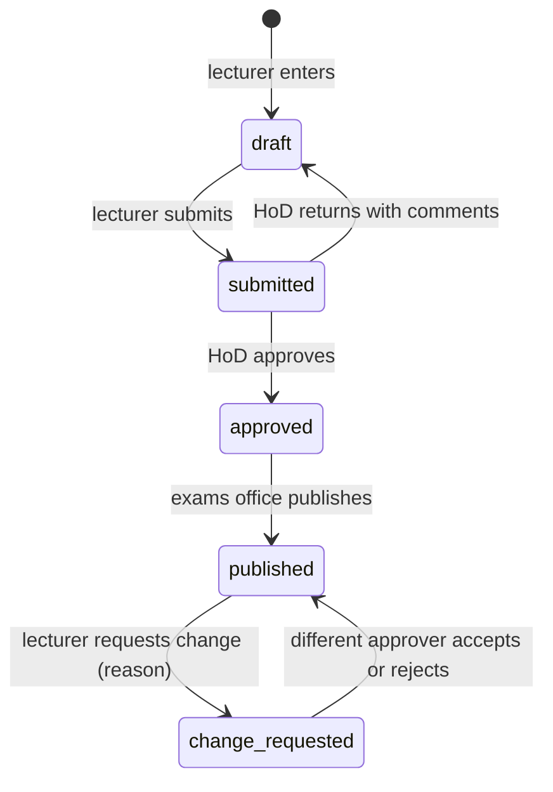

# X-CASE-01 Secure Exam Results Portal

> [!info] About this case
> A **fictional** university replaces emailed spreadsheets of marks with a results portal. The case uses five modules at once: requirements and design (SD), threat modelling and controls (CS), access logic (DM), implementation and tests (PY), and the plan, risks and business case (PM). The rules and numbers are asserted in `test_xcase01_portal_plan` and `test_x05_security_risk_in_pm_terms` (`08 - Cross-Module Connections/code/`). Work through it after [[X-01 Logic and Sets in Python and Requirements]] to [[X-05 Security Risk in Project Management]].

## 1. Situation
Lecturers email mark spreadsheets to the exams office, which merges them and emails results to departments. Problems reported by the (fictional) exams office:
- copies of marks circulate in inboxes;
- there's no record of who changed a mark;
- results have occasionally been visible to students before official release;
- every results day, the department's shared drive is overloaded.

The registrar wants a portal: lecturers enter marks; heads of department approve; the exams office publishes; students view their own results after publication.

## 2. Requirements (SD)
| ID | Requirement |
|---|---|
| FR1 | Lecturers enter and submit marks for courses they teach |
| FR2 | A head of department approves submitted marks |
| FR3 | The exams office publishes approved results on the release date |
| FR4 | Students view only their own results, and only after publication |
| FR5 | A change to a published mark needs a reason and approval by a different person in an approving role (maker–checker) |
| FR6 | Every mark change records the old and new values, the user, the time and the reason |
| NFR1 | Results day: 3,000 students in the first hour without degradation (load-tested at 2×) |
| NFR2 | Published results can be checked for tampering |

**Mark lifecycle:**

*Text version: marks go from draft to submitted (lecturer), then approved (head of department, who can return them to draft), then published (exams office). After publication, a change request with a reason goes to a different approver, who accepts or rejects it; either way the mark is published again.*

## 3. Threat model (CS)
| STRIDE | Threat | Control | Requirement |
|---|---|---|---|
| S | A stolen lecturer password is used to change marks | MFA for staff; login throttling | SR1 |
| T | A mark is altered in the database or in transit | Maker–checker; audit trail in the same transaction; TLS; a digest of each published result set | SR2, SR3 |
| R | A lecturer denies making a change | Audit trail with the user, time and reason | SR3 |
| I | A student views someone else's results, or results before release | Server-side checks on every request (`can_view_result`) | SR4 |
| D | Results-day overload | Load test; caching published results; staggered release by faculty | NFR1 |
| E | A student account gains lecturer functions | Role checks in the service layer; no role data from the client | SR4 |

(Security testing of a real portal is done only by authorised testers, with written scope, see [[CS-18 Security Testing and Vulnerability Management]].)

## 4. Access logic (DM, PY)
Specification: an exams officer may view any result; a lecturer may view results for courses they teach; a student may view a result only if it's published **and** it's their own; everything else is denied.

`can_view_result(role, published, own, teaches)` implements it. Over the 24 combinations of the three roles and three conditions, exactly **14** are allowed (8 for the exams officer, 4 for a lecturer who teaches the course, 2 for a student viewing their own published result), and the implementation agrees with the specification on all 24. Unknown roles are denied (**default deny**).

**Maker–checker:** `approve_mark_change(maker, approver, approver_role)` is true only if the approver is a different person **and** holds an approving role. Self-approval and approval by another lecturer are both rejected.

**Integrity digest:** `results_digest(rows)` hashes a canonical, sorted form of (student, course, mark). It doesn't depend on row order, and changing one mark from 49.0 to 50.0 changes the digest. A digest only helps if the published value is itself protected, e.g. signed, or stored where the database administrator can't change it ([[CS-06 Hashes, MACs and Integrity]]).

## 5. Architecture (SD)
- **Layers:** web interface → services (authorisation, maker–checker, lifecycle) → repository (parameterised SQL, audit in the same transaction) → database.
- **Read path for students:** published results only, from a read-optimised table or cache, separated from the mark-entry path. This addresses both confidentiality (unpublished marks never reach the student path) and the results-day load.
- **Web controls** ([[CS-11 Web Application Security]] §10): per-request authorisation, output encoding, CSRF tokens on mark forms, security headers, MFA for staff.

## 6. Plan (PM)
| ID | Activity | Weeks | Pred. |
|---|---|---|---|
| A | Requirements and threat model | 2 | — |
| B | Design | 2 | A |
| C | Authentication and role-based access | 3 | B |
| D | Mark import and validation | 2 | B |
| E | Maker–checker approval | 2 | C |
| F | Audit log and integrity digest | 1 | C |
| G | Security testing and remediation | 2 | D, E, F |
| H | UAT with the exams office | 1 | G |
| I | Training | 1 | B |
| J | Go-live before the release date | 1 | H, I |

`cpm`: **13 weeks**, critical path **A-B-C-E-G-H-J**. Float: D 3 weeks, F 1 week, I 7 weeks. The security work (C, E, G) is on the critical path, so it can't be squeezed without moving go-live.

**Risks** (project, EMV): late critical findings 4.0 M; early release during the pilot 3.0 M; results-day outage 2.4 M; go-live after the release date 3.0 M; total **12.4 M** contingency (TZS, fictional).

**Business case for the controls** (operational, ALE): SLE 40 M, ARO 0.25 → ALE **10 M/year**; with the controls ARO 0.05 → **2 M**; cost 3 M/year → net **5 M/year**, ROSI ≈ **1.67**; break-even at an ARO of 0.175 ([[X-05 Security Risk in Project Management]]).

## 7. Quality (SD, PM)
- Unit tests for every access rule (all 24 rows), the lifecycle transitions and maker–checker.
- Integration tests for audit atomicity (as in [[PRJ-PY-05 Hostel Maintenance System]]).
- A load test at 2× the expected peak.
- UAT scripts written with the exams office.
- Track defects by category (Pareto) and DRE ([[X-04 Testing as Software Quality Assurance]]).

## 8. Discussion questions
1. Write the access specification as a formula, and show that `role == "student" and published and own or teaches` (a tempting shortcut) is wrong. Give a counterexample.
2. Why is maker–checker needed only **after** publication, and not for draft marks?
3. The digest detects changes. Who could still change both the marks and the digest, and what control addresses that?
4. Security testing slips 1 week. What happens to go-live? Which activity's float could absorb a 1-week slip in the audit log (F)?
5. The registrar suggests cutting MFA to save cost. Use the ALE numbers and a sensitivity check to respond.
6. Draft a traceability matrix for SR1–SR4, with test names ([[X-03 Security Requirements in Software Architecture]]).

> [!success]- Model answer notes
> 1. Spec: $O \lor (L \land T) \lor (S \land P \land W)$ (officer, lecturer-teaches, student-published-own). The shortcut lets **any** role with `teaches=True` through (e.g. a student flagged as teaching, through a data error), and ignores the lecturer role check: counterexample `role="student", published=False, own=False, teaches=True` → allowed by the shortcut, denied by the spec. It also wrongly denies the exams officer (e.g. `role="exams_officer"` with every flag false). Use [[X-01 Logic and Sets in Python and Requirements]]'s `equivalent` to find all of them. 2. Before publication, the HoD approval step already is a second-person check, and drafts change often. After publication, a change affects an official record that students have seen; that's when an unauthorised change does most harm. 3. A database administrator, or anyone with write access to both. Mitigations: sign the digest with a key the DBA doesn't hold, or publish it somewhere separately controlled (e.g. in the official, signed results notice), and log administrative access. 4. G is critical: go-live slips 1 week, unless the release date is fixed, in which case use contingency (overtime, a second tester) or descope. F has 1 week of float, so a 1-week slip in F alone doesn't delay the project. 5. MFA is part of the control set that cuts ALE from 10 M to 2 M for 3 M a year. Even if the controls were only half as effective as estimated (ALE after 6 M), the net benefit would be 10 − 6 − 3 = 1 M a year, still positive. Break-even is an ARO of 0.175. Cutting MFA would also leave SR1 untested and the S threat unmitigated. 6. SR1 → tests for MFA required for staff and throttling; SR2 → maker–checker tests (self-approval rejected); SR3 → audit atomicity test; SR4 → the 24-row access test and an unknown-role test.

Back to [[X 00 Cross-Module Index]] · Related: [[CS-11 Web Application Security]], [[CS-04 Authorization and Access Control]], [[SD-17 Secure and Reliable Software Design]], [[PM-11 Risk Management]]
