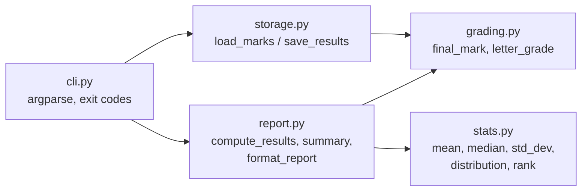

# PRJ-PY-01 Student Marks and Grading System (beginner)

> [!info] Project card
> **Level:** beginner · **When:** Week 4 (core logic, after PY-08), extended in Week 7 (CSV storage, after PY-14) · **Effort:** 8–12 h · **Reference implementation:** `marks/` in this folder (Python 3.10+, standard library only) · **Tests:** `python -m pytest`, 20 tests passing at build time
> **Uses:** [[PY-04 Conditions and Branching]], [[PY-05 Loops and Iteration]], [[PY-06 Functions, Parameters, Return Values and Scope]], [[PY-10 Lists and Tuples]], [[PY-14 Files, CSV and JSON]], [[PY-15 Exceptions and Defensive Programming]]

> [!warning] Illustrative rules
> The 40/60 coursework/exam weighting, the A–F bands and the pass mark of 40 are **illustrative**. Replace them with your institution's official regulations (all are constants in `marks/grading.py`).

## 1. Requirements

### Functional
| ID | Requirement |
|---|---|
| FR1 | Read student records (`student_id, name, coursework, exam`) from a CSV file |
| FR2 | Validate every row. Reject missing, non-numeric, out-of-range (0–100) and duplicate-ID rows, **reporting the line number and reason**, and continue with the valid rows |
| FR3 | Compute the final mark = 0.4 × coursework + 0.6 × exam, rounded to 1 decimal place |
| FR4 | Assign a letter grade from the configured bands |
| FR5 | Rank students by final mark (ties share a rank, then sort by name) |
| FR6 | Show class statistics: count, mean, median, population SD, min, max, pass rate, grade distribution |
| FR7 | Optionally save the ranked results to a CSV file (`--out`) |
| FR8 | Exit code 0 if all rows are valid, 1 if some rows were rejected, 2 for fatal errors (missing file or columns) |

### Non-functional
| ID | Requirement |
|---|---|
| NFR1 | Standard library only, Python 3.10+ |
| NFR2 | Calculation logic separated from I/O, so it's unit-testable |
| NFR3 | A bad row never crashes the program |
| NFR4 | Handles 10 000 rows in under 1 second on a typical laptop (measured at build time: 0.07 s for load + compute + format of 10 000 random rows) |

## 2. Proposed design

*Text version: the CLI loads the data through storage, then asks report to compute and format the results. Report uses grading (rules) and stats (statistics). Only cli.py prints and only storage.py touches files, so grading, stats and report are pure and easily tested.*

| Module | Responsibility | Lesson |
|---|---|---|
| `grading.py` | Rules: weights, bands, validation | PY-04 |
| `stats.py` | Statistics by hand (cross-checked against `statistics` in the tests) | PY-05, PY-10 |
| `storage.py` | CSV in/out with per-row error collection | PY-14, PY-15 |
| `report.py` | Combine the above, format the text report (returns `str`) | PY-03 |
| `cli.py` | Parse arguments, print, exit codes | PY-13 |

Each record is a `dict` (beginner-friendly). The extension challenge upgrades it to a dataclass.

## 3. Milestones (do them in order; commit after each)
| # | Milestone | Done when |
|---|---|---|
| M1 | `final_mark`, `letter_grade` with boundary tests | `tests/test_marks.py::test_letter_grade_boundaries` passes |
| M2 | `mean`, `median`, `std_dev`, `distribution` | Stats match the `statistics` module |
| M3 | `rank` with shared ranks | `test_rank_shares_ties` passes |
| M4 | `load_marks` with an error list | The sample file gives 7 valid records and 3 errors |
| M5 | `format_report` and the CLI | `python -m marks report data/sample_marks.csv` prints the report below |
| M6 | `--out` export and exit codes | `test_cli_exit_codes` passes |

**Honest-practice route:** copy only `tests/` and `data/` into a new folder, write `marks/` yourself milestone by milestone, and look at the reference only when stuck.

## 4. Reference implementation
Files: `marks/__init__.py`, `grading.py`, `stats.py`, `storage.py`, `report.py`, `cli.py`, `__main__.py`. Run it from this folder:
```bash
python -m marks report data/sample_marks.csv
python -m marks report data/sample_marks.csv --out results.csv
python -m pytest
```
Key excerpt: per-row validation (the heart of FR2/NFR3):
```python
for line_no, row in enumerate(reader, start=2):
    sid = (row["student_id"] or "").strip()
    name = (row["name"] or "").strip()
    try:
        if not sid or not name:
            raise ValueError("student_id and name are required")
        if sid in seen:
            raise ValueError(f"duplicate student_id {sid}")
        cw = _parse_mark(row["coursework"], "coursework")
        ex = _parse_mark(row["exam"], "exam")
    except ValueError as exc:
        errors.append(f"line {line_no}: {exc}")
        continue
```

## 5. Tests
20 pytest tests (all passing on CPython 3.13 at build time): final-mark arithmetic, grade boundaries (39.9/40/49.9/50/60/70), statistics cross-checked against `statistics.median`/`pstdev`, tie ranking, sample-file validation errors (exact messages), missing columns, duplicate IDs, summary values, export round trip, and CLI exit codes 0/1/2.

## 6. Sample output (actual run of the reference implementation)
```text
Rank  ID     Name                  CW  Exam  Final Grade
--------------------------------------------------------
   1  S003   Chen Wei            90.0  85.0   87.0   A
   2  S010   Joyce Mollel        82.0  79.0   80.2   A
   3  S001   Amina Juma          78.0  72.0   74.4   A
   4  S005   Elia Mrema          62.0  66.0   64.4   B
   5  S002   Baraka Mushi        55.0  48.0   50.8   C
   6  S008   Halima Omary        45.0  52.0   49.2   D
   7  S004   Dorcas Achieng      35.0  30.0   32.0   F
--------------------------------------------------------
Students: 7  Mean: 62.6  Median: 64.4  SD: 18.1  Min: 32.0  Max: 87.0
Pass rate: 85.7%   Grades: A=3  B=1  C=1  D=1  F=1

Rejected rows (3):
  - line 7: coursework is not a number: 'abc'
  - line 8: exam is missing
  - line 10: coursework must be between 0 and 100, got 101.0
```
(The process exit code is 1 because rows were rejected, per FR8.) All the names in the sample data are fictional.

## 7. Design rationale
- **Constants for policy** (weights, bands, pass mark): regulations change, and one edit should update everything ([[PY-19 Type Hints, Documentation, Clean Code and Refactoring]]).
- **Collect errors and continue:** a lecturer with 300 students wants *all* the problems at once, not one crash per attempt ([[PY-15 Exceptions and Defensive Programming]]).
- **Pure functions return strings:** `format_report` is tested without capturing stdout ([[PY-03 Input, Output and String Formatting]]).
- **Exit codes:** scripts and schedulers can detect partial failures (FR8).
- **Population SD:** the class *is* the whole population of interest. If you treat it as a sample, use `statistics.stdev`. Document the choice.
- **Rounding the final mark to 1 decimal place before grading:** a mark of 69.96 rounds to 70.0, giving an A. Regulations often specify the rounding, so **check yours**. This is an example of a requirement to clarify with stakeholders.

## 8. Common bugs (and how the tests catch them)
| Bug | Symptom | Caught by |
|---|---|---|
| Grade thresholds in the wrong order | Everyone gets D | `test_letter_grade_boundaries` |
| `>` instead of `>=` at a boundary | 40.0 gets F | boundary test at 40 |
| Using `split(",")` instead of `csv` | Names with commas break | (add such a name to the sample as an exercise) |
| Crash on `"abc"` | Traceback instead of a report | `test_load_sample_reports_bad_rows` |
| Header line counted as line 1 of the data | Error line numbers off by one | exact error messages in the tests |
| Ties given different ranks | Unfair ranking | `test_rank_shares_ties` |
| Integer division or float formatting confusion | `62.571428…` in the report | formatted output test |

## 9. Extension challenges
1. **Dataclass upgrade:** replace the dicts with `@dataclass(frozen=True) class StudentResult` ([[PY-16 Classes and Objects]]). Update the tests.
2. **Histogram:** print a text bar chart of the grade distribution (`A ###`).
3. **Moderation:** add `--scale-exam 5`, adding up to 5 marks to the exam (capped at 100), and report how many grades changed.
4. **Multiple modules:** read one CSV per module and produce each student's GPA-style average across modules ([[PY-11 Dictionaries, Sets and Comprehensions]] grouping).
5. **Interactive mode:** a menu loop with validated input ([[PY-05 Loops and Iteration]] §10).
6. **Persistence:** store the results in SQLite and query the top 3 per module ([[PY-22 SQL and Database Integration]]).

## 10. Assessment rubric (self-assessment, 100 marks)
| Criterion | Excellent | Adequate | Weak | Marks |
|---|---|---|---|---|
| Correctness (FR1–FR8) | All the tests plus your own pass | Most features work | Crashes or wrong grades | 30 |
| Validation and error handling | Every bad row reported with its line and reason, no crash | Some checks | Crashes on bad data | 20 |
| Code structure | Pure logic separated from I/O, small functions | Some separation | One long script | 20 |
| Tests | Your own boundary and edge tests added | Uses the provided tests only | No tests | 15 |
| Readability and documentation | Clear names, docstrings, constants | Mostly clear | Cryptic | 10 |
| Reflection | Explains two design choices and one trade-off | Brief | None | 5 |

**Mastery evidence:** this project with extension 1 or 6 completed, plus a written reflection, counts as level-5 evidence for PY-04, PY-05, PY-10 and PY-14 ([[Mastery Rubric]]).

Back to [[Labs and Projects Index]] · [[PY 00 Dashboard]]
