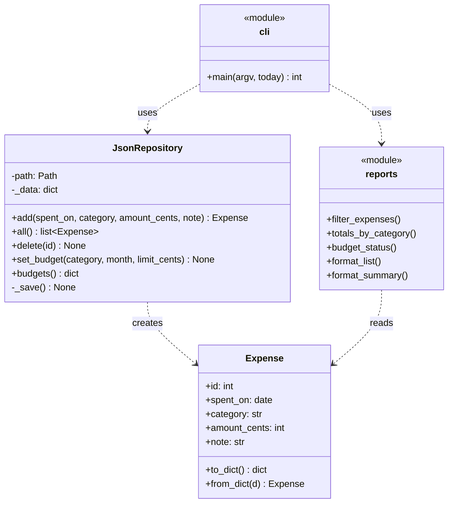

# PRJ-PY-02 Personal Expense Tracker (beginner/intermediate)

> [!info] Project card
> **When:** Week 7 (after PY-14/15), with the dataclass refactor after PY-16 · **Effort:** 12–16 h · **Reference implementation:** `expense_tracker/` · **Tests:** `python -m pytest`, 20 passing at build time · **Run:** `python -m expense_tracker --data my.json <command>`
> **Uses:** [[PY-02 Variables, Types, Expressions and Operators]] (integer cents), [[PY-11 Dictionaries, Sets and Comprehensions]], [[PY-14 Files, CSV and JSON]], [[PY-15 Exceptions and Defensive Programming]], [[PY-16 Classes and Objects]], [[PY-24 Secure Programming and Input Validation]] (allowlists, CSV injection)

## 1. Requirements

### Functional
| ID | Requirement | Command |
|---|---|---|
| FR1 | Record an expense: amount, category, optional note and date (default today) | `add 12,000 food "lunch" [--date 2026-10-08]` |
| FR2 | List expenses, filtered by month and/or category, with a total | `list --month 2026-10 [--category food]` |
| FR3 | Summarise totals by category, with percentage shares | `summary --month 2026-10` |
| FR4 | Set a monthly budget per category, and show the status (spent / limit / OVER) | `budget food 15000 --month 2026-10`, `status` |
| FR5 | Delete an expense by ID. IDs are never reused. | `delete 3` |
| FR6 | Export to CSV for spreadsheets, safely | `export out.csv` |
| FR7 | Import a bank-statement CSV, rejecting bad lines **with line numbers and reasons** | `import statement.csv` |
| FR8 | Data persists between runs in one JSON file | `--data FILE` |

### Non-functional
| ID | Requirement | How it's met |
|---|---|---|
| NFR1 | **No money rounding errors** | Integer cents throughout (`parse_amount`, `format_cents`) |
| NFR2 | **No data loss on crash** while saving | Atomic write: temp file + `os.replace` |
| NFR3 | A corrupt data file is reported, never silently replaced | `StorageError` with the line number |
| NFR4 | Exported CSV is safe to open in spreadsheets | Formula-injection guard on notes |
| NFR5 | Testable without touching the real data file or the real date | `tmp_path`, injected `today` |

## 2. Design

*Text version: `Expense` is a frozen dataclass (value object). `JsonRepository` owns persistence and creates Expenses. `reports` contains pure functions over lists of Expenses (no file access). `cli` wires everything together and is the only module that prints.*

**Data file format** (versioned, so it can be migrated later):
```json
{"version": 1, "next_id": 6, "expenses": [{"id": 1, "spent_on": "2026-10-01", "category": "food",
  "amount_cents": 1200000, "note": "lunch with team"}], "budgets": {"food:2026-10": 1500000}}
```

## 3. Milestones
| # | Milestone | Evidence |
|---|---|---|
| M1 | `parse_amount` / `format_cents` with tests (the hardest little function) | `test_parse_amount*` pass |
| M2 | `Expense` dataclass with validation | Invalid amount or category raises |
| M3 | `JsonRepository` add/all/delete with persistence | `test_repository_persists_and_ids` |
| M4 | Atomic save and corrupt-file detection | `test_atomic_save_keeps_old_file_on_failure`, `test_corrupt_file_reported` |
| M5 | Reports (filter, totals, budget status) as pure functions | `test_reports` |
| M6 | CLI subcommands | `test_cli_flow` |
| M7 | CSV import with the error report, and safe export | `test_import_reports_bad_lines`, `test_export_guards_formula_injection` |

## 4. Reference implementation highlights
**Money parsing with an allowlist regex** (accepts `1500`, `1,500.50`, `0.5`, and rejects `-5`, `1.234`, `12,00`, `1e3`):
```python
AMOUNT_RE = re.compile(r"\d{1,3}(,\d{3})*(\.\d{1,2})?|\d+(\.\d{1,2})?")

def parse_amount(text: str) -> int:
    t = text.strip()
    if not AMOUNT_RE.fullmatch(t):
        raise ValueError(f"invalid amount {text!r} (use e.g. 1500 or 1,500.50)")
    whole, _, frac = t.replace(",", "").partition(".")
    cents = int(whole) * 100 + int((frac + "00")[:2])
    if cents <= 0 or cents > MAX_CENTS:
        raise ValueError("amount must be positive and realistic")
    return cents
```
**Atomic save** (NFR2): see `JsonRepository._save`, the pattern from [[PY-14 Files, CSV and JSON]] §5.6.

## 5. Tests (20, all passing at build time)
Amount parsing (5 valid, 7 invalid), formatting and categories, persistence and **non-reused IDs**, corrupt file, **atomic save under a simulated disk-full failure** (monkeypatching `json.dump` to raise), month filtering and budget status, CSV import line errors, export formula guard, and a full CLI flow with an injected date.

## 6. Sample session (actual output, build environment)
```text
$ python -m expense_tracker --data demo.json import data/bank_statement_sample.csv
Imported 4 expenses
  rejected line 4: too many fields (unquoted comma in an amount or note?)
  rejected line 6: month must be in 1..12
  rejected line 7: invalid amount '-50' (use e.g. 1500 or 1,500.50)
$ python -m expense_tracker --data demo.json add 3500 food "chips mayai" --date 2026-10-08
Added #5: 3,500.00 on food (2026-10-08)
$ python -m expense_tracker --data demo.json list --month 2026-10
  ID  Date        Category           Amount  Note
   1  2026-10-01  food            12,000.00  lunch with team
   2  2026-10-02  transport        2,500.00  daladala
   3  2026-10-05  rent           350,000.00  October rent
   4  2026-10-07  airtime          5,000.50  bundle
   5  2026-10-08  food             3,500.00  chips mayai
                  TOTAL          373,000.50
$ python -m expense_tracker --data demo.json summary --month 2026-10
Category            Total  Share
rent           350,000.00  93.8%
food            15,500.00   4.2%
airtime          5,000.50   1.3%
transport        2,500.00   0.7%
$ python -m expense_tracker --data demo.json budget food 15000 --month 2026-10
Budget for food in 2026-10 set to 15000
$ python -m expense_tracker --data demo.json status --month 2026-10
food         spent    15,500.00 of    15,000.00  [OVER]
$ python -m expense_tracker --data demo.json add 12.345 food
error: invalid amount '12.345' (use e.g. 1500 or 1,500.50)
```
Note that `Rent` in the CSV was normalised to the category `rent`, and the `"5,000.50"` amount was quoted in the CSV, so it was parsed correctly.

## 7. Design rationale
- **Integer cents:** `0.1 + 0.2 != 0.3` is unacceptable for money ([[PY-02 Variables, Types, Expressions and Operators]]).
- **A frozen `Expense`:** a recorded expense is a fact. Corrections are delete + add, which keeps reasoning simple and supports a future audit log.
- **IDs never reused:** a deleted #3 must not be confused with a new #3 in old exports or in conversations ("I deleted #3 last week").
- **Pure `reports` module:** every report is tested with in-memory lists. Changing storage to SQLite later ([[PY-22 SQL and Database Integration]]) won't touch it.
- **Versioned JSON:** a future schema change can detect and migrate old files instead of crashing mysteriously.
- **Exit codes and stderr:** errors go to stderr with code 1 (user error) or 2 (storage error), so scripts can react.

## 8. Common bugs, including one found while building this project
| Bug | Symptom | Fix |
|---|---|---|
| **Unquoted comma in an amount (`45,000`) shifts the CSV columns.** The row parsed as amount `45`, note `000`, and was silently accepted. *(Found during the build: the first version of the import test failed with 5 imports instead of 4.)* | Silently wrong data | `csv.DictReader` stores surplus fields under the key `None`, so reject rows where `None in row` |
| Float amounts | `12000.000000001` totals | Integer cents |
| Overwriting the data file directly | Empty file after a crash | Atomic save |
| `except Exception: data = {}` on load | All the user's data "disappears" after one corrupt byte | Raise `StorageError` and tell the user to restore |
| Using `date.today()` inside the logic | Tests fail at month boundaries | Inject `today` |
| Category case differences (`Food` vs `food`) | Split totals | Normalise (lowercase + allowlist) |
| Exporting notes like `=HYPERLINK(...)` | Formula executes in the spreadsheet | Prefix risky cells with `'` |

## 9. Extension challenges
1. **SQLite backend:** implement `SqliteRepository` with the same methods, choosable with `--backend sqlite`. Reuse the schema from [[PY-22 SQL and Database Integration]] practice 10. The report tests must pass unchanged.
2. **Recurring expenses:** `add --monthly` creates entries automatically each month (careful with 31st → February).
3. **Charts:** a text bar chart of the category shares, or matplotlib if allowed.
4. **Undo:** keep an undo stack of operations ([[PY-21 Data Structures and Algorithm Design]]).
5. **Multi-currency:** a `Money` value object ([[PY-16 Classes and Objects]] practice 9) with explicit conversion rates.
6. **Packaging:** add a `pyproject.toml` with the `expenses` entry point ([[PY-25 Performance, Packaging and Project Organization]]).

## 10. Assessment rubric (100 marks)
| Criterion | Excellent (full) | Marks |
|---|---|---|
| Functional completeness (FR1–FR8) | All commands work as specified | 25 |
| Data integrity (NFR1–NFR3) | Cents, atomic save, corrupt-file handling, tested | 25 |
| Validation and security (NFR4, input allowlists) | All the bad inputs in §8 rejected with clear messages | 15 |
| Design (separation of models / storage / reports / CLI) | Reports pure, storage swappable | 15 |
| Tests | Own tests for the edge cases you found | 15 |
| Documentation and reflection | Design rationale in your own words, plus one trade-off | 5 |

Back to [[Labs and Projects Index]] · [[PY 00 Dashboard]]
