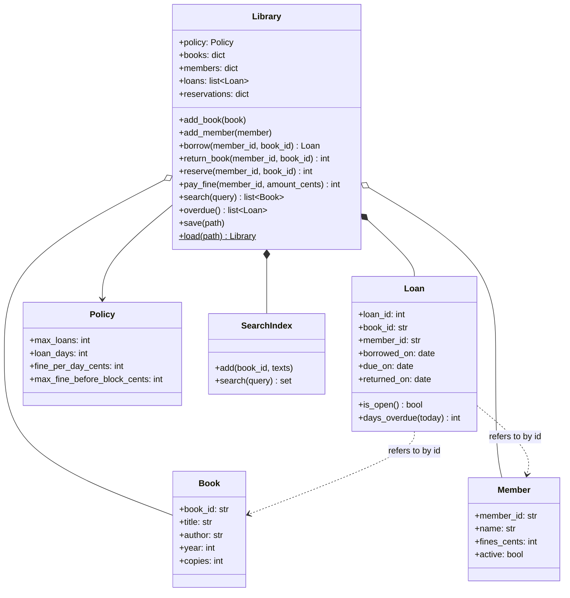
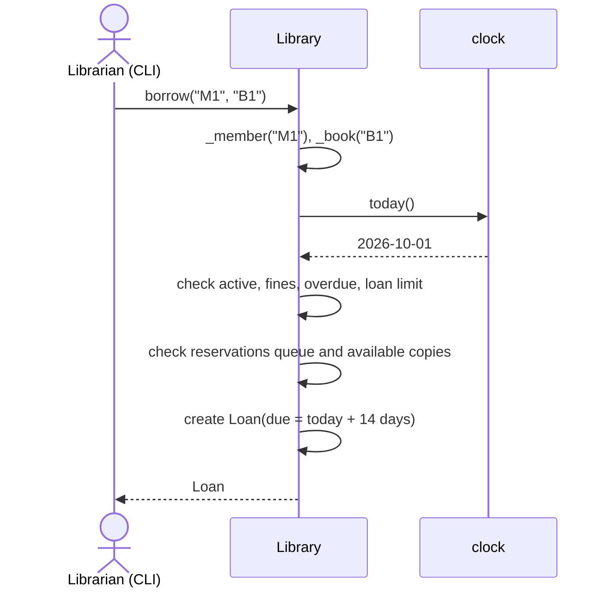

# PRJ-PY-03 Library Management System (intermediate)

> [!info] Project card
> **When:** Week 10 (after PY-16/17) · **Effort:** 15–20 h · **Reference implementation:** `library/` · **Tests:** `python -m pytest`, 12 passing at build time · **Demo:** `python -m library.demo`
> **Uses:** [[PY-16 Classes and Objects]] (entities, invariants), [[PY-17 Inheritance, Composition and Polymorphism]] (exception hierarchy, composition), [[PY-11 Dictionaries, Sets and Comprehensions]] (inverted index), [[PY-21 Data Structures and Algorithm Design]] (FIFO reservation queue), [[PY-15 Exceptions and Defensive Programming]], [[PY-20 Testing, Debugging and Test-Driven Development]] (injected clock)
> **Design link:** this is the most "UML-able" project, so draw its class and sequence diagrams as practice for [[SD-07 UML Class Diagrams]] and [[SD-08 UML Sequence, Activity and State Diagrams]].

## 1. Requirements

### Functional
| ID | Requirement |
|---|---|
| FR1 | Register books (id, title, author, year, number of copies) and members |
| FR2 | A member borrows a book if a copy is available. The due date is today + 14 days. |
| FR3 | A member may hold at most **3** open loans |
| FR4 | A member is **blocked** from borrowing while they have an overdue book, unpaid fines ≥ 1 000.00, or an inactive account |
| FR5 | Return a book. Charge a fine of 50.00 per overdue day. |
| FR6 | Members can reserve a book. Reservations are served **first come, first served**. A returned copy is held for the first person in the queue. |
| FR7 | Search by words in the title or author (case-insensitive, AND semantics) |
| FR8 | List overdue loans, oldest due date first |
| FR9 | Save and load the whole library to and from JSON |
*(All numbers are illustrative policy values held in one `Policy` dataclass.)*

### Non-functional
| ID | Requirement |
|---|---|
| NFR1 | Every rule violation raises a specific `LibraryError` subclass with a user-readable message |
| NFR2 | The rules are enforced in **one** class (`Library`), so no other code can create a loan |
| NFR3 | Time-dependent behaviour is testable (injected clock) |
| NFR4 | Search is $O(\text{query words} \times \text{matches})$ through an inverted index, not a scan of all books |

## 2. Design

### 2.1 Class diagram

*Text version: Library is composed of a SearchIndex and its Loans (they don't exist outside it), aggregates Books and Members, and uses a Policy. Loans refer to books and members by ID, so the JSON persistence stays simple.*

### 2.2 Borrow sequence


### 2.3 Exception hierarchy
`LibraryError` ← `NotFoundError`, `BookUnavailableError`, `LoanLimitError`, `MemberBlockedError`, `NotOnLoanError`. A user interface catches `LibraryError` and shows `str(exc)`. Programming bugs (e.g. `TypeError`) are deliberately **not** caught, so they surface in testing ([[PY-15 Exceptions and Defensive Programming]]).

## 3. Milestones
| # | Milestone | Evidence |
|---|---|---|
| M1 | Dataclasses `Book`, `Member`, `Loan` with validation | `test_model_validation` |
| M2 | `Library.add_*`, `borrow` with due dates and the copies invariant | `test_borrow_sets_due_date`, `test_copies_invariant` |
| M3 | Loan limit and blocking rules | `test_loan_limit`, `test_overdue_fine_and_block`, `test_fine_threshold_blocks` |
| M4 | Returns and fines (injected clock) | fine = 5 days × 50.00 = 250.00 |
| M5 | Reservation queue (`deque`) | `test_reservation_queue` |
| M6 | Inverted-index search | `test_search` |
| M7 | JSON save/load round trip | `test_save_load_round_trip` |
| M8 *(your own)* | A CLI or menu over `Library` | your own tests with `capsys` |

## 4. Reference implementation: the rule-enforcing core
```python
def borrow(self, member_id: str, book_id: str) -> Loan:
    member, _ = self._member(member_id), self._book(book_id)
    today = self.clock()
    if not member.active:
        raise MemberBlockedError(f"{member_id} is inactive")
    if member.fines_cents >= self.policy.max_fine_before_block_cents:
        raise MemberBlockedError(f"{member_id} has unpaid fines of {member.fines_cents / 100:.2f}")
    if any(ln.days_overdue(today) > 0 for ln in self.open_loans(member_id=member_id)):
        raise MemberBlockedError(f"{member_id} has overdue books")
    if len(self.open_loans(member_id=member_id)) >= self.policy.max_loans:
        raise LoanLimitError(f"{member_id} already has {self.policy.max_loans} books")
    queue = self.reservations.get(book_id)
    if queue and queue[0] != member_id and self.available_copies(book_id) <= len(queue):
        raise BookUnavailableError(f"{book_id} is reserved for another member")
    if self.available_copies(book_id) <= 0:
        raise BookUnavailableError(f"no copies of {book_id} available")
    ...
```
**Guard-clause order matters:** the cheapest and most informative checks come first. "You are blocked" is more useful to a member than "no copies", because it tells them what to fix.

## 5. Tests (12, all passing at build time)
Model validation, due dates, the copies invariant, the loan limit, unknown IDs, overdue blocking and the fine amount, the fine threshold and payment, return errors and the exception hierarchy, the reservation queue (including "reserved for someone else"), search, the save/load round trip that preserves loan IDs, and a custom policy.

## 6. Sample output (actual run of `python -m library.demo`)
```text
search 'python': ['Python Programming Basics']
M1 borrowed B1, due 2026-10-15
M2 cannot borrow: no copies of B1 available
M2 reserves B1, position 1
overdue loans: [('M1', 'B1', 5)]
M1 returned B1 late, fine 250.00
M2 now borrows reserved B1, due 2026-11-03
```
(The book titles and authors in the demo are fictional.)

## 7. Design rationale
- **One aggregate root (`Library`) for the rules:** if `Member` had its own `borrow` method that appended to its loans, the "copies ≤ available" rule would need coordination between objects. Centralising the rules gives one place to read, test and change them (cohesion, [[SD-06 Modular Design, Cohesion and Coupling]]).
- **IDs instead of object references inside `Loan`:** this simplifies JSON persistence and avoids reference cycles. The cost is a dictionary lookup.
- **A `Policy` object:** different libraries (or the exam) may change the numbers, and tests can create strict policies.
- **Injected clock:** the overdue logic is otherwise untestable without waiting two weeks.
- **Composition, not inheritance:** there's no `StudentMember(Member)` hierarchy. Different member types would differ only in policy values, which is **data**, not behaviour ([[PY-17 Inheritance, Composition and Polymorphism]]).
- **Known limitation:** the reservation rule holds a copy for the head of the queue only while `available ≤ queue length`. That's a simplification you could improve (extension 2).

## 8. Common bugs
| Bug | Symptom | Prevention |
|---|---|---|
| Checking availability with `copies > 0` instead of copies − open loans | Unlimited borrowing | `available_copies()` derived from the loans |
| Fines computed from `borrowed_on` | Wrong amounts | `days_overdue` uses `due_on` |
| Using `date.today()` inside methods | Untestable, flaky tests | Injected clock |
| Mutable default `reservations={}` in a dataclass | Shared queues across libraries | `field(default_factory=…)` or `__init__` |
| Catching `Exception` in the CLI | Bugs disguised as "cannot borrow" | Catch `LibraryError` only |
| Reservation not removed after a successful borrow | The queue never advances | `popleft()` when the head borrows |

## 9. Extension challenges
1. **CLI/menu** (M8) with `argparse` subcommands, or an interactive loop, with tests.
2. **Fair reservations:** when a copy is returned, record a "hold until" date. If the reserver doesn't collect within 3 days, offer it to the next person in the queue.
3. **Renewals:** a member may renew once if nobody has reserved the book (a state machine, see [[SD-08 UML Sequence, Activity and State Diagrams]]).
4. **SQLite persistence:** a `LibraryRepository`, with each borrow done in a transaction ([[PY-22 SQL and Database Integration]]).
5. **Reports:** the most-borrowed books this month, and members with the highest fines.
6. **Strategy pattern for fines:** flat per day vs capped vs escalating, chosen per policy ([[SD-12 Behavioral Design Patterns]]).

## 10. Assessment rubric (100 marks)
| Criterion | Excellent | Marks |
|---|---|---|
| Rule correctness (FR2–FR6) | All rules enforced, with tests for each | 30 |
| OO design | Clear responsibilities, invariants enforced in one place, composition used appropriately | 20 |
| Error handling | Domain exception hierarchy, user-readable messages | 10 |
| Search and data structures | Inverted index, deque queue, justified | 10 |
| Persistence | Round-trip tested | 10 |
| UML | A class diagram and one sequence diagram that match the code | 10 |
| Tests and reflection | Own tests for extensions, plus a reflection on one design trade-off | 10 |

Back to [[Labs and Projects Index]] · [[PY 00 Dashboard]]
