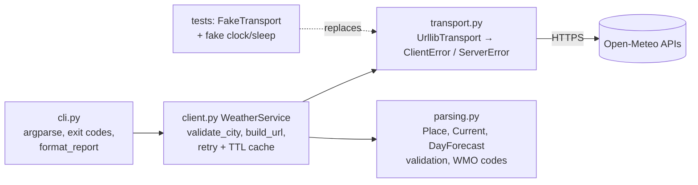

# PRJ-PY-04 Weather API Client (intermediate)

> [!info] Project card
> **When:** Week 12–13 (after PY-23) · **Effort:** 10–14 h · **Reference implementation:** `weather/` · **Tests:** `python -m pytest`, 20 passing **offline** at build time · **Run (needs internet):** `python -m weather "Dar es Salaam" --days 3`
> **API:** Open-Meteo forecast and geocoding APIs (no key required for non-commercial use, according to their published terms; check the terms yourself before use).

> [!warning] What was and was not verified
> - The build environment **blocked outbound network access** (`Tunnel connection failed: 403 Forbidden`), so the **live API was never called** while building this vault.
> - The test fixtures in `tests/fixtures/*.json` are **constructed examples in the documented response shape**. They are *not* real weather observations.
> - The endpoints (`https://api.open-meteo.com/v1/forecast`, `https://geocoding-api.open-meteo.com/v1/search`) and parameter names were taken from Open-Meteo's published usage, confirmed only partially through third-party pages ([[Source Register]]).
> - **Your first task:** run the live command, save one real response for each endpoint into `tests/fixtures/` (replacing the constructed ones), and run the tests again. If any field name differs, the validation errors tell you exactly which one.

## 1. Requirements
| ID | Requirement |
|---|---|
| FR1 | Accept a city name. Validate it (allowlist: letters, spaces, `.'-`, ≤ 60 characters). |
| FR2 | Geocode the city to latitude/longitude, with a clear message if it isn't found |
| FR3 | Show the current temperature, wind speed and a weather description (WMO code → text) |
| FR4 | Show a 1–7 day forecast: min/max temperature and precipitation |
| FR5 | Exit codes: 0 success, 1 user/input or response error, 2 service unavailable |
| NFR1 | Every request has a 10 s timeout |
| NFR2 | Retry only transient failures (5xx, 429, network), with exponential backoff (0.5 s, 1 s), at most 3 attempts |
| NFR3 | Cache identical requests for 10 minutes (reduces load on a free service) |
| NFR4 | Validate every response field the program uses (type and plausible range) |
| NFR5 | The test suite runs **without internet**, deterministically, in under a second |
| NFR6 | Identify the client with a descriptive `User-Agent` |

## 2. Design

*Text version: the CLI calls WeatherService, which validates the input, builds the URLs, and calls the transport with retries and caching. Responses are validated by parsing.py into frozen dataclasses. The tests replace the real transport, clock and sleep with fakes, so no network is used.*

**Patterns:** *Adapter* (transport maps library exceptions to domain ones), *dependency injection* (transport, clock, sleep), *value objects* (frozen dataclasses), and *cache-aside* (check the cache, else fetch and store).

## 3. Milestones
| # | Milestone | Evidence |
|---|---|---|
| M1 | `validate_city` and `build_url` | `test_validate_city_*` |
| M2 | Parsers with validation (`ResponseError`) | `test_parsers`, `test_parse_*_rejects` |
| M3 | `UrllibTransport` with error mapping | Review: 4xx → ClientError, 5xx/429/network → ServerError |
| M4 | `WeatherService` with retries and a TTL cache | `test_retry_*`, `test_urls_and_cache` |
| M5 | CLI with exit codes | `test_cli_success_and_errors` |
| M6 | **Live check on your machine**: save real fixtures | Tests still pass with the real fixtures |

## 4. Key code
Retry and cache in one place:
```python
def _get(self, url: str) -> dict:
    hit = self._cache.get(url)
    if hit and self.clock() - hit[0] < self.ttl:
        return hit[1]
    for attempt in range(1, self.attempts + 1):
        try:
            self.network_calls += 1
            payload = self.transport.get_json(url, timeout=10)
            self._cache[url] = (self.clock(), payload)
            return payload
        except ServerError:
            if attempt == self.attempts:
                raise
            self.sleep(0.5 * 2 ** (attempt - 1))
```
Validating a numeric field:
```python
def _num(container: dict, key: str, low: float, high: float) -> float:
    try:
        value = float(container[key])
    except (KeyError, TypeError, ValueError) as exc:
        raise ResponseError(f"missing or non-numeric field {key!r}") from exc
    if not low <= value <= high:
        raise ResponseError(f"implausible {key}={value}")
    return value
```

## 5. Tests (20, offline)
City validation (4 valid including accented and apostrophe names, 5 invalid including an injection-like string), parsers, rejection of malformed or implausible responses, ragged daily arrays, place not found, URL encoding, the **cache hit/expiry** with a fake clock, **retry with recorded backoff delays `[0.5, 1.0]`**, giving up after 3 attempts, no retry on a client error, forecast-days validation, and the CLI output plus exit codes.

## 6. Sample output
Formatted from the **constructed fixtures** (not live data):
```text
Weather for Dar es Salaam, Tanzania (-6.82, 39.27)
  Now (2026-10-19T14:00): 30.2 °C, wind 18 km/h, partly cloudy
  2026-10-19: 24–31 °C, rain 0.0 mm
  2026-10-20: 24–30 °C, rain 2.4 mm
  2026-10-21: 24–30 °C, rain 11.0 mm
```
Actual live attempt in the build environment (network blocked), showing graceful degradation:
```text
$ python -m weather "Dar es Salaam"
service unavailable, try again later: network problem: <urlopen error Tunnel connection failed: 403 Forbidden>
$ echo $?
2
```

## 7. Design rationale
- **Validate before calling:** invalid city names never reach the network (fail fast, cheaper, no wasted rate limit).
- **Two error categories:** the CLI decides on *what the user should do* ("check your input" vs "try later"), not on library details.
- **Range checks on responses:** a temperature of 300 °C means a units or format change upstream. Failing loudly is better than displaying nonsense.
- **Caching:** being polite to a free public API is part of the terms-of-use ethics in [[PY-23 HTTP APIs and External Services]] §5.5.
- **Frozen dataclasses:** the parsed results can't be mutated accidentally, and they compare easily in tests.

## 8. Common bugs
| Bug | Consequence | Prevention |
|---|---|---|
| No timeout | CLI hangs on a dead network | `timeout=10` everywhere |
| Retrying 400 Bad Request | Pointless repeated failures | `ClientError` isn't retried |
| `payload["current"]["temperature_2m"]` without checks | `KeyError` traceback on any API change | `_num` validation |
| Building the URL with `+` | Spaces and accents break the request | `urlencode` |
| Tests that call the real API | Flaky, slow, fail offline (as they would have in this build environment) | `FakeTransport` |
| Sleeping for real in tests | Slow test suite | Inject `sleep` |

## 9. Extension challenges
1. **Disk cache:** persist the cache in a JSON file with timestamps (atomic writes from [[PY-14 Files, CSV and JSON]]).
2. **Units option:** `--units imperial` (check the API documentation for the parameter name).
3. **Multiple cities in parallel** with `concurrent.futures.ThreadPoolExecutor` (I/O-bound work), while respecting rate limits.
4. **Honour `Retry-After`** headers on a 429 (extend the transport to expose headers).
5. **Alerts:** warn if tomorrow's precipitation is > 10 mm (a rule-based feature with tests).
6. **Packaging:** `pyproject.toml` with a `weather` console entry point ([[PY-25 Performance, Packaging and Project Organization]]).

## 10. Assessment rubric (100 marks)
| Criterion | Marks |
|---|---|
| Correct behaviour on the live API (demonstrated with a screenshot or log on your machine) | 20 |
| Robustness: timeouts, retry policy, error categories, exit codes | 25 |
| Response and input validation | 15 |
| Testability and tests (offline, deterministic, edge cases) | 25 |
| Code organisation and documentation | 10 |
| Ethics and terms: rate limiting, caching, User-Agent, no secrets in the code | 5 |

Back to [[Labs and Projects Index]] · [[PY 00 Dashboard]]
