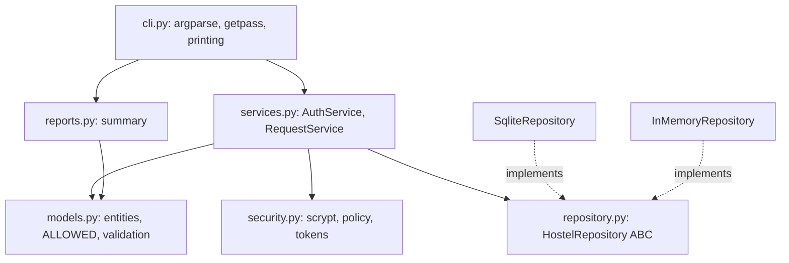
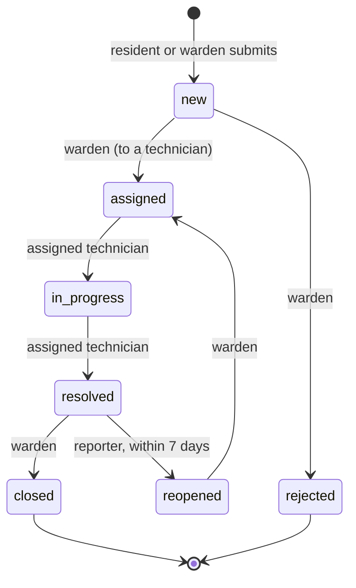
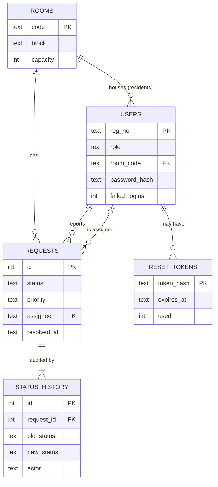

# PRJ-PY-05 Hostel Maintenance System (advanced)

> [!info] Project card
> **When:** Weeks 13–15 (after PY-22 to PY-25) · **Effort:** 30–40 h · **Reference implementation:** `src/hostel/` (stdlib only) · **Tests:** `python -m pytest`, 42 passing at build time (the repository-dependent tests run against both the in-memory and the SQLite repository) · **Types:** `python -m mypy src/hostel` is clean · **Run:** `PYTHONPATH=src python -m hostel --help`, or `pip install -e .` and then `hostel --help` · **Docs:** `README.txt`, `CHANGES.txt`
> **Uses:** [[PY-22 SQL and Database Integration]] (transactions, parameterised SQL), [[PY-24 Secure Programming and Input Validation]] (validation, password storage), [[PY-25 Performance, Packaging and Project Organization]] (src layout, entry point, logging), [[PY-17 Inheritance, Composition and Polymorphism]] (an ABC, dependency injection), [[PY-20 Testing, Debugging and Test-Driven Development]] (fixtures, a fake clock, parametrised tests)
> **Cross-module:** the domain is the running example of [[FYP 00 Dashboard]]; the state machine is [[SD-08 UML Sequence, Activity and State Diagrams]] §10; the password design follows [[CS-08 Password Storage and Authentication Security]] §10; the full lifecycle is [[X-CAPSTONE Hostel Maintenance System Full Lifecycle]].

> [!warning] Teaching code, not a deployable system
> This is a learning project. It has no web interface, no MFA, no per-IP rate limiting, no email delivery, and no independent security review. The password and token design follows current guidance as described in CS-08, but **don't deploy it as-is**. The registration numbers, names and passwords in the tests and examples are fictional.

## 1. Requirements

### Functional
| ID | Requirement |
|---|---|
| FR1 | A resident can report a fault in **their own room**, with a category and a description; wardens can report for any room; technicians can't report |
| FR2 | Each category has a default priority (electrical → urgent; furniture → low; others → normal). A warden can change the priority while the request is open |
| FR3 | A request follows the lifecycle NEW → ASSIGNED → IN_PROGRESS → RESOLVED → CLOSED; a warden can REJECT a new request; the reporter can REOPEN a resolved request within 7 days |
| FR4 | Only wardens assign (to a technician), reject and close; only the assigned technician starts and resolves; only the reporter reopens |
| FR5 | Every change (status or priority) is recorded in an audit trail with the actor, time and note |
| FR6 | Residents see their own requests; technicians see the ones assigned to them; wardens see all of them. History is visible to wardens, the reporter and the assignee |
| FR7 | Users authenticate with a registration number and password; the first user must be a warden, and later users are registered by a warden |
| FR8 | Password reset uses a single-use token that expires after 30 minutes |
| FR9 | A warden's report shows counts by status, open requests by priority, the mean hours to resolve, and urgent requests open for more than 24 hours |

### Non-functional
| ID | Requirement | How it's met |
|---|---|---|
| NFR1 | A status change and its history row are atomic | One `BEGIN IMMEDIATE` transaction; a test forces the history insert to fail and checks that the update rolled back |
| NFR2 | Two users changing the same request can't silently overwrite each other | `UPDATE … WHERE id = ? AND status = ?` (optimistic concurrency); a test uses two connections |
| NFR3 | Passwords stored with a memory-hard KDF | scrypt (n = 2¹⁷, r = 8, p = 1) in a self-describing format, rehashed on login when the parameters change |
| NFR4 | No SQL injection | Every query is parameterised; a test stores a hostile description as data |
| NFR5 | No log forging | Descriptions and notes are collapsed to a single line; passwords are never logged (tested with `caplog`) |
| NFR6 | The business layer is testable without a database | Services depend on the `HostelRepository` interface; an `InMemoryRepository` implements it |
| NFR7 | Layering is enforced | A test parses the imports and fails if `models`, `services` or `reports` import SQLite or the CLI |

## 2. Design

### 2.1 Layers and modules

*Text version: the CLI calls the services and the report function. The services use the domain models, the security helpers and the repository interface. Two classes implement that interface: SQLite and in-memory. The domain models depend on nothing else in the package except the errors module.*

### 2.2 Request lifecycle (the `ALLOWED` table)

*Text version: a new request is either assigned or rejected by a warden. The assigned technician starts and then resolves it. A warden closes it, or the reporter reopens it within 7 days, after which a warden reassigns it. Closed and rejected are terminal.*

### 2.3 Data model


### 2.4 Status change sequence
```mermaid
sequenceDiagram
    participant U as CLI (technician)
    participant A as AuthService
    participant S as RequestService
    participant R as SqliteRepository
    U->>A: authenticate(reg_no, password)
    A->>R: login_state / get_user
    A-->>U: User
    U->>S: transition(user, id, RESOLVED, note)
    S->>R: get_request(id)
    S->>S: check ALLOWED, role, assignee
    S->>R: save_change(updated, expected=IN_PROGRESS, entry)
    R->>R: BEGIN IMMEDIATE; UPDATE ... WHERE status = 'in_progress'; INSERT history; COMMIT
    R-->>S: ok (or ConcurrentUpdateError)
    S-->>U: Request
```

## 3. Milestones
| # | Milestone | Done when |
|---|---|---|
| M1 | Domain model and `ALLOWED` table | Parametrised tests reject every disallowed transition |
| M2 | In-memory repository and `RequestService` | Lifecycle, permission and visibility tests pass |
| M3 | SQLite repository | The same tests pass with `repo` parametrised over both |
| M4 | Atomicity and concurrency | The rollback and two-connection tests pass |
| M5 | Authentication | Policy, generic errors, backoff, rehash and reset tests pass |
| M6 | CLI and packaging | The end-to-end CLI test passes; `pip install -e .` provides `hostel` |
| M7 | Report and documentation | The summary test passes; README and changelog written |

## 4. Reference implementation: the rule-enforcing core
The service checks the rules; the repository makes the write atomic and detects lost updates.
```python
# not-runnable (an excerpt from src/hostel/services.py; it needs the package's imports)
def transition(self, actor, request_id, new_status, assignee=None, note=""):
    req = self.repo.get_request(request_id)
    if new_status not in ALLOWED[req.status]:
        raise TransitionError(f"{req.status.value} -> {new_status.value} is not allowed")
    if actor.role is not ACTOR_FOR[new_status]:
        raise PermissionDenied(f"only a {ACTOR_FOR[new_status].value} can set {new_status.value}")
    now = self.clock()
    changes = {"status": new_status}
    if new_status is Status.ASSIGNED:
        if assignee is None or self.repo.get_user(assignee).role is not Role.TECHNICIAN:
            raise ValidationError("assign to an existing technician")
        changes["assignee"] = assignee
    if new_status in (Status.IN_PROGRESS, Status.RESOLVED) and actor.reg_no != req.assignee:
        raise PermissionDenied("only the assigned technician can do this")
    if new_status is Status.RESOLVED:
        changes["resolved_at"] = now
    if new_status is Status.REOPENED:
        if actor.reg_no != req.reporter:
            raise PermissionDenied("only the reporter can reopen")
        if req.resolved_at is None or now - req.resolved_at > REOPEN_WINDOW:
            raise TransitionError("requests can be reopened within 7 days of resolution")
        changes["resolved_at"] = None
    updated = replace(req, **changes)
    self.repo.save_change(updated, req.status,
                          HistoryEntry(req.id, req.status, new_status, actor.reg_no, now, _clean_note(note)))
    return updated
```

```python
# not-runnable (an excerpt from SqliteRepository in src/hostel/repository.py)
def save_change(self, updated, expected_status, entry):
    with self._tx():                                   # BEGIN IMMEDIATE ... COMMIT / ROLLBACK
        cur = self._conn.execute(
            "UPDATE requests SET priority = ?, status = ?, assignee = ?, resolved_at = ? "
            "WHERE id = ? AND status = ?",
            (updated.priority.value, updated.status.value, updated.assignee,
             updated.resolved_at.isoformat() if updated.resolved_at else None, updated.id, expected_status.value))
        if cur.rowcount != 1:
            raise ConcurrentUpdateError(f"request {updated.id} changed; reload")
        self._insert_history(entry)
```

Login throttling is a pure function, so its schedule is easy to test:
```python
FREE_ATTEMPTS, BASE_DELAY_S, MAX_DELAY_S = 3, 30, 900


def login_delay(failures: int) -> int:
    if failures < FREE_ATTEMPTS:
        return 0
    return min(BASE_DELAY_S * 2 ** (failures - FREE_ATTEMPTS), MAX_DELAY_S)


print([login_delay(n) for n in range(10)])   # [0, 0, 0, 30, 60, 120, 240, 480, 900, 900]
```

## 5. Tests (42, all passing at build time)
- **`test_requests.py`** (each test runs on both repositories): the full lifecycle and its audit trail; every disallowed transition from every status; permissions (role, assignee, own room); the reopen window (exactly 7 days is allowed, 7 days plus 1 second isn't) and ownership; priorities and visibility; input validation, including newline collapsing and a hostile SQL-like string stored as data. On SQLite only: the two-connection lost-update test, and the forced-rollback atomicity test.
- **`test_auth.py`:** the password policy; registration rejecting weak or personal passwords; the hash format, salts and verification; generic error messages for wrong passwords and unknown users, with no password in the logs; the backoff schedule; throttling driven by the fake clock; rehash on login; password reset (unknown user, weak new password not consuming the token, single use, expiry).
- **`test_reports_cli_architecture.py`:** the summary numbers (mean (5 + 26)/2 = 15.5 h; one overdue urgent request); an end-to-end CLI run against a temporary database; the layering rules.

## 6. Sample output (actual run, with the commands from `README.txt`)
```text
$ hostel --db demo.db init
database ready: demo.db
$ hostel register WARDEN01 "Asha Warden" warden
registered WARDEN01 (warden)
$ hostel --as STU/21/0001 submit A-101 electrical "Socket sparks near the desk"
request 1 submitted (urgent)
$ hostel --as WARDEN01 move 1 assigned --assignee TECH01
request 1 is now assigned
$ hostel --as TECH01 move 1 resolved --note "Replaced the socket"   (after in_progress)
request 1 is now resolved
$ hostel --as TECH01 move 1 closed
error: only a warden can set closed
$ hostel --as STU/21/0001 history 1
2026-10-20T09:54:03+00:00  - -> new  by STU/21/0001  submitted
2026-10-20T09:54:03+00:00  new -> assigned  by WARDEN01
2026-10-20T09:54:04+00:00  assigned -> in_progress  by TECH01
2026-10-20T09:54:04+00:00  in_progress -> resolved  by TECH01  Replaced the socket
```
(Some setup commands are omitted; passwords were supplied on stdin. The report command printed JSON with `"resolved": 1` and `"mean_hours_to_resolve": 0.0`, because the demo resolved the request within seconds.)

## 7. Design rationale
- **The state machine as data (`ALLOWED`, `ACTOR_FOR`):** the rules can be read, diagrammed and tested exhaustively. Adding a state means editing a table, not hunting through `if` chains ([[SD-08 UML Sequence, Activity and State Diagrams]]).
- **The repository interface:** services are tested on the in-memory implementation, and the **same tests** run against SQLite (dependency inversion, [[SD-10 SOLID Principles]]).
- **Optimistic concurrency instead of locks held across user think-time:** a stale write fails loudly, with `ConcurrentUpdateError`, and the user reloads. Compare LabBook's check-and-insert race ([[SD-CASE LabBook Running Case Study]]).
- **History in the same transaction:** an audit trail that can disagree with the data is worse than none ([[CS-15 Logging, Monitoring, Incident Response and Recovery]]).
- **An injected clock:** the reopen window, throttling and token expiry are tested in milliseconds.
- **Passwords through stdin/getpass, never argv:** command-line arguments end up in shell history and process lists.
- **The stdlib only:** easy to install in a lab; scrypt is in `hashlib`. (Argon2id would need `argon2-cffi`; see CS-08.)

## 8. Security notes and known limitations
| Area | Current state | What a real deployment needs |
|---|---|---|
| Authentication | Password only; per-account backoff | MFA for wardens and technicians; per-IP limits; alerting on spraying |
| Password blocklist | 8 examples | A large breached-password list |
| Reset tokens | Returned to the caller | Delivered by email to the address on file; existing sessions invalidated |
| Unknown accounts | Not throttled (no row to count failures on) | Per-IP or global limits |
| Sessions | Every CLI command authenticates again | Server-side sessions with expiry, for a web interface |
| Authorisation | Role and ownership checks in the services | The same checks, plus tests for every endpoint in a web layer |
| Data protection | Names and room numbers stored in plain text | Access control on the database file, backups, a retention policy ([[FYP-10 Research Ethics, Privacy, Academic Integrity and Citation]]) |

## 9. Common bugs
| Bug | Symptom | Prevention |
|---|---|---|
| Checking the transition but updating without `WHERE status = ?` | Two wardens assign different technicians; the last one wins silently | Optimistic concurrency check |
| Writing history in a separate transaction | A history row for a change that never happened (or the reverse) | One transaction |
| Building SQL with f-strings | SQL injection | Parameters only |
| `datetime.now()` inside services | Untestable time rules | Injected clock |
| Different messages for unknown users and wrong passwords | Account enumeration | One generic message, and similar timing |
| Logging request bodies | Passwords in logs | Log the event, not the secret |
| Not clearing `resolved_at` on reopen | Reports count reopened requests as resolved | Reset it, and test it |

## 10. Extension challenges
1. **Comments:** residents and technicians can add comments to a request (a new table and service method, with the same visibility rules).
2. **Assignment policy:** suggest the technician with the fewest open requests (Strategy pattern, [[SD-12 Behavioral Design Patterns]]); test it.
3. **Escalation:** a scheduled job lists urgent requests open for more than 24 hours, and notifies the warden through a `Notifier` interface (fake in tests).
4. **Web interface:** a small Flask or FastAPI layer over the same services, with sessions, CSRF protection and output encoding ([[CS-11 Web Application Security]]).
5. **Argon2id:** replace scrypt using `argon2-cffi`, keeping old hashes verifiable and rehashing on login.
6. **Reports:** time to resolve by category, as a table, and as a chart for the warden.

## 11. Assessment rubric (100 marks)
| Criterion | Excellent | Marks |
|---|---|---|
| Lifecycle and permissions (FR1–FR6) | All rules enforced, with exhaustive transition tests | 25 |
| Persistence (FR5, NFR1, NFR2) | Parameterised SQL, atomic changes, lost updates detected, tested | 20 |
| Security (FR7, FR8, NFR3, NFR5) | KDF storage, generic errors, throttling, safe resets, no secrets in logs | 20 |
| Architecture (NFR6, NFR7) | Clear layers, an interface with two implementations, a layering test | 15 |
| Tooling and docs | Packaging, entry point, type-checking clean, README and changelog | 10 |
| Reflection | A security review using §8, with two implemented improvements | 10 |

Back to [[Labs and Projects Index]] · [[PY 00 Dashboard]]
