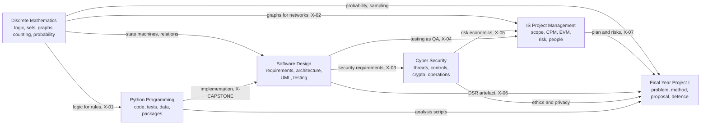

# MM Semester Concept Map

How the six modules feed each other. Arrows mean "supplies a method or idea to". Each module's own map shows its lessons.

*Text version: Discrete Mathematics supplies logic to Python (rules, X-01), graphs to Project Management (networks, X-02), state machines and relations to Software Design, and probability to the FYP's sampling. Python implements the designs of Software Design (the capstone). Software Design supplies security requirements to Cyber Security (X-03) and testing as quality assurance to Project Management (X-04). Cyber Security supplies risk economics to Project Management (X-05). Project Management supplies the plan and risks, Software Design the design science artefact, Cyber Security the ethics and privacy controls, and Python the analysis scripts to the Final Year Project (X-06, X-07).*

## Module maps
- [[MM-PY Python Programming Mind Map]]
- [[MM-DM Discrete Mathematics Mind Map]]
- [[MM-SD Software Design Mind Map]]
- [[MM-CS Cyber Security Mind Map]]
- [[MM-PM Project Management Mind Map]]
- [[MM-FYP Final Year Project Mind Map]]

## The bridges, as notes
[[X 00 Cross-Module Index]] lists the integration lessons, the two integrated cases and the capstone.

## Shared ideas (same idea, different names)
| Idea | Where you meet it |
|---|---|
| Dependency / precedence | DM partial orders and DAGs · PY imports · SD module dependencies · PM network diagrams · FYP research activity order |
| Rules | DM propositions · PY conditions · SD business rules · CS access policies · FYP inclusion criteria |
| State | DM finite-state machines · PY enums and transition tables · SD state diagrams · PM lifecycle and stage gates |
| Evidence | DM proof · PY tests · SD verification · PM quality control · CS audit logs · FYP data and analysis |
| Uncertainty | DM probability · PM PERT, EMV and Monte Carlo · CS ALE and likelihood · FYP sampling error |

Back to [[00 Dashboard]]
