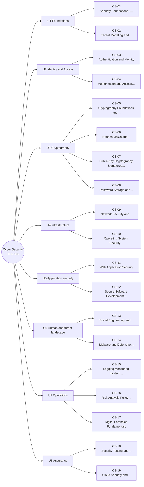

# MM-CS Cyber Security Mind Map

The 19 lessons of Cyber Security, grouped by unit (from each lesson's `unit` field). The outline under the diagram has clickable links and is the text version of the diagram.

## Outline (text version)

- **U1 Foundations**
  - [[CS-01 Security Foundations - CIA, Threats, Vulnerabilities and Risk]]
  - [[CS-02 Threat Modeling and Security Requirements]]
- **U2 Identity and Access**
  - [[CS-03 Authentication and Identity]]
  - [[CS-04 Authorization and Access Control]]
- **U3 Cryptography**
  - [[CS-05 Cryptography Foundations and Symmetric Encryption]]
  - [[CS-06 Hashes, MACs and Integrity]]
  - [[CS-07 Public-Key Cryptography, Signatures and Key Management]]
  - [[CS-08 Password Storage and Authentication Security]]
- **U4 Infrastructure**
  - [[CS-09 Network Security and Secure Communication]]
  - [[CS-10 Operating System Security and Hardening]]
- **U5 Application security**
  - [[CS-11 Web Application Security]]
  - [[CS-12 Secure Software Development and Database Security]]
- **U6 Human and threat landscape**
  - [[CS-13 Social Engineering and Security Awareness]]
  - [[CS-14 Malware and Defensive Detection]]
- **U7 Operations**
  - [[CS-15 Logging, Monitoring, Incident Response and Recovery]]
  - [[CS-16 Risk Analysis, Policy, Governance and Compliance]]
  - [[CS-17 Digital Forensics Fundamentals]]
- **U8 Assurance**
  - [[CS-18 Security Testing and Vulnerability Management]]
  - [[CS-19 Cloud Security and Privacy]]

## Bridges to other modules

- [[X-03 Security Requirements in Software Architecture]]
- [[X-05 Security Risk in Project Management]]
- [[X-CASE-01 Secure Exam Results Portal]]

Back to [[CS 00 Dashboard]] · [[MM Semester Concept Map]]
