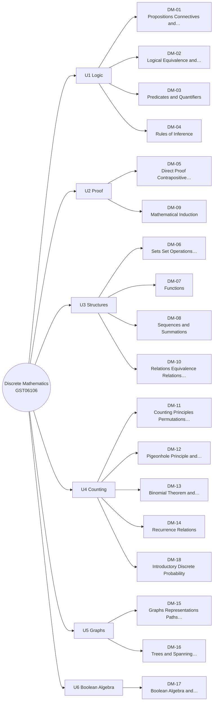

# MM-DM Discrete Mathematics Mind Map

The 18 lessons of Discrete Mathematics, grouped by unit (from each lesson's `unit` field). The outline under the diagram has clickable links and is the text version of the diagram.

## Outline (text version)

- **U1 Logic**
  - [[DM-01 Propositions, Connectives and Truth Tables]]
  - [[DM-02 Logical Equivalence and Laws of Logic]]
  - [[DM-03 Predicates and Quantifiers]]
  - [[DM-04 Rules of Inference]]
- **U2 Proof**
  - [[DM-05 Direct Proof, Contrapositive and Contradiction]]
  - [[DM-09 Mathematical Induction]]
- **U3 Structures**
  - [[DM-06 Sets, Set Operations, Power Sets and Cartesian Products]]
  - [[DM-07 Functions]]
  - [[DM-08 Sequences and Summations]]
  - [[DM-10 Relations, Equivalence Relations and Partial Orders]]
- **U4 Counting**
  - [[DM-11 Counting Principles, Permutations and Combinations]]
  - [[DM-12 Pigeonhole Principle and Inclusion-Exclusion]]
  - [[DM-13 Binomial Theorem and Pascal's Triangle]]
  - [[DM-14 Recurrence Relations]]
  - [[DM-18 Introductory Discrete Probability]]
- **U5 Graphs**
  - [[DM-15 Graphs, Representations, Paths and Connectivity]]
  - [[DM-16 Trees and Spanning Trees]]
- **U6 Boolean Algebra**
  - [[DM-17 Boolean Algebra and Logic Circuits]]

## Bridges to other modules

- [[X-01 Logic and Sets in Python and Requirements]]
- [[X-02 Graph Theory in Algorithms, Networks and Scheduling]]

Back to [[DM 00 Dashboard]] · [[MM Semester Concept Map]]
