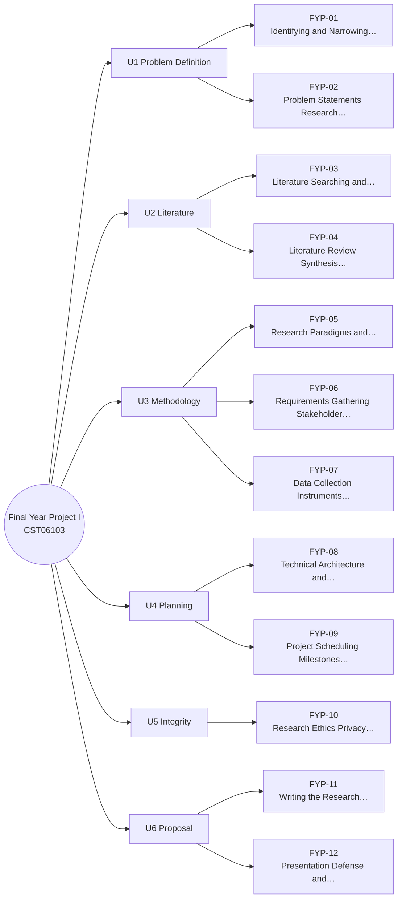

# MM-FYP Final Year Project Mind Map

The 12 lessons of Final Year Project I, grouped by unit (from each lesson's `unit` field). The outline under the diagram has clickable links and is the text version of the diagram.

## Outline (text version)

- **U1 Problem Definition**
  - [[FYP-01 Identifying and Narrowing a Research Problem]]
  - [[FYP-02 Problem Statements, Research Questions, Objectives and Scope]]
- **U2 Literature**
  - [[FYP-03 Literature Searching and Critical Reading]]
  - [[FYP-04 Literature Review Synthesis, Research Gaps and Contribution]]
- **U3 Methodology**
  - [[FYP-05 Research Paradigms and Methodology]]
  - [[FYP-06 Requirements Gathering, Stakeholder and Feasibility Analysis]]
  - [[FYP-07 Data Collection Instruments, Sampling and Evaluation Planning]]
- **U4 Planning**
  - [[FYP-08 Technical Architecture and Design Planning]]
  - [[FYP-09 Project Scheduling, Milestones and Risk Assessment]]
- **U5 Integrity**
  - [[FYP-10 Research Ethics, Privacy, Academic Integrity and Citation]]
- **U6 Proposal**
  - [[FYP-11 Writing the Research Proposal]]
  - [[FYP-12 Presentation, Defense and Working with Supervisor Feedback]]

## Bridges to other modules

- [[X-06 Research Methodology Applied to the Final Year Project]]
- [[X-07 Scheduling Your Own Semester with CPM]]
- [[X-CAPSTONE Hostel Maintenance System Full Lifecycle]]

Back to [[FYP 00 Dashboard]] · [[MM Semester Concept Map]]
