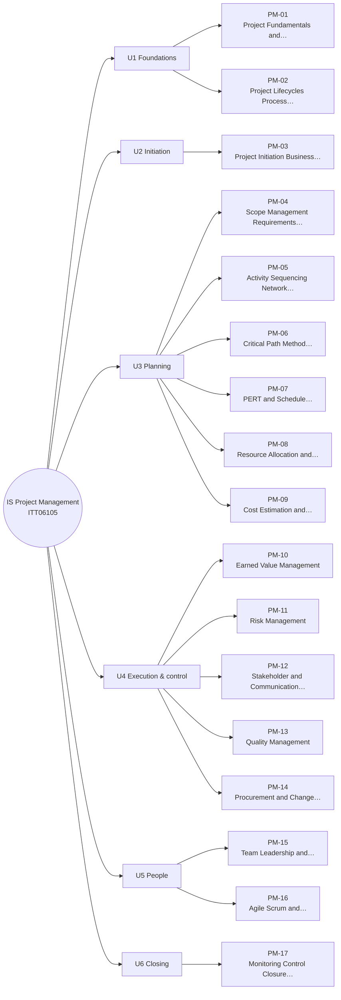

# MM-PM Project Management Mind Map

The 17 lessons of IS Project Management, grouped by unit (from each lesson's `unit` field). The outline under the diagram has clickable links and is the text version of the diagram.

## Outline (text version)

- **U1 Foundations**
  - [[PM-01 Project Fundamentals and Organizational Context]]
  - [[PM-02 Project Lifecycles, Process Groups and Methodologies]]
- **U2 Initiation**
  - [[PM-03 Project Initiation, Business Case and Charter]]
- **U3 Planning**
  - [[PM-04 Scope Management, Requirements Traceability and WBS]]
  - [[PM-05 Activity Sequencing, Network Diagrams and Gantt Charts]]
  - [[PM-06 Critical Path Method and Float]]
  - [[PM-07 PERT and Schedule Estimation]]
  - [[PM-08 Resource Allocation and Levelling]]
  - [[PM-09 Cost Estimation and Budgeting]]
- **U4 Execution & control**
  - [[PM-10 Earned Value Management]]
  - [[PM-11 Risk Management]]
  - [[PM-12 Stakeholder and Communication Management]]
  - [[PM-13 Quality Management]]
  - [[PM-14 Procurement and Change Management]]
- **U5 People**
  - [[PM-15 Team Leadership and Conflict Management]]
  - [[PM-16 Agile, Scrum and Hybrid Delivery]]
- **U6 Closing**
  - [[PM-17 Monitoring, Control, Closure and Lessons Learned]]

## Bridges to other modules

- [[X-02 Graph Theory in Algorithms, Networks and Scheduling]]
- [[X-05 Security Risk in Project Management]]
- [[X-07 Scheduling Your Own Semester with CPM]]
- [[X-CASE-02 SME Inventory Rollout]]

Back to [[PM 00 Dashboard]] · [[MM Semester Concept Map]]
