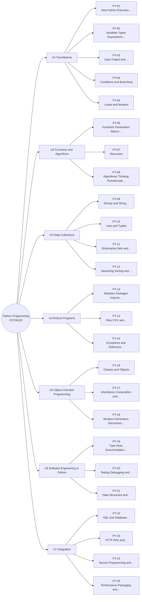

# MM-PY Python Programming Mind Map

The 25 lessons of Python Programming, grouped by unit (from each lesson's `unit` field). The outline under the diagram has clickable links and is the text version of the diagram.

## Outline (text version)

- **U1 Foundations**
  - [[PY-01 How Python Executes Programs and Environment Setup]]
  - [[PY-02 Variables, Types, Expressions and Operators]]
  - [[PY-03 Input, Output and String Formatting]]
  - [[PY-04 Conditions and Branching]]
  - [[PY-05 Loops and Iteration]]
- **U2 Functions and Algorithms**
  - [[PY-06 Functions, Parameters, Return Values and Scope]]
  - [[PY-07 Recursion]]
  - [[PY-08 Algorithmic Thinking, Pseudocode, Flowcharts and Tracing]]
- **U3 Data Collections**
  - [[PY-09 Strings and String Processing]]
  - [[PY-10 Lists and Tuples]]
  - [[PY-11 Dictionaries, Sets and Comprehensions]]
  - [[PY-12 Searching, Sorting and Complexity]]
- **U4 Robust Programs**
  - [[PY-13 Modules, Packages, Imports and Virtual Environments]]
  - [[PY-14 Files, CSV and JSON]]
  - [[PY-15 Exceptions and Defensive Programming]]
- **U5 Object-Oriented Programming**
  - [[PY-16 Classes and Objects]]
  - [[PY-17 Inheritance, Composition and Polymorphism]]
  - [[PY-18 Iterators, Generators, Decorators and Context Managers]]
- **U6 Software Engineering in Python**
  - [[PY-19 Type Hints, Documentation, Clean Code and Refactoring]]
  - [[PY-20 Testing, Debugging and Test-Driven Development]]
  - [[PY-21 Data Structures and Algorithm Design]]
- **U7 Integration**
  - [[PY-22 SQL and Database Integration]]
  - [[PY-23 HTTP APIs and External Services]]
  - [[PY-24 Secure Programming and Input Validation]]
  - [[PY-25 Performance, Packaging and Project Organization]]

## Bridges to other modules

- [[X-01 Logic and Sets in Python and Requirements]]
- [[X-04 Testing as Software Quality Assurance]]
- [[X-CAPSTONE Hostel Maintenance System Full Lifecycle]]

Back to [[PY 00 Dashboard]] · [[MM Semester Concept Map]]
