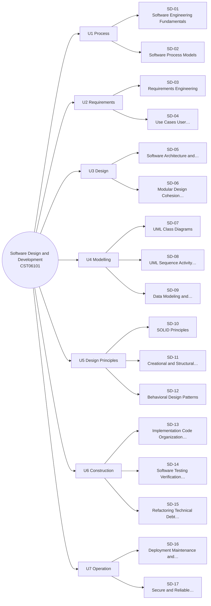

# MM-SD Software Design Mind Map

The 17 lessons of Software Design and Development, grouped by unit (from each lesson's `unit` field). The outline under the diagram has clickable links and is the text version of the diagram.

## Outline (text version)

- **U1 Process**
  - [[SD-01 Software Engineering Fundamentals]]
  - [[SD-02 Software Process Models]]
- **U2 Requirements**
  - [[SD-03 Requirements Engineering]]
  - [[SD-04 Use Cases, User Stories and Traceability]]
- **U3 Design**
  - [[SD-05 Software Architecture and Architectural Styles]]
  - [[SD-06 Modular Design, Cohesion and Coupling]]
- **U4 Modelling**
  - [[SD-07 UML Class Diagrams]]
  - [[SD-08 UML Sequence, Activity and State Diagrams]]
  - [[SD-09 Data Modeling and Interface Design]]
- **U5 Design Principles**
  - [[SD-10 SOLID Principles]]
  - [[SD-11 Creational and Structural Design Patterns]]
  - [[SD-12 Behavioral Design Patterns]]
- **U6 Construction**
  - [[SD-13 Implementation, Code Organization and Version Control]]
  - [[SD-14 Software Testing, Verification and Validation]]
  - [[SD-15 Refactoring, Technical Debt, Code Review and Quality]]
- **U7 Operation**
  - [[SD-16 Deployment, Maintenance and Documentation]]
  - [[SD-17 Secure and Reliable Software Design]]

## Bridges to other modules

- [[X-03 Security Requirements in Software Architecture]]
- [[X-04 Testing as Software Quality Assurance]]
- [[X-06 Research Methodology Applied to the Final Year Project]]

Back to [[SD 00 Dashboard]] · [[MM Semester Concept Map]]
