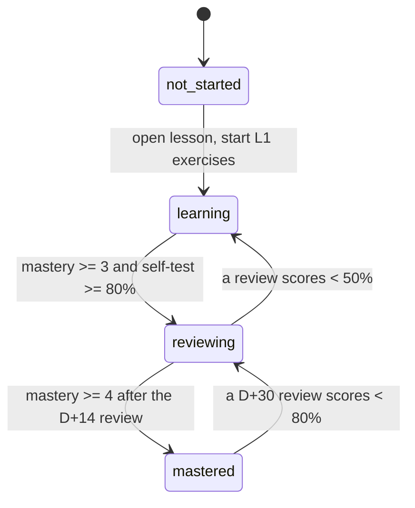

# Metadata Schema

All notes begin with YAML frontmatter. The validator ([[README]], section 7) enforces the **required** fields for `type: lesson`.

| Field | Required for | Allowed values / format | Purpose |
|---|---|---|---|
| `title` | all | string | Human-readable title |
| `aliases` | optional | list of strings | Alternative names for Obsidian search and linking |
| `module` | lessons, labs, projects | exact module name | Filtering |
| `module_code` | lessons, labs, projects | `ITT06102`, `GST06106`, `CST06103`, `ITT06105`, `CST06102`, `CST06101` | Filtering |
| `modules` | cross-module notes | list of the module codes above; such notes use `module: "Cross-Module"` and `module_code: "multiple"` (not an official code) | Filtering integration notes |
| `topic_id` | lessons, labs, projects, exams | e.g. `PY-06`, `LAB-CS-03`, `PRJ-PY-02`, `MOCK-DM-01` | Unique identity (validator checks uniqueness) |
| `type` | all | `lesson`, `dashboard`, `curriculum-map`, `lab`, `project`, `exam`, `question-bank`, `case-study`, `artifact`, `template`, `index`, `mind-map`, `glossary`, `tracker`, `system` | Navigation, Dataview queries |
| `unit` | lessons | `U<n> <name>` | Position in module hierarchy |
| `difficulty` | lessons | `beginner`, `intermediate`, `advanced` | Planning |
| `syllabus_status` | lessons | `provisional-core`, `supplementary`, `optional-advanced`, `verified` | Separates core from enrichment ([[Syllabus Verification Log]]) |
| `status` | lessons | `not-started`, `learning`, `reviewing`, `mastered` | Progress |
| `mastery` | lessons | integer 0–5 ([[Mastery Rubric]]) | Competence, not reading |
| `prerequisites` | lessons | list of wikilinks | Dependency graph |
| `related` | optional | list of wikilinks | Cross-links |
| `next` | lessons | wikilink | Learning sequence |
| `last_reviewed`, `next_review` | lessons | `YYYY-MM-DD` | Spaced repetition ([[Review Schedule]]) |
| `tags` | all | always includes `semester-6` plus the module tag (`cyber-security`, `discrete-math`, `final-year-project`, `project-management`, `python`, `software-design`) | Search |

## Tag vocabulary

- Module tags: `cyber-security`, `discrete-math`, `final-year-project`, `project-management`, `python`, `software-design`, `cross-module`.
- Content tags: `lesson`, `lab`, `project`, `exam`, `flashcards`, `case-study`, `artifact`, `template`.
- Flashcard tags (Spaced Repetition plugin): `#flashcards/<module-tag>`, written in the lesson body.

## Status workflow

*Text version: a topic moves from not-started → learning when you begin the exercises. It moves to reviewing once you reach mastery 3 with a self-test of at least 80%, and to mastered only after mastery 4 at the 14-day review. A failed review sends it back a stage.*
