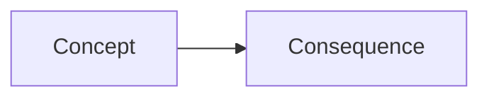

# {{title}}

> [!info] Topic card
> **ID:** · **Module:** · **Unit:** · **Status:** provisional-core · **Estimated study time:**

## 1. Learning objectives
By the end you can:
- (Bloom verb) …

## 2. Why it matters

## 3. Prerequisites (review these first if your mastery is below 3)
- [[…]]: what exactly you need from it

## 4. Intuition (plain language)

## 5. Rigorous explanation

## 6. Essential terminology
| Term | Meaning |
|---|---|

## 7. Step-by-step reasoning / derivation

## 8. Diagram

*Text description of the diagram for devices that cannot render it.*

## 9. Worked examples
### Example 1 (basic)
### Example 2 (intermediate)
### Example 3 (challenging)

## 10. Application / case study

## 11. Common mistakes and why they happen

## 12. Comparison with related concepts

## 13. Practice (Levels 1–5)
**L1 Recall** · **L2 Routine application** · **L3 Multi-step** · **L4 Transfer to unfamiliar scenarios** · **L5 Synthesis / design / evaluation**

## 14. Hints
> [!tip]- Hints (open only when stuck)

## 15. Worked solutions
> [!success]- Solution L1

## 16. Self-test (5 minutes, closed book)

## 17. Flashcards
Question::Answer

## 18. Blank-page recall
Close this note and write, from memory: …

## 19. Revision summary

## 20. Links
- Prerequisites: · Related: · Next: 

## 21. Sources and further reading

## 22. Mastery checklist
- [ ] Level 3: I solved L1–L3 without hints
- [ ] Level 4: I solved an L4 problem and explained my reasoning aloud
- [ ] Self-test score ≥ 80%
- [ ] Scheduled reviews (D+1, D+3, D+7, D+14, D+30) in [[Review Schedule]]
